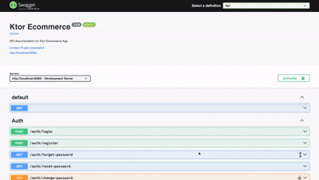
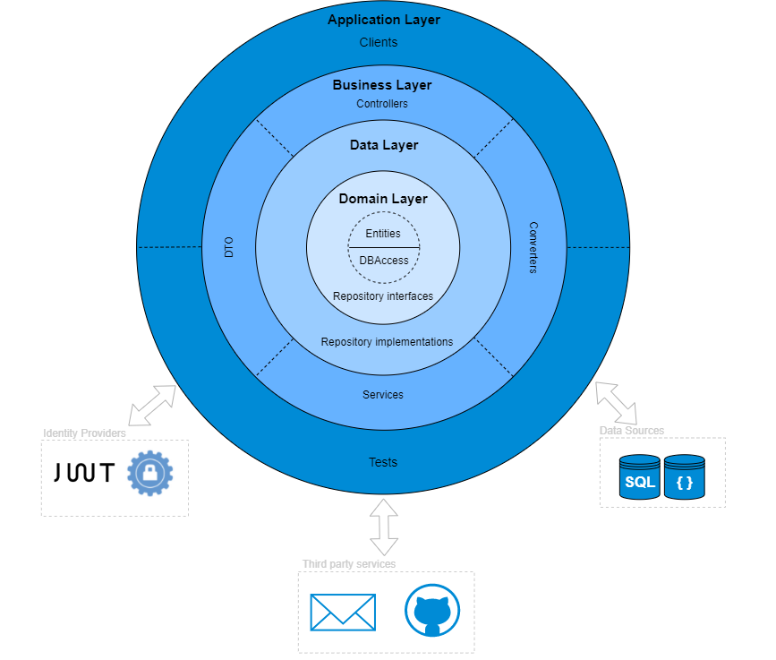
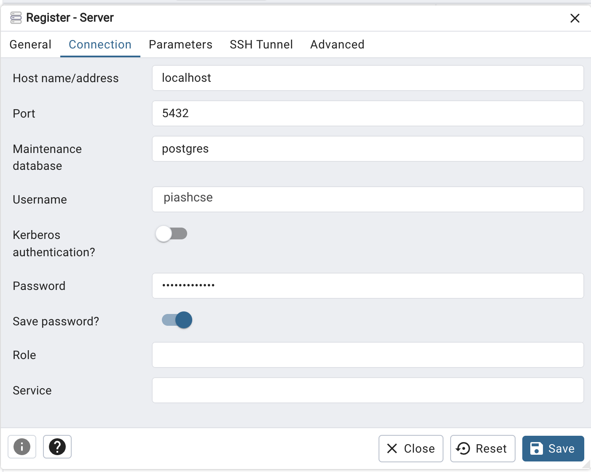

<div align="center">
  
# 🛒 Ktor E-Commerce Backend
  
  **A high-performance, enterprise-grade e-commerce backend built with Kotlin & Ktor.**

  [](https://github.com/ktorio/ktor)
  [](https://github.com/JetBrains/Exposed)
  [](https://kotlinlang.org)
  
  [](https://www.postgresql.org/)
  [](https://www.apache.org/licenses/LICENSE-2.0)
  <a href="https://github.com/piashcse"></a>

  <h4>
    <a href="https://piashcse.github.io/ktor-E-Commerce">Documentation</a>
    <span> · </span>
    <a href="https://github.com/piashcse/ktor-E-Commerce/issues">Report Bug</a>
    <span> · </span>
    <a href="https://github.com/piashcse/ktor-E-Commerce/pulls">Request Feature</a>
  </h4>

  
</div>

---

## 🚀 Overview

**Ktor-E-Commerce** is a robust, scalable, and high-performance backend solution designed for modern e-commerce applications. Leveraging the power of [Kotlin](https://kotlinlang.org) and [Ktor](https://ktor.io), it provides an efficient service for handling complex e-commerce workflows, from multi-role authentication to advanced order processing and real-time inventory management.

### Key Pillars
- **Performance**: Built with Ktor's asynchronous engine for non-blocking I/O.
- **Security**: JWT-based auth, rate limiting, and password complexity enforcement.
- **Quality**: Strict static analysis with Ktlint and Detekt integrated.

# Features

### 1. Role-Based Access Control

- **Customer Role**: Shoppers with basic access to browse and make purchases.
- **Seller Role**: Vendors can list products and manage their inventory.
- **Admin Role**: Administrators have full control over the platform.

### 2. User Accounts and Authentication

- **User Registration**: Allow customers to create accounts. Users can register with the same email for different roles (customer and seller).
- **User Authentication**: Implement JWT-based authentication for user sessions.
- **User Profiles**: Enable users to view and update their profiles.

### 3. Product Management

- **Product Listings**: Create, update, and delete product listings.
- **Categories**: Organize products into categories and brands for easy navigation.
- **Inventory Control**: Keep track of product availability and stock levels.

### 4. Shopping Cart and Checkout

- **Shopping Cart**: Add and remove products, update quantities, and calculate totals.
- **Checkout Summary**: Retrieve detailed checkout summary with subtotal, shipping, tax, and discount breakdown.
- **Checkout**: Streamline the checkout process with consolidated shipping address and method selection.
- **Stock Validation**: Automatic stock validation during checkout using effective inventory levels.
- **Price Validation**: Order totals validated against database prices to prevent tampering.
- **Cart Clearing**: Automatic cart clearing after successful order placement.

### 5. Order Management

- **Order Processing**: Handle order creation, status updates, and order history.
- **Order Status History**: Comprehensive audit trail for every status transition (Placed, Confirmed, Shipped, etc.).
- **Automatic Taxation**: Configurable tax calculation (default 5%) applied automatically during checkout.
- **Order Cancellation**: Customers can cancel PENDING/CONFIRMED orders with automatic stock restoration.
- **Seller Orders**: Sellers can view and manage orders from their shop.
- **Admin Orders**: Admins can view all orders with advanced filters (status, date range).
- **Human-Readable Order Numbers**: Date-prefixed order numbers in `ORD-YYYYMMDD-XXXX-XXXXXXXX` format (random suffix guarantees uniqueness under concurrency).
- **Idempotency Support**: Prevent duplicate orders with idempotency keys.
- **Payment Integration**: Integrate with popular payment gateways for seamless transactions.
- **Payment Validation**: Payment amounts validated against order totals.
- **Payment History**: Track all payments for each order.

### 6. Discount & Coupon System

- **Promo Codes**: Create and manage fixed or percentage-based discount coupons.
- **Usage Limits**: Enforce expiration dates, usage limits per coupon, and minimum order amounts.
- **Admin Controls**: Dedicated administrative interface for managing the coupon lifecycle.

### 7. Refund Management

- **Refund Requests**: Customers can request refunds for order items with reasons and evidence images.
- **Refund Approval**: Sellers and admins can approve, reject, or process refunds.
- **Return Shipping**: Customers can mark approved refunds as shipped with tracking numbers.
- **Refund Tracking**: Complete refund lifecycle tracking from request to resolution.

### 8. Scalability and Performance

- **Asynchronous Processing**: Leverage Ktor's async capabilities for high performance.
- **Load Balancing**: Easily scale your application to accommodate increased traffic.

### 9. Security

- **JWT Tokens**: Implement JSON Web Tokens for secure authentication.
- **Refresh Tokens**: Secure token refresh with hashed storage and automatic revocation.
- **Rate Limiting**: Auth endpoints protected against brute-force attacks (5 req/10min).
- **Account Lockout**: Automatic 30-minute lockout after 5 failed login attempts.
- **Password Strength**: Enforced password complexity requirements (min 8 chars, mixed case, digit, special char).
- **Input Validation**: Protect against common web vulnerabilities like SQL injection and cross-site scripting (XSS).
- **Atomic Stock Operations**: Thread-safe inventory updates within database transactions.

### 10. Dashboard Analytics

- **Summary Statistics**: Quick overview of revenue, orders, users, products, and shops.
- **Revenue Analytics**: Detailed revenue breakdown with daily trends and average order value.
- **Order Statistics**: Order status distribution and recent order activity.
- **User Growth**: User registration trends with breakdown by role and daily signups.
- **Top Products**: Best-selling products ranked by sales volume and revenue.
- **Activity Feed**: Recent platform activity including orders and user registrations.

### 11. Audit Logging

- **Action Tracking**: Records every admin action with actor identity, action type, and target resource.
- **Rich Context**: Captures actor email, role, IP address, user agent, and outcome for full audit trail.
- **Filterable Queries**: Search audit logs by actor, action type, resource, or outcome.
- **Immutable Records**: Append-only log records that cannot be modified or deleted.

### 12. Code Quality & Static Analysis

- **Ktlint**: Automated Kotlin linting to ensure consistent code style.
- **Detekt**: Static code analysis for finding potential bugs and code smells.
- **Pre-commit Hooks**: Enforce quality standards before code is even committed.

### 13. Testing & Coverage

- **Unit + route tests**: `./gradlew test` (no database required)
- **PostgreSQL integration tests**: Flyway migrations, repositories, order/payment/refund/payout
  lifecycles and concurrency guards
- **Coverage gate**: JaCoCo overall + per-package rules; CI enforces the integration-backed target
- **Current baseline**: 430 tests, **54.3% instruction / 25.7% branch / 59.3% line**

```bash
./gradlew test jacocoTestReport
# report: build/reports/jacoco/test/html/index.html
```

See [Testing & Coverage](docs/testing.md) for the test pyramid, local database setup, thresholds
and known gaps.

See the [Product Roadmap](docs/roadmap.md) for the prioritised list of remaining
e-commerce capabilities and the PR-per-feature branch plan.

## Architecture

<p align="center">
  </br>
  
</p>
<p align="center">
<b>Fig. Clean / Onion Architecture </b>
</p>

The project follows **Clean Architecture** with clear separation of concerns:

- **Route Layer** (`*Routes.kt`) — HTTP routing only, uses `by inject()` for dependency injection, delegates logic to services/repositories
- **Service Layer** (`*Service.kt`) — Business logic orchestration, works with domain models and DTOs
- **Repository Layer** (`*Repository` interface + `*RepositoryImpl`) — Data access, Exposed queries, transaction management
- **Mapper Layer** (`*Mappers.kt`) — Object mapping between DAO entities and response DTOs, fully separated from entities
- **Plugin Layer** — Cross-cutting concerns: auth, status pages, routing configuration, OpenAPI generation

This architecture ensures:
- **Testability**: Repositories can be mocked for service-layer unit tests
- **Swapability**: Data access implementation can change without affecting business logic
- **Discoverability**: Each concern lives in its own well-named file, not hidden inside god classes
- **Safety**: Flyway-managed schema migrations prevent destructive table recreation in production

### Production readiness notes

- **Single-instance defaults.** The rate limiter, catalog cache, JWT blacklist cache, email throttle
  and SMTP circuit breaker are in-process. Running more than one replica requires replacing
  `CacheService.cache` with a Redis-backed implementation (the `Cache` interface is ready) and using
  a shared rate-limit store. Until then, deploy as a single instance or accept per-instance limits.
- **HSTS** is only emitted when `FORCE_HTTPS=true` (set it behind a TLS-terminating proxy).
- **Pretty JSON** is opt-in via `JSON_PRETTY_PRINT=true`; production should leave it disabled.
- **Read replicas** are supported via `DB_READ_URL`; only explicitly read-only paths use `readQuery`.

## Built With 🛠

- [Ktor](https://ktor.io/docs/welcome.html) - An asynchronous framework for creating microservices, web applications, and more.
- [Exposed](https://github.com/JetBrains/Exposed) - A lightweight SQL library on top of JDBC driver for the Kotlin language.
- [PostgreSQL](https://www.postgresql.org/) - A powerful, open-source object-relational database system.
- [Flyway](https://flywaydb.org/) - Database migration tool for safe, version-controlled schema management.
- [Koin](https://github.com/InsertKoinIO/koin) - A pragmatic lightweight dependency injection framework for Kotlin.
- [Ktlint](https://github.com/jlleitschuh/ktlint-gradle) - An anti-bikeshedding Kotlin linter with built-in formatter.
- [Detekt](https://detekt.dev/) - A static code analysis tool for the Kotlin programming language.
- [Valiktor](https://github.com/valiktor/valiktor) - A type-safe, powerful and extensible fluent DSL to validate objects in Kotlin.
- [Ktor OpenAPI/Swagger](https://ktor.io/docs/server-openapi.html) - Ktor's built-in OpenAPI generation and Swagger UI.

## Requirements

- **Java**: JDK 17 or latest
- **PostgreSQL**: Version 12 or latest

## Clone the repository

```bash
git clone git@github.com:piashcse/ktor-E-Commerce.git
```

Note: some installation instructions are for mac, for windows/linux please install accordingly.

## Environment Configuration

This project uses DotEnv for configuration management. Follow these steps to set up your environment:

1. Create a `.env` file in the project root directory:
   ```bash
   touch .env
   ```

2. Add the following variables to your `.env` file:

   ```env
   # Database Configuration
   DB_HOST=localhost
   DB_PORT=5432
   DB_NAME=ktor-ecommerce
   DB_USER=postgres
   DB_PASSWORD=p123

   # Server Configuration
   PORT=8080
   HOST=localhost

   # JWT Configuration
   JWT_SECRET=your-super-secret-jwt-secret-key-change-in-production
   JWT_ISSUER=ktor-ecommerce-app
   JWT_AUDIENCE=ktor-ecommerce
   JWT_REALM=ktor-ecommerce

   # Email Configuration
   EMAIL_HOST=smtp.gmail.com
   EMAIL_PORT=587
   EMAIL_USERNAME=your-email@gmail.com
   EMAIL_PASSWORD=your-gmail-app-password
   ```

3. Update the values as needed for your environment, especially:
   - Database credentials to match your PostgreSQL setup
   - JWT secret with a strong, unique value for production
   - Email credentials with your actual Gmail and app password

The `.env` file is included in `.gitignore` to prevent sensitive information from being committed to the repository.

> **Note**: For email configuration, make sure to use a Gmail app password rather than your regular Gmail password. You can generate an app password in your Google Account settings under Security > 2-Step Verification > App passwords.

## PgAdmin Setup

On Terminal

```
brew install --cask pgadmin4
```

Open PgAdmin

In the "Create - Server" dialog that appears, fill in the following information:

General tab:

- Name: Give your server a name (e.g., "Ktor Ecommerce App")

Connection tab:

- Host name/address: localhost (if your PostgreSQL server is on the same machine)
- Port: 5432 (default PostgreSQL port)
- Maintenance database: postgres (default database)
- Username: piashcse (the user you created for your application)
- Password: p123 (the password you set for piashcse)




## 📧 SMTP Email Setup

This project uses Gmail’s SMTP service to send emails (e.g., for password recovery). The email configuration is managed through environment variables in your `.env` file.

### 🔧 SMTP Configuration
Configure your email settings in the `.env` file:

- `EMAIL_HOST`: SMTP server host (e.g., `smtp.gmail.com`)
- `EMAIL_PORT`: SMTP server port (e.g., `587` for TLS)
- `EMAIL_USERNAME`: Your email address
- `EMAIL_PASSWORD`: Your email app password

> **Important**: Use Gmail app passwords instead of your regular Gmail password. Generate an app password in your Google Account settings under Security > 2-Step Verification > App passwords.

## API Documentation & OpenAPI Specification

The application includes built-in API documentation and OpenAPI specification generation:

### Accessing API Documentation

- **Swagger UI**: Access interactive API documentation at the root `/` or `/swagger` endpoint when the application is running. The root URL automatically redirects to Swagger for easy API discovery.
- **Raw OpenAPI Specification**: Generated at runtime by Ktor's OpenAPI plugin and served through Swagger UI.

### Generating OpenAPI Specification

OpenAPI is generated at runtime from the route documentation annotations. There is no static `openapi.json` file and no `transformOpenApiJson` Gradle task. Use Swagger UI at `/swagger` for the live specification.

## Run the project

On Terminal

```
./gradlew run
```

## API Response Format

This API follows industry-standard patterns (Stripe, GitHub, OpenAI) for clean, predictable responses.

### Success Responses

- **HTTP status code indicates success** (200, 201, 204)
- **Response body contains data directly** - no wrapper objects

> The historical examples below sometimes show an older `{ "data": ..., "message": ... }` envelope. The current API returns the raw DTO (or a paginated `{data, metadata}` object); error responses use `ApiError`.
- No `isSuccess` or `statusCode` fields needed

**Example (200 OK):**
```json
{
  "id": "ce563774-d3d5-442e-ad1a-b884bb0a53f0",
  "email": "customer@gmail.com",
  "userType": "customer"
}
```

### Error Responses

**Standard Error (400/401/403/404/500):**
```json
{
  "message": "Invalid email or password"
}
```

**Validation Error (400):**
```json
{
  "message": "Validation failed",
  "errors": [
    {"field": "email", "message": "Invalid email format"},
    {"field": "password", "message": "Password must be at least 8 characters with uppercase, lowercase, digit, and special character"}
  ]
}
```

### Pagination

All collection-based endpoints support standardized pagination using `limit` and `offset` query parameters.

- **`limit`**: Maximum number of items to return (default: 20, some endpoints default to 10)
- **`offset`**: Number of items to skip (default: 0)

**Paginated Response Format:**
```json
{
  "data": [
    { ... item 1 ... },
    { ... item 2 ... }
  ],
  "metadata": {
    "totalCount": 100,
    "limit": 20,
    "offset": 0
  }
}
```

### Common Error Codes

| Status Code | Description | Example Message |
|-------------|-------------|-----------------|
| `400` | Bad Request | `"Invalid email address"` |
| `401` | Unauthorized | `"Authentication required"` |
| `403` | Forbidden | `"Insufficient permissions"` |
| `404` | Not Found | `"Product not found"` |
| `409` | Conflict | `"User already exists with this email"` |
| `410` | Gone | `"API version v0 for 'product' is no longer available"` |
| `500` | Internal Server Error | `"Internal server error"` |

### Message Constants

All error messages are centralized in `Message.kt` for consistency and maintainability:
- **Validation**: Field-level validation messages
- **Auth**: Authentication and authorization errors  
- **Orders/Products/Shops**: Domain-specific errors
- **General**: Common error messages

This ensures consistent, actionable error messages across all endpoints.

## Documentation

### 📖 MkDocs Documentation

Comprehensive API documentation is maintained using [MkDocs](https://www.mkdocs.org/) and available in the `docs/` directory. To view the documentation locally:

1. Install MkDocs: `pip install mkdocs-material`
2. Run the documentation server: `mkdocs serve`
3. Open [http://localhost:8000](http://localhost:8000) in your browser

### 🔗 API Endpoints

The API is organized into the following modules:

- **Authentication** - Login, register, OTP, password reset, refresh, logout
- **Profile** - User profile and profile image
- **Shop** - Public shop discovery, seller shop management, admin approval
- **Shop Category** - Shop category taxonomy
- **Brand** - Brand management
- **Product Category / Subcategory** - Catalog taxonomy
- **Product** - Catalog, search, variants, options and recommendations
- **Recommendation** - Personalized recommendation feed
- **Review & Rating** - Product reviews and helpful votes
- **Wishlist** - Wishlist and move-to-cart
- **Cart** - Shopping cart operations and summary
- **Checkout** - Shipping addresses, checkout summary, guest checkout, order placement
- **Order** - Order processing, tracking, cancellation, seller/admin order views
- **Payment** - Payment intents, history and admin confirmation
- **Coupon** - Coupon validation and administration
- **Shipping Method** - Delivery methods and prices
- **Inventory** - Seller/admin stock management across warehouses
- **Warehouse** - Seller physical locations
- **Refund Request** - Refund lifecycle, private evidence and seller/admin actions
- **RMA** - Returns, exchanges, replacement orders
- **Notification** - Inbox, announcements and per-event preferences
- **Seller KYC** - Business/bank verification workflow
- **Payout** - Seller balance, payout requests, statements, admin payouts
- **Tax Rules** - Country/category tax rules
- **FX Rates** - Multi-currency rates
- **API Keys** - Scoped self-service API keys
- **Feature Flags** - Runtime feature switches
- **Outbox** - Outbox health and dead-letter replay
- **Privacy Policy / Consent** - Policy lifecycle and GDPR consent
- **Privacy** - GDPR export and account erasure
- **Dashboard** - Admin and seller analytics
- **Audit Log** - Admin audit trail and activity tracking
- **Health** - Liveness and readiness probes

See the **[complete endpoint index](docs/endpoints.md)** for all **206** operations with
method, path, description and access level. It mirrors the same OpenAPI document
that powers Swagger UI.

### 🌐 Swagger/OpenAPI

Interactive API documentation is available via Swagger UI at `http://localhost:8080/swagger` when the application is running.

> **API contract note:** every operation is documented below as a `<details>` block with
> Description, Curl, Request URL and Response. All 206 operations are also listed in the
> generated [endpoint index](docs/endpoints.md). Success responses return data directly and
> errors use the `ApiError` shape; some older examples may still show a legacy `data`/`message`
> wrapper, so use the generated blocks and Swagger as the canonical contract.

### ROLE MANAGEMENT

<details>
<summary>Admin, Seller, Customer </summary>

- <b>Customer Role:</b> Basic shoppers who can browse products, manage their cart, wishlist, shipping addresses, and place orders.
- <b>Seller Role:</b> Vendors who can manage their own shops, list products, handle inventory, and manage orders and refund requests for their products.
- <b>Admin Role:</b> Platform administrators with full access to manage all users, shops, categories, brands, coupons, shipping methods, and system-wide settings.

</details>

### AUTH

<details>
<summary> <code>POST</code> <code>/api/v1/auth/login</code></summary>

### Description
Authenticate user with email, password and user type.
> **Security**: Rate-limited to 5 requests per 10 minutes.

### Curl
```bash
curl -X 'POST' \
  'http://localhost:8080/api/v1/auth/login' \
  -H 'accept: application/json' \
  -H 'Content-Type: application/json' \
  -d '{
  "email": "customer@gmail.com",
  "password": "Password123!",
  "userType": "customer"
}'
```

### Request URL
```text
http://localhost:8080/api/v1/auth/login
```

### Response
```json
{
  "data": {
    "user": {
      "id": "ce563774-d3d5-442e-ad1a-b884bb0a53f0",
      "email": "customer@gmail.com",
      "isVerified": true,
      "userType": "CUSTOMER",
      "isActive": true,
      "createdAt": "2024-05-06T12:00:00",
      "updatedAt": "2024-05-06T12:00:00"
    },
    "accessToken": "eyJhbGciOiJIUzI1NiIsInR5cCI6IkpXVCJ9...",
    "refreshToken": "764b8a1c-9d6e-4c7b-8e1f-4a3b2c1d0e9f",
    "expiresIn": 900,
    "tokenType": "Bearer"
  },
  "message": "Login successful"
}
```
</details>

<details>
<summary> <code>POST</code> <code>/api/v1/auth/register</code></summary>

### Description
Register a new user account.

### Curl
```bash
curl -X 'POST' \
  'http://localhost:8080/api/v1/auth/register' \
  -H 'accept: application/json' \
  -H 'Content-Type: application/json' \
  -d '{
  "email": "customer@gmail.com",
  "password": "Password123!",
  "userType": "customer"
}'
```

### Request URL
```text
http://localhost:8080/api/v1/auth/register
```

### Response
```json
{
  "data": {
    "id": "ce563774-d3d5-442e-ad1a-b884bb0a53f0",
    "email": "customer@gmail.com",
    "message": "OTP sent to your email"
  },
  "message": "User registered successfully"
}
```
</details>

<details>
<summary> <code>POST</code> <code>/api/v1/auth/otp-verification</code></summary>

### Description
Verify user account or password reset with OTP.

### Curl
```bash
curl -X 'POST' \
  'http://localhost:8080/api/v1/auth/otp-verification' \
  -H 'accept: application/json' \
  -H 'Content-Type: application/json' \
  -d '{
    "userId": "ce563774-d3d5-442e-ad1a-b884bb0a53f0",
    "otp": "123456"
  }'
```

### Request URL
```text
http://localhost:8080/api/v1/auth/otp-verification
```

### Response
```json
{
  "data": true,
  "message": "OTP verified successfully"
}
```
</details>

<details>
<summary> <code>POST</code> <code>/api/v1/auth/forgot-password</code></summary>

### Description
Request password reset OTP.

### Curl
```bash
curl -X 'POST' \
  'http://localhost:8080/api/v1/auth/forgot-password' \
  -H 'accept: application/json' \
  -H 'Content-Type: application/json' \
  -d '{
  "email": "customer@gmail.com",
  "userType": "customer"
}'
```

### Request URL
```text
http://localhost:8080/api/v1/auth/forgot-password
```

### Response
```json
{
  "data": null,
  "message": "OTP sent to your email"
}
```
</details>

<details>
<summary> <code>POST</code> <code>/api/v1/auth/reset-password</code></summary>

### Description
Reset password using OTP verification.

### Curl
```bash
curl -X 'POST' \
  'http://localhost:8080/api/v1/auth/reset-password' \
  -H 'accept: application/json' \
  -H 'Content-Type: application/json' \
  -d '{
  "email": "customer@gmail.com",
  "userType": "customer",
  "verificationCode": "123456",
  "newPassword": "newPassword123!"
}'
```

### Request URL
```text
http://localhost:8080/api/v1/auth/reset-password
```

### Response
```json
{
  "data": null,
  "message": "Password changed successfully"
}
```
</details>

<details>
<summary> <code>POST</code> <code>/api/v1/auth/refresh-token</code></summary>

### Description
Refresh access token using refresh token.

### Curl
```bash
curl -X 'POST' \
  'http://localhost:8080/api/v1/auth/refresh-token' \
  -H 'accept: application/json' \
  -H 'Content-Type: application/json' \
  -d '{
  "refreshToken": "764b8a1c-9d6e-4c7b-8e1f-4a3b2c1d0e9f"
}'
```

### Request URL
```text
http://localhost:8080/api/v1/auth/refresh-token
```

### Response
```json
{
  "data": {
    "accessToken": "eyJhbGciOiJIUzI1NiIsInR5cCI6IkpXVCJ9...",
    "refreshToken": "8f2a3b4c-5d6e-7f8a-9b0c-1d2e3f4a5b6c",
    "expiresIn": 900
  },
  "message": "Token refreshed successfully"
}
```
</details>

<details>
<summary> <code>POST</code> <code>/api/v1/auth/logout</code></summary>

### Description
Logout authenticated user and revoke refresh token.

### Curl
```bash
curl -X 'POST' \
  'http://localhost:8080/api/v1/auth/logout' \
  -H 'accept: application/json' \
  -H 'Authorization: Bearer <token>' \
  -H 'Content-Type: application/json' \
  -d '{
  "refreshToken": "764b8a1c-9d6e-4c7b-8e1f-4a3b2c1d0e9f"
}'
```

### Request URL
```text
http://localhost:8080/api/v1/auth/logout
```

### Response
```json
{
  "data": null,
  "message": "Logged out successfully"
}
```
</details>

<details>
<summary> <code>PUT</code> <code>/api/v1/auth/change-password</code></summary>

### Description
Change password for authenticated user.

### Curl
```bash
curl -X 'PUT' \
  'http://localhost:8080/api/v1/auth/change-password' \
  -H 'accept: application/json' \
  -H 'Authorization: Bearer <token>' \
  -H 'Content-Type: application/json' \
  -d '{
  "oldPassword": "Password123!",
  "newPassword": "newPassword123!"
}'
```

### Request URL
```text
http://localhost:8080/api/v1/auth/change-password
```

### Request Body
```json
{
  "oldPassword": "current-password",
  "newPassword": "new-password"
}
```

### Response
```json
{
  "data": null,
  "message": "Password changed successfully"
}
```
</details>

<details>
<summary> <code>PUT</code> <code>/api/v1/admin/auth/{userId}/change-user-type</code></summary>

### Description
Admin: Change user role (CUSTOMER, SELLER, ADMIN).

### Curl
```bash
curl -X 'PUT' \
  'http://localhost:8080/api/v1/admin/auth/ce563774-d3d5-442e-ad1a-b884bb0a53f0/change-user-type?userType=seller' \
  -H 'accept: application/json' \
  -H 'Authorization: Bearer <admin-token>'
```

### Request URL
```text
http://localhost:8080/api/v1/admin/auth/{userId}/change-user-type?userType={userType}
```

### Response
```json
{
  "data": null,
  "message": "User type updated successfully"
}
```
</details>

<details>
<summary> <code>PUT</code> <code>/api/v1/admin/auth/{userId}/deactivate</code></summary>

### Description
Admin: Deactivate a user account.

### Curl
```bash
curl -X 'PUT' \
  'http://localhost:8080/api/v1/admin/auth/ce563774-d3d5-442e-ad1a-b884bb0a53f0/deactivate' \
  -H 'accept: application/json' \
  -H 'Authorization: Bearer <admin-token>'
```

### Request URL
```text
http://localhost:8080/api/v1/admin/auth/{userId}/deactivate
```

### Response
```json
{
  "data": null,
  "message": "User deactivated successfully"
}
```
</details>

<details>
<summary> <code>PUT</code> <code>/api/v1/admin/auth/{userId}/activate</code></summary>

### Description
Admin: Activate a user account.

### Curl
```bash
curl -X 'PUT' \
  'http://localhost:8080/api/v1/admin/auth/ce563774-d3d5-442e-ad1a-b884bb0a53f0/activate' \
  -H 'accept: application/json' \
  -H 'Authorization: Bearer <admin-token>'
```

### Request URL
```text
http://localhost:8080/api/v1/admin/auth/{userId}/activate
```

### Response
```json
{
  "data": null,
  "message": "User activated successfully"
}
```
</details>

<details>
<summary> <code>POST</code> <code>/api/v1/auth/mfa/setup</code></summary>

### Description
Start TOTP multi-factor authentication setup. Returns a Base32 secret and an `otpauth://` URL to
scan with an authenticator app. MFA is not active until a valid code is submitted to
`/api/v1/auth/mfa/enable`.

### Curl
```bash
curl -X 'POST' \
  'http://localhost:8080/api/v1/auth/mfa/setup' \
  -H 'Authorization: Bearer <access-token>'
```

### Request URL
```text
http://localhost:8080/api/v1/auth/mfa/setup
```

### Response
```json
{
  "data": {
    "secret": "JBSWY3DPEHPK3PXPJBSWY3DPEHPK3PXP",
    "otpauthUrl": "otpauth://totp/Ktor%20E-Commerce:customer@gmail.com?secret=JBSWY3DPEHPK3PXPJBSWY3DPEHPK3PXP&issuer=Ktor%20E-Commerce&digits=6&period=30"
  },
  "message": "MFA setup"
}
```
</details>

<details>
<summary> <code>POST</code> <code>/api/v1/auth/mfa/enable</code></summary>

### Description
Enable TOTP MFA after verifying a 6-digit code from the authenticator app.

### Curl
```bash
curl -X 'POST' \
  'http://localhost:8080/api/v1/auth/mfa/enable' \
  -H 'Authorization: Bearer <access-token>' \
  -H 'Content-Type: application/json' \
  -d '{ "code": "123456" }'
```

### Request URL
```text
http://localhost:8080/api/v1/auth/mfa/enable
```

### Response
```json
{
  "data": null,
  "message": "MFA enabled"
}
```
</details>

<details>
<summary> <code>POST</code> <code>/api/v1/auth/mfa/disable</code></summary>

### Description
Disable TOTP MFA. Requires a valid current authenticator code; the stored secret is removed.

### Curl
```bash
curl -X 'POST' \
  'http://localhost:8080/api/v1/auth/mfa/disable' \
  -H 'Authorization: Bearer <access-token>' \
  -H 'Content-Type: application/json' \
  -d '{ "code": "123456" }'
```

### Request URL
```text
http://localhost:8080/api/v1/auth/mfa/disable
```

### Response
```json
{
  "data": null,
  "message": "MFA disabled"
}
```
</details>

### PROFILE

<details>
<summary> <code>GET</code> <code>/api/v1/profile</code></summary>

### Description
Retrieve the authenticated user's profile information.

### Curl
```bash
curl -X 'GET' \
  'http://localhost:8080/api/v1/profile' \
  -H 'accept: application/json' \
  -H 'Authorization: Bearer <token>'
```

### Request URL
```text
http://localhost:8080/api/v1/profile
```

### Response
```json
{
  "data": {
    "userId": "ce563774-d3d5-442e-ad1a-b884bb0a53f0",
    "image": "http://localhost:8080/uploads/profile/profile.jpg",
    "firstName": "John",
    "lastName": "Doe",
    "mobile": "+1234567890",
    "faxNumber": null,
    "streetAddress": "123 Main St",
    "city": "New York",
    "state": "NY",
    "country": "USA",
    "postCode": "10001",
    "gender": "Male",
    "identificationType": "Passport",
    "identificationNo": "AB123456",
    "occupation": "Developer",
    "dateOfBirth": null,
    "bio": null,
    "isActive": true,
    "verified": true
  },
  "message": "Profile retrieved successfully"
}
```
</details>

<details>
<summary> <code>PUT</code> <code>/api/v1/profile</code></summary>

### Description
Update the authenticated user's profile information.

### Curl
```bash
curl -X 'PUT' \
  'http://localhost:8080/api/v1/profile?firstName=John&lastName=Doe&mobile=%2B1234567890' \
  -H 'accept: application/json' \
  -H 'Authorization: Bearer <token>'
```

### Request URL
```text
http://localhost:8080/api/v1/profile?firstName={firstName}&lastName={lastName}&mobile={mobile}...
```

### Response
```json
{
  "data": {
    "userId": "ce563774-d3d5-442e-ad1a-b884bb0a53f0",
    "image": "http://localhost:8080/uploads/profile/profile.jpg",
    "firstName": "John",
    "lastName": "Doe",
    "mobile": "+1234567890",
    "faxNumber": null,
    "streetAddress": "123 Main St",
    "city": "New York",
    "state": "NY",
    "country": "USA",
    "postCode": "10001",
    "gender": "Male",
    "identificationType": "Passport",
    "identificationNo": "AB123456",
    "occupation": "Developer",
    "dateOfBirth": null,
    "bio": null,
    "isActive": true,
    "verified": true
  },
  "message": "Profile updated successfully"
}
```
</details>

<details>
<summary> <code>POST</code> <code>/api/v1/profile/image-upload</code></summary>

### Description
Upload a profile image.

### Curl
```bash
curl -X 'POST' \
  'http://localhost:8080/api/v1/profile/image-upload' \
  -H 'accept: application/json' \
  -H 'Authorization: Bearer <token>' \
  -H 'Content-Type: multipart/form-data' \
  -F 'image=@/path/to/image.jpg'
```

### Request URL
```text
http://localhost:8080/api/v1/profile/image-upload
```

### Response
```json
{
  "data": "http://localhost:8080/uploads/profile/profile_uuid.jpg",
  "message": "Image uploaded successfully"
}
```
</details>

### SHOP CATEGORY

<details>
<summary> <code>POST</code> <code>/api/v1/admin/shop-categories</code></summary>

### Description
Admin: Create a new shop category.

### Curl
```bash
curl -X 'POST' \
  'http://localhost:8080/api/v1/admin/shop-categories' \
  -H 'accept: application/json' \
  -H 'Authorization: Bearer <admin-token>' \
  -H 'Content-Type: application/json' \
  -d '{
  "name": "Electronics"
}'
```

### Request URL
```text
http://localhost:8080/api/v1/admin/shop-categories
```

### Response
```json
{
  "data": {
    "id": "ce563774-d3d5-442e-ad1a-b884bb0a53f0",
    "name": "Electronics"
  },
  "message": "Shop category created successfully"
}
```
</details>

<details>
<summary> <code>PUT</code> <code>/api/v1/admin/shop-categories/{id}</code></summary>

### Description
Admin: Update an existing shop category name.

### Curl
```bash
curl -X 'PUT' \
  'http://localhost:8080/api/v1/admin/shop-categories/ce563774-d3d5-442e-ad1a-b884bb0a53f0?name=Mobile%20Phones' \
  -H 'accept: application/json' \
  -H 'Authorization: Bearer <admin-token>'
```

### Request URL
```text
http://localhost:8080/api/v1/admin/shop-categories/{id}?name={name}
```

### Response
```json
{
  "data": {
    "id": "ce563774-d3d5-442e-ad1a-b884bb0a53f0",
    "name": "Mobile Phones"
  },
  "message": "Shop category updated successfully"
}
```
</details>

<details>
<summary> <code>DELETE</code> <code>/api/v1/admin/shop-categories/{id}</code></summary>

### Description
Admin: Permanently delete a shop category.

### Curl
```bash
curl -X 'DELETE' \
  'http://localhost:8080/api/v1/admin/shop-categories/ce563774-d3d5-442e-ad1a-b884bb0a53f0' \
  -H 'accept: application/json' \
  -H 'Authorization: Bearer <admin-token>'
```

### Request URL
```text
http://localhost:8080/api/v1/admin/shop-categories/{id}
```

### Response
```json
{
  "data": true,
  "message": "Shop category deleted successfully"
}
```
</details>

<details>
<summary> <code>GET</code> <code>/api/v1/shop-categories</code></summary>

### Description
Retrieve a paginated list of all shop categories

### Curl
```bash
curl -X 'GET' \
  'http://localhost:8080/api/v1/shop-categories?limit=20' \
  -H 'accept: application/json'
```

### Request URL
```text
http://localhost:8080/api/v1/shop-categories?limit={limit}
```

### Response
```json
{
  "data": [
    {
      "id": "uuid",
      "name": "Example Name"
    }
  ],
  "metadata": {
    "totalCount": 1,
    "limit": 1,
    "offset": 1,
    "page": 1,
    "perPage": 1,
    "totalPages": 1,
    "hasNext": true,
    "hasPrev": true
  }
}
```
</details>


### SHOP

<details>
<summary> <code>GET</code> <code>/api/v1/shops/{id}</code></summary>

### Description
Retrieve detailed information about a specific shop.

### Curl
```bash
curl -X 'GET' \
  'http://localhost:8080/api/v1/shops/ce563774-d3d5-442e-ad1a-b884bb0a53f0' \
  -H 'accept: application/json'
```

### Request URL
```text
http://localhost:8080/api/v1/shops/{id}
```

### Response
```json
{
  "data": {
    "id": "ce563774-d3d5-442e-ad1a-b884bb0a53f0",
    "name": "Tech Hub",
    "description": "Best electronics shop",
    "logo": "http://localhost:8080/uploads/shop/shop.jpg",
    "categoryId": "cat-uuid",
    "status": "APPROVED"
  },
  "message": "Shop details retrieved"
}
```
</details>

<details>
<summary> <code>GET</code> <code>/api/v1/shops/public</code></summary>

### Description
Retrieve public shops with filters (status, category). Requires an authenticated CUSTOMER or SELLER token.

### Curl
```bash
curl -X 'GET' \
  'http://localhost:8080/api/v1/shops/public?status=APPROVED&limit=10' \
  -H 'accept: application/json'
```

### Request URL
```text
http://localhost:8080/api/v1/shops/public?status={status}&category={category}&limit={limit}&offset={offset}
```

### Response
```json
{
  "data": {
    "data": [
      {
        "id": "ce563774-d3d5-442e-ad1a-b884bb0a53f0",
        "name": "Tech Hub",
        "status": "APPROVED"
      }
    ],
    "metadata": {
      "totalCount": 1,
      "limit": 10,
      "offset": 0
    }
  },
  "message": "Shops retrieved successfully"
}
```
</details>

<details>
<summary> <code>GET</code> <code>/api/v1/shops/category/{categoryId}</code></summary>

### Description
Retrieve shops by category.

### Curl
```bash
curl -X 'GET' \
  'http://localhost:8080/api/v1/shops/category/ce563774-d3d5-442e-ad1a-b884bb0a53f0' \
  -H 'accept: application/json'
```

### Request URL
```text
http://localhost:8080/api/v1/shops/category/{categoryId}?limit={limit}&offset={offset}
```

### Response
```json
{
  "data": {
    "data": [
      {
        "id": "ce563774-d3d5-442e-ad1a-b884bb0a53f0",
        "name": "Tech Hub"
      }
    ],
    "metadata": {
      "totalCount": 1,
      "limit": 20,
      "offset": 0
    }
  },
  "message": "Shops retrieved successfully"
}
```
</details>

<details>
<summary> <code>GET</code> <code>/api/v1/shops/featured</code></summary>

### Description
Retrieve featured shops.

### Curl
```bash
curl -X 'GET' \
  'http://localhost:8080/api/v1/shops/featured' \
  -H 'accept: application/json'
```

### Request URL
```text
http://localhost:8080/api/v1/shops/featured?limit={limit}&offset={offset}
```

### Response
```json
{
  "data": {
    "data": [
      {
        "id": "ce563774-d3d5-442e-ad1a-b884bb0a53f0",
        "name": "Featured Shop"
      }
    ],
    "metadata": {
      "totalCount": 5,
      "limit": 20,
      "offset": 0
    }
  },
  "message": "Featured shops retrieved"
}
```
</details>

<details>
<summary> <code>POST</code> <code>/api/v1/seller/shops</code></summary>

### Description
Seller: Create a new shop.

### Curl
```bash
curl -X 'POST' \
  'http://localhost:8080/api/v1/seller/shops' \
  -H 'accept: application/json' \
  -H 'Authorization: Bearer <seller-token>' \
  -H 'Content-Type: application/json' \
  -d '{
  "name": "My New Shop",
  "description": "Selling amazing gadgets",
  "categoryId": "ce563774-d3d5-442e-ad1a-b884bb0a53f0"
}'
```

### Request URL
```text
http://localhost:8080/api/v1/seller/shops
```

### Response
```json
{
  "data": {
    "id": "ce563774-d3d5-442e-ad1a-b884bb0a53f0",
    "name": "My New Shop",
    "status": "PENDING"
  },
  "message": "Shop created successfully and pending approval"
}
```
</details>

<details>
<summary> <code>GET</code> <code>/api/v1/seller/shops</code></summary>

### Description
Seller: Retrieve owned shops.

### Curl
```bash
curl -X 'GET' \
  'http://localhost:8080/api/v1/seller/shops' \
  -H 'accept: application/json' \
  -H 'Authorization: Bearer <seller-token>'
```

### Request URL
```text
http://localhost:8080/api/v1/seller/shops?limit={limit}&offset={offset}
```

### Response
```json
{
  "data": {
    "data": [
      {
        "id": "ce563774-d3d5-442e-ad1a-b884bb0a53f0",
        "name": "My New Shop"
      }
    ],
    "metadata": {
      "totalCount": 1,
      "limit": 20,
      "offset": 0
    }
  },
  "message": "Shops retrieved"
}
```
</details>

<details>
<summary> <code>PUT</code> <code>/api/v1/seller/shops/{id}</code></summary>

### Description
Seller: Update shop details.

### Curl
```bash
curl -X 'PUT' \
  'http://localhost:8080/api/v1/seller/shops/ce563774-d3d5-442e-ad1a-b884bb0a53f0' \
  -H 'accept: application/json' \
  -H 'Authorization: Bearer <seller-token>' \
  -H 'Content-Type: application/json' \
  -d '{
  "name": "Updated Shop Name",
  "description": "New description"
}'
```

### Request URL
```text
http://localhost:8080/api/v1/seller/shops/{id}
```

### Response
```json
{
  "data": {
    "id": "ce563774-d3d5-442e-ad1a-b884bb0a53f0",
    "name": "Updated Shop Name"
  },
  "message": "Shop updated successfully"
}
```
</details>

<details>
<summary> <code>GET</code> <code>/api/v1/admin/shops/status</code></summary>

### Description
Admin: Retrieve shops filtered by status.

### Curl
```bash
curl -X 'GET' \
  'http://localhost:8080/api/v1/admin/shops/status?status=PENDING' \
  -H 'accept: application/json' \
  -H 'Authorization: Bearer <admin-token>'
```

### Request URL
```text
http://localhost:8080/api/v1/admin/shops/status?status={status}&limit={limit}&offset={offset}
```

### Response
```json
{
  "data": {
    "data": [
      {
        "id": "ce563774-d3d5-442e-ad1a-b884bb0a53f0",
        "name": "Pending Shop"
      }
    ],
    "metadata": {
      "totalCount": 3,
      "limit": 20,
      "offset": 0
    }
  },
  "message": "Shops retrieved"
}
```
</details>

<details>
<summary> <code>PUT</code> <code>/api/v1/admin/shops/approve/{id}</code></summary>

### Description
Admin: Approve a pending shop application.

### Curl
```bash
curl -X 'PUT' \
  'http://localhost:8080/api/v1/admin/shops/approve/ce563774-d3d5-442e-ad1a-b884bb0a53f0' \
  -H 'accept: application/json' \
  -H 'Authorization: Bearer <admin-token>'
```

### Request URL
```text
http://localhost:8080/api/v1/admin/shops/approve/{id}
```

### Response
```json
{
  "data": true,
  "message": "Shop approved successfully"
}
```
</details>

<details>
<summary> <code>PUT</code> <code>/api/v1/admin/shops/reject/{id}</code></summary>

### Description
Admin: Reject a shop application.

### Curl
```bash
curl -X 'PUT' \
  'http://localhost:8080/api/v1/admin/shops/reject/ce563774-d3d5-442e-ad1a-b884bb0a53f0' \
  -H 'accept: application/json' \
  -H 'Authorization: Bearer <admin-token>'
```

### Request URL
```text
http://localhost:8080/api/v1/admin/shops/reject/{id}
```

### Response
```json
{
  "data": true,
  "message": "Shop application rejected"
}
```
</details>

<details>
<summary> <code>PUT</code> <code>/api/v1/admin/shops/suspend/{id}</code></summary>

### Description
Admin: Suspend an active shop.

### Curl
```bash
curl -X 'PUT' \
  'http://localhost:8080/api/v1/admin/shops/suspend/ce563774-d3d5-442e-ad1a-b884bb0a53f0' \
  -H 'accept: application/json' \
  -H 'Authorization: Bearer <admin-token>'
```

### Request URL
```text
http://localhost:8080/api/v1/admin/shops/suspend/{id}
```

### Response
```json
{
  "data": true,
  "message": "Shop suspended"
}
```
</details>

<details>
<summary> <code>PUT</code> <code>/api/v1/admin/shops/activate/{id}</code></summary>

### Description
Admin: Activate a suspended shop.

### Curl
```bash
curl -X 'PUT' \
  'http://localhost:8080/api/v1/admin/shops/activate/ce563774-d3d5-442e-ad1a-b884bb0a53f0' \
  -H 'accept: application/json' \
  -H 'Authorization: Bearer <admin-token>'
```

### Request URL
```text
http://localhost:8080/api/v1/admin/shops/activate/{id}
```

### Response
```json
{
  "data": true,
  "message": "Shop activated"
}
```
</details>

<details>
<summary> <code>POST</code> <code>/api/v1/seller/shops/{id}/image</code></summary>

### Description
Seller - Upload a shop logo

### Curl
```bash
curl -X 'POST' \
  'http://localhost:8080/api/v1/seller/shops/6c5078d3-f8e3-4c88-9afe-48b5423c664f/image' \
  -H 'accept: application/json' \
  -H 'Authorization: Bearer <seller-token>'
```

### Request URL
```text
http://localhost:8080/api/v1/seller/shops/{id}/image
```

### Response
```json
{
  "id": "uuid",
  "name": "Example Name",
  "categoryId": "uuid",
  "description": "string",
  "address": "string",
  "phone": "+8801700000000",
  "email": "user@example.com",
  "logo": "/uploads/example.png",
  "coverImage": "/uploads/example.png",
  "status": "PENDING",
  "rating": "string",
  "totalReviews": 1,
  "createdAt": "2024-05-06T12:00:00",
  "updatedAt": "2024-05-06T12:00:00"
}
```
</details>


### BRAND

<details>
<summary> <code>GET</code> <code>/api/v1/brands</code></summary>

### Description
Retrieve a paginated list of all brands.

### Curl
```bash
curl -X 'GET' \
  'http://localhost:8080/api/v1/brands?limit=20&offset=0' \
  -H 'accept: application/json' \
  -H 'Authorization: Bearer <token>'
```

### Request URL
```text
http://localhost:8080/api/v1/brands?limit={limit}&offset={offset}
```

### Response
```json
{
  "data": {
    "data": [
      {
        "id": "ce563774-d3d5-442e-ad1a-b884bb0a53f0",
        "name": "Samsung"
      }
    ],
    "metadata": {
      "totalCount": 50,
      "limit": 20,
      "offset": 0
    }
  },
  "message": "Brands retrieved"
}
```
</details>

<details>
<summary> <code>POST</code> <code>/api/v1/admin/brands</code></summary>

### Description
Admin: Create a new brand.

### Curl
```bash
curl -X 'POST' \
  'http://localhost:8080/api/v1/admin/brands' \
  -H 'accept: application/json' \
  -H 'Authorization: Bearer <admin-token>' \
  -H 'Content-Type: application/json' \
  -d '{
  "name": "Apple"
}'
```

### Request URL
```text
http://localhost:8080/api/v1/admin/brands
```

### Response
```json
{
  "data": {
    "id": "ce563774-d3d5-442e-ad1a-b884bb0a53f0",
    "name": "Apple"
  },
  "message": "Brand created successfully"
}
```
</details>

<details>
<summary> <code>PUT</code> <code>/api/v1/admin/brands/{id}</code></summary>

### Description
Admin: Update an existing brand.

### Curl
```bash
curl -X 'PUT' \
  'http://localhost:8080/api/v1/admin/brands/ce563774-d3d5-442e-ad1a-b884bb0a53f0?name=Apple%20Inc' \
  -H 'accept: application/json' \
  -H 'Authorization: Bearer <admin-token>'
```

### Request URL
```text
http://localhost:8080/api/v1/admin/brands/{id}?name={name}
```

### Response
```json
{
  "data": {
    "id": "ce563774-d3d5-442e-ad1a-b884bb0a53f0",
    "name": "Apple Inc"
  },
  "message": "Brand updated successfully"
}
```
</details>

<details>
<summary> <code>DELETE</code> <code>/api/v1/admin/brands/{id}</code></summary>

### Description
Admin: Delete a brand.

### Curl
```bash
curl -X 'DELETE' \
  'http://localhost:8080/api/v1/admin/brands/ce563774-d3d5-442e-ad1a-b884bb0a53f0' \
  -H 'accept: application/json' \
  -H 'Authorization: Bearer <admin-token>'
```

### Request URL
```text
http://localhost:8080/api/v1/admin/brands/{id}
```

### Response
```json
{
  "data": true,
  "message": "Brand deleted successfully"
}
```
</details>

<details>
<summary> <code>POST</code> <code>/api/v1/admin/brands/{id}/image</code></summary>

### Description
Admin - Upload a brand logo

### Curl
```bash
curl -X 'POST' \
  'http://localhost:8080/api/v1/admin/brands/6c5078d3-f8e3-4c88-9afe-48b5423c664f/image' \
  -H 'accept: application/json' \
  -H 'Authorization: Bearer <admin-token>'
```

### Request URL
```text
http://localhost:8080/api/v1/admin/brands/{id}/image
```

### Response
```json
{
  "id": "uuid",
  "name": "Example Name",
  "logo": "/uploads/example.png"
}
```
</details>


### PRODUCT CATEGORY

<details>
<summary> <code>GET</code> <code>/api/v1/product-categories</code></summary>

### Description
Retrieve a paginated list of all product categories.

### Curl
```bash
curl -X 'GET' \
  'http://localhost:8080/api/v1/product-categories?limit=20&offset=0' \
  -H 'accept: application/json'
```

### Request URL
```text
http://localhost:8080/api/v1/product-categories?limit={limit}&offset={offset}
```

### Response
```json
{
  "data": {
    "data": [
      {
        "id": "ce563774-d3d5-442e-ad1a-b884bb0a53f0",
        "name": "Smartphones"
      }
    ],
    "metadata": {
      "totalCount": 15,
      "limit": 20,
      "offset": 0
    }
  },
  "message": "Categories retrieved"
}
```
</details>

<details>
<summary> <code>POST</code> <code>/api/v1/admin/product-categories</code></summary>

### Description
Admin: Create a new product category.

### Curl
```bash
curl -X 'POST' \
  'http://localhost:8080/api/v1/admin/product-categories?name=Laptops' \
  -H 'accept: application/json' \
  -H 'Authorization: Bearer <admin-token>'
```

### Request URL
```text
http://localhost:8080/api/v1/admin/product-categories?name={name}
```

### Response
```json
{
  "data": {
    "id": "ce563774-d3d5-442e-ad1a-b884bb0a53f0",
    "name": "Laptops"
  },
  "message": "Category created successfully"
}
```
</details>

<details>
<summary> <code>PUT</code> <code>/api/v1/admin/product-categories/{id}</code></summary>

### Description
Admin: Update an existing product category.

### Curl
```bash
curl -X 'PUT' \
  'http://localhost:8080/api/v1/admin/product-categories/ce563774-d3d5-442e-ad1a-b884bb0a53f0?name=Gaming%20Laptops' \
  -H 'accept: application/json' \
  -H 'Authorization: Bearer <admin-token>'
```

### Request URL
```text
http://localhost:8080/api/v1/admin/product-categories/{id}?name={name}
```

### Response
```json
{
  "data": {
    "id": "ce563774-d3d5-442e-ad1a-b884bb0a53f0",
    "name": "Gaming Laptops"
  },
  "message": "Category updated successfully"
}
```
</details>

<details>
<summary> <code>DELETE</code> <code>/api/v1/admin/product-categories/{id}</code></summary>

### Description
Admin: Permanently delete a product category.

### Curl
```bash
curl -X 'DELETE' \
  'http://localhost:8080/api/v1/admin/product-categories/ce563774-d3d5-442e-ad1a-b884bb0a53f0' \
  -H 'accept: application/json' \
  -H 'Authorization: Bearer <admin-token>'
```

### Request URL
```text
http://localhost:8080/api/v1/admin/product-categories/{id}
```

### Response
```json
{
  "data": true,
  "message": "Category deleted successfully"
}
```
</details>

<details>
<summary> <code>POST</code> <code>/api/v1/admin/product-categories/{id}/image</code></summary>

### Description
Admin - Upload a category image

### Curl
```bash
curl -X 'POST' \
  'http://localhost:8080/api/v1/admin/product-categories/6c5078d3-f8e3-4c88-9afe-48b5423c664f/image' \
  -H 'accept: application/json' \
  -H 'Authorization: Bearer <admin-token>'
```

### Request URL
```text
http://localhost:8080/api/v1/admin/product-categories/{id}/image
```

### Response
```json
{
  "id": "uuid",
  "name": "Example Name",
  "subCategories": [
    {
      "id": "uuid",
      "categoryId": "uuid",
      "name": "Example Name",
      "image": "/uploads/example.png"
    }
  ],
  "image": "/uploads/example.png"
}
```
</details>


### PRODUCT SUB CATEGORY

<details>
<summary> <code>GET</code> <code>/api/v1/product-subcategories</code></summary>

### Description
Retrieve subcategories for a specific category (require categoryId).

### Curl
```bash
curl -X 'GET' \
  'http://localhost:8080/api/v1/product-subcategories?categoryId=ce563774-d3d5-442e-ad1a-b884bb0a53f0' \
  -H 'accept: application/json'
```

### Request URL
```text
http://localhost:8080/api/v1/product-subcategories?categoryId={categoryId}&limit={limit}&offset={offset}
```

### Response
```json
{
  "data": {
    "data": [
      {
        "id": "sub-uuid",
        "categoryId": "ce563774-d3d5-442e-ad1a-b884bb0a53f0",
        "name": "Android Phones"
      }
    ],
    "metadata": {
      "totalCount": 5,
      "limit": 20,
      "offset": 0
    }
  },
  "message": "Subcategories retrieved"
}
```
</details>

<details>
<summary> <code>POST</code> <code>/api/v1/admin/product-subcategories</code></summary>

### Description
Admin: Create a new product subcategory.

### Curl
```bash
curl -X 'POST' \
  'http://localhost:8080/api/v1/admin/product-subcategories' \
  -H 'accept: application/json' \
  -H 'Authorization: Bearer <admin-token>' \
  -H 'Content-Type: application/json' \
  -d '{
  "categoryId": "ce563774-d3d5-442e-ad1a-b884bb0a53f0",
  "name": "iPhones"
}'
```

### Request URL
```text
http://localhost:8080/api/v1/admin/product-subcategories
```

### Response
```json
{
  "data": {
    "id": "sub-uuid",
    "categoryId": "ce563774-d3d5-442e-ad1a-b884bb0a53f0",
    "name": "iPhones"
  },
  "message": "Subcategory created successfully"
}
```
</details>

<details>
<summary> <code>PUT</code> <code>/api/v1/admin/product-subcategories/{id}</code></summary>

### Description
Admin: Update an existing product subcategory name.

### Curl
```bash
curl -X 'PUT' \
  'http://localhost:8080/api/v1/admin/product-subcategories/sub-uuid?name=Apple%20iPhones' \
  -H 'accept: application/json' \
  -H 'Authorization: Bearer <admin-token>'
```

### Request URL
```text
http://localhost:8080/api/v1/admin/product-subcategories/{id}?name={name}
```

### Response
```json
{
  "data": {
    "id": "sub-uuid",
    "name": "Apple iPhones"
  },
  "message": "Subcategory updated successfully"
}
```
</details>

<details>
<summary> <code>DELETE</code> <code>/api/v1/admin/product-subcategories/{id}</code></summary>

### Description
Admin: Permanently delete a product subcategory.

### Curl
```bash
curl -X 'DELETE' \
  'http://localhost:8080/api/v1/admin/product-subcategories/sub-uuid' \
  -H 'accept: application/json' \
  -H 'Authorization: Bearer <admin-token>'
```

### Request URL
```text
http://localhost:8080/api/v1/admin/product-subcategories/{id}
```

### Response
```json
{
  "data": true,
  "message": "Subcategory deleted successfully"
}
```
</details>

### PRODUCT

<details>
<summary> <code>GET</code> <code>/api/v1/products/{id}</code></summary>

### Description
Retrieve detailed information about a specific product.

### Curl
```bash
curl -X 'GET' \
  'http://localhost:8080/api/v1/products/ce563774-d3d5-442e-ad1a-b884bb0a53f0' \
  -H 'accept: application/json'
```

### Request URL
```text
http://localhost:8080/api/v1/products/{id}
```

### Response
```json
{
  "data": {
    "id": "ce563774-d3d5-442e-ad1a-b884bb0a53f0",
    "name": "Galaxy S24",
    "description": "Latest flagship phone",
    "price": 999.99,
    "stockQuantity": 50,
    "images": ["http://localhost:8080/uploads/product/s24.jpg"],
    "categoryId": "cat-uuid",
    "subCategoryId": "sub-uuid",
    "brandId": "brand-uuid"
  },
  "message": "Product details retrieved"
}
```
</details>

<details>
<summary> <code>GET</code> <code>/api/v1/products</code></summary>

### Description
Retrieve a paginated list of products with optional filters.

### Curl
```bash
curl -X 'GET' \
  'http://localhost:8080/api/v1/products?maxPrice=1000&sortBy=price&sortOrder=asc' \
  -H 'accept: application/json'
```

### Request URL
```text
http://localhost:8080/api/v1/products?maxPrice={maxPrice}&minPrice={minPrice}&categoryId={categoryId}&subCategoryId={subCategoryId}&brandId={brandId}&sortBy={sortBy}&sortOrder={sortOrder}&limit={limit}&offset={offset}
```

### Response
```json
{
  "data": {
    "data": [
      {
        "id": "ce563774-d3d5-442e-ad1a-b884bb0a53f0",
        "name": "Galaxy S24",
        "price": 999.99
      }
    ],
    "metadata": {
      "totalCount": 100,
      "limit": 10,
      "offset": 0
    }
  },
  "message": "Products retrieved"
}
```
</details>

<details>
<summary> <code>GET</code> <code>/api/v1/products/search</code></summary>

### Description
Search for products by name.

### Curl
```bash
curl -X 'GET' \
  'http://localhost:8080/api/v1/products/search?name=Galaxy' \
  -H 'accept: application/json'
```

### Request URL
```text
http://localhost:8080/api/v1/products/search?name={name}&limit={limit}&offset={offset}
```

### Response
```json
{
  "data": {
    "data": [
      {
        "id": "ce563774-d3d5-442e-ad1a-b884bb0a53f0",
        "name": "Galaxy S24"
      }
    ],
    "metadata": {
      "totalCount": 10,
      "limit": 10,
      "offset": 0
    }
  },
  "message": "Search results retrieved"
}
```
</details>

<details>
<summary> <code>GET</code> <code>/api/v1/seller/products</code></summary>

### Description
Seller: Retrieve seller products with filters.

### Curl
```bash
curl -X 'GET' \
  'http://localhost:8080/api/v1/seller/products' \
  -H 'accept: application/json' \
  -H 'Authorization: Bearer <seller-token>'
```

### Request URL
```text
http://localhost:8080/api/v1/seller/products?limit={limit}&offset={offset}
```

### Response
```json
{
  "data": {
    "data": [
      {
        "id": "ce563774-d3d5-442e-ad1a-b884bb0a53f0",
        "name": "Galaxy S24"
      }
    ],
    "metadata": {
      "totalCount": 5,
      "limit": 10,
      "offset": 0
    }
  },
  "message": "Seller products retrieved"
}
```
</details>

<details>
<summary> <code>POST</code> <code>/api/v1/seller/products</code></summary>

### Description
Seller: Add a new product listing.

### Curl
```bash
curl -X 'POST' \
  'http://localhost:8080/api/v1/seller/products' \
  -H 'accept: application/json' \
  -H 'Authorization: Bearer <seller-token>' \
  -H 'Content-Type: application/json' \
  -d '{
  "name": "New Product",
  "description": "Description",
  "price": 199.99,
  "stockQuantity": 100,
  "categoryId": "cat-uuid",
  "subCategoryId": "sub-uuid",
  "brandId": "brand-uuid"
}'
```

### Request URL
```text
http://localhost:8080/api/v1/seller/products
```

### Response
```json
{
  "data": {
    "id": "ce563774-d3d5-442e-ad1a-b884bb0a53f0",
    "name": "New Product",
    "description": "Description",
    "price": 199.99,
    "stockQuantity": 100
  },
  "message": "Product created successfully"
}
```
</details>

<details>
<summary> <code>PUT</code> <code>/api/v1/seller/products/{id}</code></summary>

### Description
Seller: Update an existing product listing.

### Curl
```bash
curl -X 'PUT' \
  'http://localhost:8080/api/v1/seller/products/ce563774-d3d5-442e-ad1a-b884bb0a53f0' \
  -H 'accept: application/json' \
  -H 'Authorization: Bearer <seller-token>' \
  -H 'Content-Type: application/json' \
  -d '{
  "price": 189.99
}'
```

### Request URL
```text
http://localhost:8080/api/v1/seller/products/{id}
```

### Response
```json
{
  "data": {
    "id": "ce563774-d3d5-442e-ad1a-b884bb0a53f0",
"price": 189.99
  },
  "message": "Product updated successfully"
}
```
</details>

<details>
<summary> <code>DELETE</code> <code>/api/v1/seller/products/{id}</code></summary>

### Description
Seller: Permanently delete a product listing.

### Curl
```bash
curl -X 'DELETE' \
  'http://localhost:8080/api/v1/seller/products/ce563774-d3d5-442e-ad1a-b884bb0a53f0' \
  -H 'accept: application/json' \
  -H 'Authorization: Bearer <seller-token>'
```

### Request URL
```text
http://localhost:8080/api/v1/seller/products/{id}
```

### Response
```json
{
  "data": true,
  "message": "Product deleted successfully"
}
```
</details>

<details>
<summary> <code>POST</code> <code>/api/v1/seller/products/image-upload</code></summary>

### Description
Seller: Upload a product image.

### Curl
```bash
curl -X 'POST' \
  'http://localhost:8080/api/v1/seller/products/image-upload' \
  -H 'accept: application/json' \
  -H 'Authorization: Bearer <seller-token>' \
  -H 'Content-Type: multipart/form-data' \
  -F 'image=@/path/to/product.jpg'
```

### Request URL
```text
http://localhost:8080/api/v1/seller/products/image-upload
```

### Response
```json
{
  "data": "http://localhost:8080/uploads/product/prod_uuid.jpg",
  "message": "Product image uploaded"
}
```
</details>

<details>
<summary> <code>DELETE</code> <code>/api/v1/admin/products/{id}</code></summary>

### Description
Admin: Permanently delete any product.

### Curl
```bash
curl -X 'DELETE' \
  'http://localhost:8080/api/v1/admin/products/ce563774-d3d5-442e-ad1a-b884bb0a53f0' \
  -H 'accept: application/json' \
  -H 'Authorization: Bearer <admin-token>'
```

### Request URL
```text
http://localhost:8080/api/v1/admin/products/{id}
```

### Response
```json
{
  "data": true,
  "message": "Product deleted by admin"
}
```
</details>

<details>
<summary> <code>GET</code> <code>/api/v1/products/recommendations</code></summary>

### Description
Public, guest-safe fallback ranked by sales and rating

### Curl
```bash
curl -X 'GET' \
  'http://localhost:8080/api/v1/products/recommendations?limit=20' \
  -H 'accept: application/json'
```

### Request URL
```text
http://localhost:8080/api/v1/products/recommendations?limit={limit}
```

### Response
```json
{
  "strategy": "19.99",
  "sourceProductId": "uuid",
  "items": [
    {
      "id": "uuid",
      "userId": "uuid",
      "shopId": "uuid",
      "categoryId": "uuid",
      "subCategoryId": "uuid",
      "brandId": "uuid",
      "name": "Example Name",
      "description": "string",
      "sku": "string",
      "barcode": "CODE-001",
      "weight": 1,
      "dimensions": "string",
      "minOrderQuantity": 1,
      "price": "19.99",
      "discountPrice": "19.99",
      "discountPercentage": "19.99",
      "videoLink": "string",
      "hotDeal": true,
      "featured": true,
      "bestSeller": true,
      "newProduct": true,
      "freeShipping": true,
      "images": [
        "/uploads/example.png"
      ],
      "status": "ACTIVE",
      "viewCount": 1,
      "rating": 1,
      "totalReviews": 1,
      "totalSales": 1,
      "variants": [
        {
          "id": "uuid",
          "productId": "uuid",
          "sku": "string",
          "name": "Example Name",
          "price": "19.99",
          "discountPrice": "19.99",
          "discountPercentage": "19.99",
          "barcode": "CODE-001",
          "weight": 1,
          "dimensions": "string",
          "imageUrl": "/uploads/example.png",
          "status": "ACTIVE",
          "isDefault": true,
          "sortOrder": 1,
          "options": [
            null
          ]
        }
      ]
    }
  ]
}
```
</details>

<details>
<summary> <code>GET</code> <code>/api/v1/products/{id}/related</code></summary>

### Description
Same category, subcategory boosted, ranked by sales and rating

### Curl
```bash
curl -X 'GET' \
  'http://localhost:8080/api/v1/products/6c5078d3-f8e3-4c88-9afe-48b5423c664f/related?limit=20' \
  -H 'accept: application/json'
```

### Request URL
```text
http://localhost:8080/api/v1/products/{id}/related?limit={limit}
```

### Response
```json
{
  "strategy": "19.99",
  "sourceProductId": "uuid",
  "items": [
    {
      "id": "uuid",
      "userId": "uuid",
      "shopId": "uuid",
      "categoryId": "uuid",
      "subCategoryId": "uuid",
      "brandId": "uuid",
      "name": "Example Name",
      "description": "string",
      "sku": "string",
      "barcode": "CODE-001",
      "weight": 1,
      "dimensions": "string",
      "minOrderQuantity": 1,
      "price": "19.99",
      "discountPrice": "19.99",
      "discountPercentage": "19.99",
      "videoLink": "string",
      "hotDeal": true,
      "featured": true,
      "bestSeller": true,
      "newProduct": true,
      "freeShipping": true,
      "images": [
        "/uploads/example.png"
      ],
      "status": "ACTIVE",
      "viewCount": 1,
      "rating": 1,
      "totalReviews": 1,
      "totalSales": 1,
      "variants": [
        {
          "id": "uuid",
          "productId": "uuid",
          "sku": "string",
          "name": "Example Name",
          "price": "19.99",
          "discountPrice": "19.99",
          "discountPercentage": "19.99",
          "barcode": "CODE-001",
          "weight": 1,
          "dimensions": "string",
          "imageUrl": "/uploads/example.png",
          "status": "ACTIVE",
          "isDefault": true,
          "sortOrder": 1,
          "options": [
            null
          ]
        }
      ]
    }
  ]
}
```
</details>

<details>
<summary> <code>GET</code> <code>/api/v1/products/{id}/also-bought</code></summary>

### Description
Co-purchase counts from paid, non-canceled orders

### Curl
```bash
curl -X 'GET' \
  'http://localhost:8080/api/v1/products/6c5078d3-f8e3-4c88-9afe-48b5423c664f/also-bought?limit=20' \
  -H 'accept: application/json'
```

### Request URL
```text
http://localhost:8080/api/v1/products/{id}/also-bought?limit={limit}
```

### Response
```json
{
  "strategy": "19.99",
  "sourceProductId": "uuid",
  "items": [
    {
      "id": "uuid",
      "userId": "uuid",
      "shopId": "uuid",
      "categoryId": "uuid",
      "subCategoryId": "uuid",
      "brandId": "uuid",
      "name": "Example Name",
      "description": "string",
      "sku": "string",
      "barcode": "CODE-001",
      "weight": 1,
      "dimensions": "string",
      "minOrderQuantity": 1,
      "price": "19.99",
      "discountPrice": "19.99",
      "discountPercentage": "19.99",
      "videoLink": "string",
      "hotDeal": true,
      "featured": true,
      "bestSeller": true,
      "newProduct": true,
      "freeShipping": true,
      "images": [
        "/uploads/example.png"
      ],
      "status": "ACTIVE",
      "viewCount": 1,
      "rating": 1,
      "totalReviews": 1,
      "totalSales": 1,
      "variants": [
        {
          "id": "uuid",
          "productId": "uuid",
          "sku": "string",
          "name": "Example Name",
          "price": "19.99",
          "discountPrice": "19.99",
          "discountPercentage": "19.99",
          "barcode": "CODE-001",
          "weight": 1,
          "dimensions": "string",
          "imageUrl": "/uploads/example.png",
          "status": "ACTIVE",
          "isDefault": true,
          "sortOrder": 1,
          "options": [
            null
          ]
        }
      ]
    }
  ]
}
```
</details>

<details>
<summary> <code>GET</code> <code>/api/v1/products/{id}/variants</code></summary>

### Description
Purchasable variants with option values

### Curl
```bash
curl -X 'GET' \
  'http://localhost:8080/api/v1/products/6c5078d3-f8e3-4c88-9afe-48b5423c664f/variants' \
  -H 'accept: application/json'
```

### Request URL
```text
http://localhost:8080/api/v1/products/{id}/variants
```

### Response
```json
[
  {
    "id": "uuid",
    "productId": "uuid",
    "sku": "string",
    "name": "Example Name",
    "price": "19.99",
    "discountPrice": "19.99",
    "discountPercentage": "19.99",
    "barcode": "CODE-001",
    "weight": 1,
    "dimensions": "string",
    "imageUrl": "/uploads/example.png",
    "status": "ACTIVE",
    "isDefault": true,
    "sortOrder": 1,
    "options": [
      {
        "optionId": "uuid",
        "optionName": "Example Name",
        "valueId": "uuid",
        "value": "string"
      }
    ]
  }
]
```
</details>

<details>
<summary> <code>GET</code> <code>/api/v1/products/{id}/options</code></summary>

### Description
Option dimensions (for example Size, Color) and allowed values

### Curl
```bash
curl -X 'GET' \
  'http://localhost:8080/api/v1/products/6c5078d3-f8e3-4c88-9afe-48b5423c664f/options' \
  -H 'accept: application/json'
```

### Request URL
```text
http://localhost:8080/api/v1/products/{id}/options
```

### Response
```json
[
  {
    "id": "uuid",
    "productId": "uuid",
    "name": "Example Name",
    "sortOrder": 1,
    "values": [
      {
        "id": "uuid",
        "optionId": "uuid",
        "value": "string",
        "sortOrder": 1
      }
    ]
  }
]
```
</details>

<details>
<summary> <code>POST</code> <code>/api/v1/seller/products/{id}/variants</code></summary>

### Description
Create product variant

### Curl
```bash
curl -X 'POST' \
  'http://localhost:8080/api/v1/seller/products/6c5078d3-f8e3-4c88-9afe-48b5423c664f/variants' \
  -H 'accept: application/json' \
  -H 'Authorization: Bearer <seller-token>' \
  -H 'Content-Type: application/json' \
  -d '{
  "sku": "string",
  "name": "Example Name",
  "price": "19.99",
  "discountPrice": "19.99",
  "barcode": "CODE-001",
  "weight": "19.99",
  "dimensions": "string",
  "imageUrl": "/uploads/example.png",
  "status": "ACTIVE",
  "isDefault": true,
  "sortOrder": 1
}'
```

### Request URL
```text
http://localhost:8080/api/v1/seller/products/{id}/variants
```

### Response
```json
{
  "id": "uuid",
  "productId": "uuid",
  "sku": "string",
  "name": "Example Name",
  "price": "19.99",
  "discountPrice": "19.99",
  "discountPercentage": "19.99",
  "barcode": "CODE-001",
  "weight": 1,
  "dimensions": "string",
  "imageUrl": "/uploads/example.png",
  "status": "ACTIVE",
  "isDefault": true,
  "sortOrder": 1,
  "options": [
    {
      "optionId": "uuid",
      "optionName": "Example Name",
      "valueId": "uuid",
      "value": "string"
    }
  ]
}
```
</details>

<details>
<summary> <code>PUT</code> <code>/api/v1/seller/products/{id}/variants/{variantId}</code></summary>

### Description
Update product variant

### Curl
```bash
curl -X 'PUT' \
  'http://localhost:8080/api/v1/seller/products/6c5078d3-f8e3-4c88-9afe-48b5423c664f/variants/variant-uuid' \
  -H 'accept: application/json' \
  -H 'Authorization: Bearer <seller-token>' \
  -H 'Content-Type: application/json' \
  -d '{
  "sku": "string",
  "name": "Example Name",
  "price": "19.99",
  "discountPrice": "19.99",
  "barcode": "CODE-001",
  "weight": "19.99",
  "dimensions": "string",
  "imageUrl": "/uploads/example.png",
  "status": "ACTIVE",
  "isDefault": true,
  "sortOrder": 1
}'
```

### Request URL
```text
http://localhost:8080/api/v1/seller/products/{id}/variants/{variantId}
```

### Response
```json
{
  "id": "uuid",
  "productId": "uuid",
  "sku": "string",
  "name": "Example Name",
  "price": "19.99",
  "discountPrice": "19.99",
  "discountPercentage": "19.99",
  "barcode": "CODE-001",
  "weight": 1,
  "dimensions": "string",
  "imageUrl": "/uploads/example.png",
  "status": "ACTIVE",
  "isDefault": true,
  "sortOrder": 1,
  "options": [
    {
      "optionId": "uuid",
      "optionName": "Example Name",
      "valueId": "uuid",
      "value": "string"
    }
  ]
}
```
</details>

<details>
<summary> <code>DELETE</code> <code>/api/v1/seller/products/{id}/variants/{variantId}</code></summary>

### Description
Promotes another variant as default when needed

### Curl
```bash
curl -X 'DELETE' \
  'http://localhost:8080/api/v1/seller/products/6c5078d3-f8e3-4c88-9afe-48b5423c664f/variants/variant-uuid' \
  -H 'accept: application/json' \
  -H 'Authorization: Bearer <seller-token>'
```

### Request URL
```text
http://localhost:8080/api/v1/seller/products/{id}/variants/{variantId}
```

### Response
```json
{
  "message": "string"
}
```
</details>

<details>
<summary> <code>PUT</code> <code>/api/v1/seller/products/{id}/variants/{variantId}/options</code></summary>

### Description
One value per option

### Curl
```bash
curl -X 'PUT' \
  'http://localhost:8080/api/v1/seller/products/6c5078d3-f8e3-4c88-9afe-48b5423c664f/variants/variant-uuid/options' \
  -H 'accept: application/json' \
  -H 'Authorization: Bearer <seller-token>' \
  -H 'Content-Type: application/json' \
  -d '{
  "valueIds": [
    "string"
  ]
}'
```

### Request URL
```text
http://localhost:8080/api/v1/seller/products/{id}/variants/{variantId}/options
```

### Response
```json
{
  "id": "uuid",
  "productId": "uuid",
  "sku": "string",
  "name": "Example Name",
  "price": "19.99",
  "discountPrice": "19.99",
  "discountPercentage": "19.99",
  "barcode": "CODE-001",
  "weight": 1,
  "dimensions": "string",
  "imageUrl": "/uploads/example.png",
  "status": "ACTIVE",
  "isDefault": true,
  "sortOrder": 1,
  "options": [
    {
      "optionId": "uuid",
      "optionName": "Example Name",
      "valueId": "uuid",
      "value": "string"
    }
  ]
}
```
</details>

<details>
<summary> <code>POST</code> <code>/api/v1/seller/products/{id}/options</code></summary>

### Description
Create option dimension

### Curl
```bash
curl -X 'POST' \
  'http://localhost:8080/api/v1/seller/products/6c5078d3-f8e3-4c88-9afe-48b5423c664f/options' \
  -H 'accept: application/json' \
  -H 'Authorization: Bearer <seller-token>' \
  -H 'Content-Type: application/json' \
  -d '{
  "name": "Example Name",
  "sortOrder": 1
}'
```

### Request URL
```text
http://localhost:8080/api/v1/seller/products/{id}/options
```

### Response
```json
{
  "id": "uuid",
  "productId": "uuid",
  "name": "Example Name",
  "sortOrder": 1,
  "values": [
    {
      "id": "uuid",
      "optionId": "uuid",
      "value": "string",
      "sortOrder": 1
    }
  ]
}
```
</details>

<details>
<summary> <code>DELETE</code> <code>/api/v1/seller/products/{id}/options/{optionId}</code></summary>

### Description
Also removes its values and variant links

### Curl
```bash
curl -X 'DELETE' \
  'http://localhost:8080/api/v1/seller/products/6c5078d3-f8e3-4c88-9afe-48b5423c664f/options/option-uuid' \
  -H 'accept: application/json' \
  -H 'Authorization: Bearer <seller-token>'
```

### Request URL
```text
http://localhost:8080/api/v1/seller/products/{id}/options/{optionId}
```

### Response
```json
{
  "message": "string"
}
```
</details>

<details>
<summary> <code>POST</code> <code>/api/v1/seller/products/{id}/options/{optionId}/values</code></summary>

### Description
Add option value

### Curl
```bash
curl -X 'POST' \
  'http://localhost:8080/api/v1/seller/products/6c5078d3-f8e3-4c88-9afe-48b5423c664f/options/option-uuid/values' \
  -H 'accept: application/json' \
  -H 'Authorization: Bearer <seller-token>' \
  -H 'Content-Type: application/json' \
  -d '{
  "value": "string",
  "sortOrder": 1
}'
```

### Request URL
```text
http://localhost:8080/api/v1/seller/products/{id}/options/{optionId}/values
```

### Response
```json
{
  "id": "uuid",
  "optionId": "uuid",
  "value": "string",
  "sortOrder": 1
}
```
</details>

<details>
<summary> <code>DELETE</code> <code>/api/v1/seller/products/{id}/options/{optionId}/values/{valueId}</code></summary>

### Description
Delete option value

### Curl
```bash
curl -X 'DELETE' \
  'http://localhost:8080/api/v1/seller/products/6c5078d3-f8e3-4c88-9afe-48b5423c664f/options/option-uuid/values/value-uuid' \
  -H 'accept: application/json' \
  -H 'Authorization: Bearer <seller-token>'
```

### Request URL
```text
http://localhost:8080/api/v1/seller/products/{id}/options/{optionId}/values/{valueId}
```

### Response
```json
{
  "message": "string"
}
```
</details>


<details>
<summary> <code>GET</code> <code>/api/v1/products/suggest</code></summary>

### Description
Public autocomplete over product names, categories and brands.

### Curl
```bash
curl -X 'GET' \
  'http://localhost:8080/api/v1/products/suggest?q=phone&limit=5' \
  -H 'accept: application/json'
```

### Request URL
```text
http://localhost:8080/api/v1/products/suggest?q={q}&limit={limit}
```

### Response
```json
{
  "query": "phone",
  "suggestions": [
    { "id": "prod-uuid", "text": "Phone", "type": "PRODUCT" },
    { "id": "cat-uuid", "text": "Phones", "type": "CATEGORY" }
  ]
}
```
</details>

<details>
<summary> <code>GET</code> <code>/api/v1/stock-alerts</code></summary>

### Description
List the authenticated customer's back-in-stock subscriptions.

### Curl
```bash
curl -X 'GET' \
  'http://localhost:8080/api/v1/stock-alerts' \
  -H 'Authorization: Bearer <token>'
```

### Request URL
```text
http://localhost:8080/api/v1/stock-alerts
```

### Response
```json
[{ "id": "alert-uuid", "productId": "product-uuid", "variantId": null, "notifiedAt": null }]
```
</details>

<details>
<summary> <code>POST</code> <code>/api/v1/stock-alerts</code></summary>

### Description
Subscribe to a back-in-stock alert for a product or variant.

### Curl
```bash
curl -X 'POST' \
  'http://localhost:8080/api/v1/stock-alerts' \
  -H 'Authorization: Bearer <token>' \
  -H 'Content-Type: application/json' \
  -d '{"productId":"product-uuid","variantId":null}'
```

### Request URL
```text
http://localhost:8080/api/v1/stock-alerts
```

### Response
`201 Created` with the subscription.
</details>

<details>
<summary> <code>DELETE</code> <code>/api/v1/stock-alerts/{productId}</code></summary>

### Description
Remove a back-in-stock alert.

### Curl
```bash
curl -X 'DELETE' \
  'http://localhost:8080/api/v1/stock-alerts/product-uuid' \
  -H 'Authorization: Bearer <token>'
```

### Request URL
```text
http://localhost:8080/api/v1/stock-alerts/{productId}
```

### Response
```json
{ "message": "Back-in-stock alert removed" }
```
</details>

### REVIEW RATING

<details>
<summary> <code>GET</code> <code>/api/v1/reviews</code></summary>

### Description
Retrieve reviews and ratings for a specific product.

### Curl
```bash
curl -X 'GET' \
  'http://localhost:8080/api/v1/reviews?productId=ce563774-d3d5-442e-ad1a-b884bb0a53f0' \
  -H 'accept: application/json'
```

### Request URL
```text
http://localhost:8080/api/v1/reviews?productId={productId}&limit={limit}&offset={offset}
```

### Response
```json
{
  "data": {
    "data": [
      {
        "id": "review-uuid",
        "userId": "user-uuid",
        "productId": "ce563774-d3d5-442e-ad1a-b884bb0a53f0",
        "reviewText": "Excellent product!",
        "rating": 5,
        "createdAt": "2024-05-06T12:00:00"
      }
    ],
    "metadata": {
      "totalCount": 1,
      "limit": 20,
      "offset": 0
    }
  },
  "message": "Reviews retrieved successfully"
}
```
</details>

<details>
<summary> <code>POST</code> <code>/api/v1/reviews</code></summary>

### Description
Submit a new review and rating for a product.

### Curl
```bash
curl -X 'POST' \
  'http://localhost:8080/api/v1/reviews' \
  -H 'accept: application/json' \
  -H 'Authorization: Bearer <token>' \
  -H 'Content-Type: application/json' \
  -d '{
  "productId": "ce563774-d3d5-442e-ad1a-b884bb0a53f0",
  "reviewText": "Very good product",
  "rating": 4
}'
```

### Request URL
```text
http://localhost:8080/api/v1/reviews
```

### Response
```json
{
  "data": {
    "id": "review-uuid",
    "reviewText": "Very good product",
    "rating": 4
  },
  "message": "Review submitted successfully"
}
```
</details>

<details>
<summary> <code>PUT</code> <code>/api/v1/reviews/{id}</code></summary>

### Description
Update an existing review and rating.

### Curl
```bash
curl -X 'PUT' \
  'http://localhost:8080/api/v1/reviews/review-uuid?review=Updated%20review&rating=5' \
  -H 'accept: application/json' \
  -H 'Authorization: Bearer <token>'
```

### Request URL
```text
http://localhost:8080/api/v1/reviews/{id}?review={review}&rating={rating}
```

### Response
```json
{
  "data": {
    "id": "review-uuid",
    "reviewText": "Updated review",
    "rating": 5
  },
  "message": "Review updated successfully"
}
```
</details>

<details>
<summary> <code>DELETE</code> <code>/api/v1/reviews/{id}</code></summary>

### Description
Delete a review and rating.

### Curl
```bash
curl -X 'DELETE' \
  'http://localhost:8080/api/v1/reviews/review-uuid' \
  -H 'accept: application/json' \
  -H 'Authorization: Bearer <token>'
```

### Request URL
```text
http://localhost:8080/api/v1/reviews/{id}
```

### Response
```json
{
  "data": true,
  "message": "Review deleted successfully"
}
```
</details>

<details>
<summary> <code>POST</code> <code>/api/v1/reviews/{id}/helpful</code></summary>

### Description
helpful=false removes the vote

### Curl
```bash
curl -X 'POST' \
  'http://localhost:8080/api/v1/reviews/6c5078d3-f8e3-4c88-9afe-48b5423c664f/helpful?helpful=string' \
  -H 'accept: application/json' \
  -H 'Authorization: Bearer <token>'
```

### Request URL
```text
http://localhost:8080/api/v1/reviews/{id}/helpful?helpful={helpful}
```

### Response
```json
{
  "id": "uuid",
  "userId": "uuid",
  "productId": "uuid",
  "reviewText": "string",
  "rating": 1,
  "title": "string",
  "isVerifiedPurchase": true,
  "helpfulCount": 1,
  "notHelpfulCount": 1,
  "status": "ACTIVE",
  "createdAt": "2024-05-06T12:00:00"
}
```
</details>


<details>
<summary> <code>PUT</code> <code>/api/v1/reviews/{id}/images</code></summary>

### Description
Replace the review gallery. At most 8 image URLs are allowed.

### Curl
```bash
curl -X 'PUT' \
  'http://localhost:8080/api/v1/reviews/6c5078d3-f8e3-4c88-9afe-48b5423c664f/images' \
  -H 'Authorization: Bearer <token>' \
  -H 'Content-Type: application/json' \
  -d '{"images":["/uploads/review-images/front.png"]}'
```

### Request URL
```text
http://localhost:8080/api/v1/reviews/{id}/images
```

### Response
```json
{
  "id": "6c5078d3-f8e3-4c88-9afe-48b5423c664f",
  "rating": 5,
  "images": ["/uploads/review-images/front.png"],
  "status": "ACTIVE"
}
```
</details>

<details>
<summary> <code>GET</code> <code>/api/v1/admin/reviews</code></summary>

### Description
Admin: list reviews with an optional status filter (`ACTIVE`, `HIDDEN`, `FLAGGED`).

### Curl
```bash
curl -X 'GET' \
  'http://localhost:8080/api/v1/admin/reviews?status=FLAGGED' \
  -H 'Authorization: Bearer <admin-token>'
```

### Request URL
```text
http://localhost:8080/api/v1/admin/reviews?status={status}
```

### Response
```json
{
  "data": [],
  "metadata": { "totalCount": 0, "limit": 20, "offset": 0 }
}
```
</details>

<details>
<summary> <code>PUT</code> <code>/api/v1/admin/reviews/{id}/status</code></summary>

### Description
Admin: set a review status to `ACTIVE`, `HIDDEN` or `FLAGGED`.

### Curl
```bash
curl -X 'PUT' \
  'http://localhost:8080/api/v1/admin/reviews/6c5078d3-f8e3-4c88-9afe-48b5423c664f/status' \
  -H 'Authorization: Bearer <admin-token>' \
  -H 'Content-Type: application/json' \
  -d '{"status":"HIDDEN"}'
```

### Request URL
```text
http://localhost:8080/api/v1/admin/reviews/{id}/status
```

### Response
```json
{
  "id": "6c5078d3-f8e3-4c88-9afe-48b5423c664f",
  "status": "HIDDEN"
}
```
</details>

### CART

<details>
<summary> <code>POST</code> <code>/api/v1/carts</code></summary>

### Description
Add an item to the authenticated user's cart.

### Curl
```bash
curl -X 'POST' \
  'http://localhost:8080/api/v1/carts' \
  -H 'accept: application/json' \
  -H 'Authorization: Bearer <token>' \
  -H 'Content-Type: application/json' \
  -d '{
  "productId": "ce563774-d3d5-442e-ad1a-b884bb0a53f0",
  "quantity": 2
}'
```

### Request URL
```text
http://localhost:8080/api/v1/carts
```

### Response
```json
{
  "data": {
    "productId": "ce563774-d3d5-442e-ad1a-b884bb0a53f0",
    "quantity": 2
  },
  "message": "Item added to cart"
}
```
</details>

<details>
<summary> <code>GET</code> <code>/api/v1/carts</code></summary>

### Description
Retrieve all items in the authenticated user's cart.

### Curl
```bash
curl -X 'GET' \
  'http://localhost:8080/api/v1/carts' \
  -H 'accept: application/json' \
  -H 'Authorization: Bearer <token>'
```

### Request URL
```text
http://localhost:8080/api/v1/carts?limit={limit}&offset={offset}
```

### Response
```json
{
  "data": {
    "data": [
      {
        "productId": "ce563774-d3d5-442e-ad1a-b884bb0a53f0",
        "quantity": 2,
        "productName": "Galaxy S24",
        "price": 999.99
      }
    ],
    "metadata": {
      "totalCount": 1,
      "limit": 20,
      "offset": 0
    }
  },
  "message": "Cart items retrieved"
}
```
</details>

<details>
<summary> <code>PUT</code> <code>/api/v1/carts/update</code></summary>

### Description
Update the quantity of an item in the cart.

### Curl
```bash
curl -X 'PUT' \
  'http://localhost:8080/api/v1/carts/update' \
  -H 'accept: application/json' \
  -H 'Authorization: Bearer <token>' \
  -H 'Content-Type: application/json' \
  -d '{
  "productId": "ce563774-d3d5-442e-ad1a-b884bb0a53f0",
  "quantity": 5
}'
```

### Request URL
```text
http://localhost:8080/api/v1/carts/update
```

### Response
```json
{
  "data": {
    "productId": "ce563774-d3d5-442e-ad1a-b884bb0a53f0",
    "quantity": 5
  },
  "message": "Cart quantity updated"
}
```
</details>

<details>
<summary> <code>DELETE</code> <code>/api/v1/carts/remove</code></summary>

### Description
Remove a specific item from the cart (require productId).

### Curl
```bash
curl -X 'DELETE' \
  'http://localhost:8080/api/v1/carts/remove?productId=ce563774-d3d5-442e-ad1a-b884bb0a53f0' \
  -H 'accept: application/json' \
  -H 'Authorization: Bearer <token>'
```

### Request URL
```text
http://localhost:8080/api/v1/carts/remove?productId={productId}
```

### Response
```json
{
  "data": true,
  "message": "Item removed from cart"
}
```
</details>

<details>
<summary> <code>DELETE</code> <code>/api/v1/carts/all</code></summary>

### Description
Remove all items from the authenticated user's cart.

### Curl
```bash
curl -X 'DELETE' \
  'http://localhost:8080/api/v1/carts/all' \
  -H 'accept: application/json' \
  -H 'Authorization: Bearer <token>'
```

### Request URL
```text
http://localhost:8080/api/v1/carts/all
```

### Response
```json
{
  "data": true,
  "message": "Cart cleared successfully"
}
```
</details>

<details>
<summary> <code>GET</code> <code>/api/v1/carts/summary</code></summary>

### Description
Retrieve a summary of the cart (totals, counts).

### Curl
```bash
curl -X 'GET' \
  'http://localhost:8080/api/v1/carts/summary' \
  -H 'accept: application/json' \
  -H 'Authorization: Bearer <token>'
```

### Request URL
```text
http://localhost:8080/api/v1/carts/summary
```

### Response
```json
{
  "data": {
    "items": [...],
    "subtotal": 1999.98,
    "estimatedTax": 99.99,
    "itemCount": 2
  },
  "message": "Cart summary retrieved"
}
```
</details>

### WISHLIST

<details>
<summary> <code>POST</code> <code>/api/v1/wishlists</code></summary>

### Description
Add a product to the authenticated user's wishlist.

### Curl
```bash
curl -X 'POST' \
  'http://localhost:8080/api/v1/wishlists' \
  -H 'accept: application/json' \
  -H 'Authorization: Bearer <token>' \
  -H 'Content-Type: application/json' \
  -d '{
  "productId": "ce563774-d3d5-442e-ad1a-b884bb0a53f0"
}'
```

### Request URL
```text
http://localhost:8080/api/v1/wishlists
```

### Response
```json
{
  "data": {
    "productId": "ce563774-d3d5-442e-ad1a-b884bb0a53f0"
  },
  "message": "Added to wishlist"
}
```
</details>

<details>
<summary> <code>GET</code> <code>/api/v1/wishlists</code></summary>

### Description
Retrieve all items in the user's wishlist.

### Curl
```bash
curl -X 'GET' \
  'http://localhost:8080/api/v1/wishlists' \
  -H 'accept: application/json' \
  -H 'Authorization: Bearer <token>'
```

### Request URL
```text
http://localhost:8080/api/v1/wishlists?limit={limit}&offset={offset}
```

### Response
```json
{
  "data": {
    "data": [
      {
        "productId": "ce563774-d3d5-442e-ad1a-b884bb0a53f0",
        "productName": "Galaxy S24",
        "price": 999.99
      }
    ],
    "metadata": {
      "totalCount": 1,
      "limit": 20,
      "offset": 0
    }
  },
  "message": "Wishlist retrieved"
}
```
</details>

<details>
<summary> <code>DELETE</code> <code>/api/v1/wishlists/remove</code></summary>

### Description
Remove a specific product from the wishlist.

### Curl
```bash
curl -X 'DELETE' \
  'http://localhost:8080/api/v1/wishlists/remove?productId=ce563774-d3d5-442e-ad1a-b884bb0a53f0' \
  -H 'accept: application/json' \
  -H 'Authorization: Bearer <token>'
```

### Request URL
```text
http://localhost:8080/api/v1/wishlists/remove?productId={productId}
```

### Response
```json
{
  "data": true,
  "message": "Removed from wishlist"
}
```
</details>

<details>
<summary> <code>GET</code> <code>/api/v1/wishlists/check</code></summary>

### Description
Check if a specific product is in the user's wishlist.

### Curl
```bash
curl -X 'GET' \
  'http://localhost:8080/api/v1/wishlists/check?productId=ce563774-d3d5-442e-ad1a-b884bb0a53f0' \
  -H 'accept: application/json' \
  -H 'Authorization: Bearer <token>'
```

### Request URL
```text
http://localhost:8080/api/v1/wishlists/check?productId={productId}
```

### Response
```json
{
  "data": true,
  "message": "Product is in wishlist"
}
```
</details>

<details>
<summary> <code>POST</code> <code>/api/v1/wishlists/move-to-cart</code></summary>

### Description
Adds the product to the cart and removes it from the wishlist

### Curl
```bash
curl -X 'POST' \
  'http://localhost:8080/api/v1/wishlists/move-to-cart?productId=uuid&quantity=string' \
  -H 'accept: application/json' \
  -H 'Authorization: Bearer <token>'
```

### Request URL
```text
http://localhost:8080/api/v1/wishlists/move-to-cart?productId={productId}&quantity={quantity}
```

### Response
```json
{
  "productId": "uuid",
  "quantity": 1,
  "product": {
    "id": "uuid",
    "userId": "uuid",
    "shopId": "uuid",
    "categoryId": "uuid",
    "subCategoryId": "uuid",
    "brandId": "uuid",
    "name": "Example Name",
    "description": "string",
    "sku": "string",
    "barcode": "CODE-001",
    "weight": 1,
    "dimensions": "string",
    "minOrderQuantity": 1,
    "price": "19.99",
    "discountPrice": "19.99",
    "discountPercentage": "19.99",
    "videoLink": "string",
    "hotDeal": true,
    "featured": true,
    "bestSeller": true,
    "newProduct": true,
    "freeShipping": true,
    "images": [
      "/uploads/example.png"
    ],
    "status": "ACTIVE",
    "viewCount": 1,
    "rating": 1,
    "totalReviews": 1,
    "totalSales": 1,
    "variants": [
      {
        "id": "uuid",
        "productId": "uuid",
        "sku": "string",
        "name": "Example Name",
        "price": "19.99",
        "discountPrice": "19.99",
        "discountPercentage": "19.99",
        "barcode": "CODE-001",
        "weight": 1,
        "dimensions": "string",
        "imageUrl": "/uploads/example.png",
        "status": "ACTIVE",
        "isDefault": true,
        "sortOrder": 1,
        "options": [
          null
        ]
      }
    ]
  },
  "variantId": "uuid",
  "variant": {
    "id": "uuid",
    "productId": "uuid",
    "sku": "string",
    "name": "Example Name",
    "price": "19.99",
    "discountPrice": "19.99",
    "discountPercentage": "19.99",
    "barcode": "CODE-001",
    "weight": 1,
    "dimensions": "string",
    "imageUrl": "/uploads/example.png",
    "status": "ACTIVE",
    "isDefault": true,
    "sortOrder": 1,
    "options": [
      {
        "optionId": "uuid",
        "optionName": "Example Name",
        "valueId": "uuid",
        "value": "string"
      }
    ]
  }
}
```
</details>


### CHECKOUT

<details>
<summary> <code>POST</code> <code>/api/v1/checkout/shipping-address</code></summary>

### Description
Add a new shipping address for the authenticated user.

### Curl
```bash
curl -X 'POST' \
  'http://localhost:8080/api/v1/checkout/shipping-address' \
  -H 'accept: application/json' \
  -H 'Authorization: Bearer <token>' \
  -H 'Content-Type: application/json' \
  -d '{
  "firstName": "John",
  "lastName": "Doe",
  "email": "john@example.com",
  "phoneNumber": "+1234567890",
  "streetAddress": "123 Main St",
  "city": "New York",
  "state": "NY",
  "zipCode": "10001",
  "country": "USA",
  "isDefault": true
}'
```

### Request URL
```text
http://localhost:8080/api/v1/checkout/shipping-address
```

### Response
```json
{
  "data": {
    "id": "ce563774-d3d5-442e-ad1a-b884bb0a53f0",
    "firstName": "John",
    "city": "New York",
    "isDefault": true
  },
  "message": "Shipping address added"
}
```
</details>

<details>
<summary> <code>GET</code> <code>/api/v1/checkout/shipping-address</code></summary>

### Description
Retrieve all shipping addresses for the authenticated user.

### Curl
```bash
curl -X 'GET' \
  'http://localhost:8080/api/v1/checkout/shipping-address' \
  -H 'accept: application/json' \
  -H 'Authorization: Bearer <token>'
```

### Request URL
```text
http://localhost:8080/api/v1/checkout/shipping-address
```

### Response
```json
{
  "data": [
    {
      "id": "ce563774-d3d5-442e-ad1a-b884bb0a53f0",
      "firstName": "John",
      "streetAddress": "123 Main St",
      "isDefault": true
    }
  ],
  "message": "Shipping addresses retrieved"
}
```
</details>

<details>
<summary> <code>PUT</code> <code>/api/v1/checkout/shipping-address/{id}</code></summary>

### Description
Update an existing shipping address.

### Curl
```bash
curl -X 'PUT' \
  'http://localhost:8080/api/v1/checkout/shipping-address/ce563774-d3d5-442e-ad1a-b884bb0a53f0' \
  -H 'accept: application/json' \
  -H 'Authorization: Bearer <token>' \
  -H 'Content-Type: application/json' \
  -d '{
  "addressName": "Office"
}'
```

### Request URL
```text
http://localhost:8080/api/v1/checkout/shipping-address/{id}
```

### Response
```json
{
  "data": {
    "id": "ce563774-d3d5-442e-ad1a-b884bb0a53f0",
    "addressName": "Office"
  },
  "message": "Shipping address updated"
}
```
</details>

<details>
<summary> <code>DELETE</code> <code>/api/v1/checkout/shipping-address/{id}</code></summary>

### Description
Delete a shipping address.

### Curl
```bash
curl -X 'DELETE' \
  'http://localhost:8080/api/v1/checkout/shipping-address/ce563774-d3d5-442e-ad1a-b884bb0a53f0' \
  -H 'accept: application/json' \
  -H 'Authorization: Bearer <token>'
```

### Request URL
```text
http://localhost:8080/api/v1/checkout/shipping-address/{id}
```

### Response
```json
{
  "data": true,
  "message": "Shipping address deleted"
}
```
</details>

<details>
<summary> <code>GET</code> <code>/api/v1/checkout/shipping-method</code></summary>

### Description
Retrieve all available shipping methods.

### Curl
```bash
curl -X 'GET' \
  'http://localhost:8080/api/v1/checkout/shipping-method' \
  -H 'accept: application/json' \
  -H 'Authorization: Bearer <token>'
```

### Request URL
```text
http://localhost:8080/api/v1/checkout/shipping-method
```

### Response
```json
{
  "data": [
    {
      "id": "ce563774-d3d5-442e-ad1a-b884bb0a53f0",
      "name": "Express Shipping",
      "price": 15.00
    }
  ],
  "message": "Shipping methods retrieved"
}
```
</details>

<details>
<summary> <code>POST</code> <code>/api/v1/checkout/summary</code></summary>

### Description
Get a summary of the checkout (totals) without placing an order.

### Curl
```bash
curl -X 'POST' \
  'http://localhost:8080/api/v1/checkout/summary' \
  -H 'accept: application/json' \
  -H 'Authorization: Bearer <token>' \
  -H 'Content-Type: application/json' \
  -d '{
  "shippingAddressId": "ce563774-d3d5-442e-ad1a-b884bb0a53f0",
  "shippingMethodId": "ce563774-d3d5-442e-ad1a-b884bb0a53f0",
  "couponCode": "SUMMER20"
}'
```

### Request URL
```text
http://localhost:8080/api/v1/checkout/summary
```

### Response
```json
{
  "data": {
    "subTotal": 1999.98,
    "shippingCost": 15.00,
    "taxAmount": 99.99,
    "discountAmount": 200.00,
    "total": 1914.97,
    "itemCount": 2
  },
  "message": "Checkout summary generated"
}
```
</details>

<details>
<summary> <code>POST</code> <code>/api/v1/checkout/place-order</code></summary>

### Description
Place a new order from the cart.

### Curl
```bash
curl -X 'POST' \
  'http://localhost:8080/api/v1/checkout/place-order' \
  -H 'accept: application/json' \
  -H 'Authorization: Bearer <token>' \
  -H 'Content-Type: application/json' \
  -d '{
  "shippingAddressId": "ce563774-d3d5-442e-ad1a-b884bb0a53f0",
  "shippingMethodId": "ce563774-d3d5-442e-ad1a-b884bb0a53f0",
  "paymentMethod": "CREDIT_CARD"
}'
```

### Request URL
```text
http://localhost:8080/api/v1/checkout/place-order
```

### Response
```json
{
  "data": {
    "orderId": "ORD-20240506-0001-A1B2C3D4",
    "total": 1914.97,
    "status": "PENDING"
  },
  "message": "Order placed successfully"
}
```
</details>

<details>
<summary> <code>POST</code> <code>/api/v1/checkout/guest</code></summary>

### Description
Feature-flagged; creates/claims a guest account and places the order

### Curl
```bash
curl -X 'POST' \
  'http://localhost:8080/api/v1/checkout/guest' \
  -H 'accept: application/json' \
  -H 'Content-Type: application/json' \
  -d '{
  "email": "user@example.com",
  "firstName": "Example Name",
  "lastName": "Example Name",
  "phoneNumber": "+8801700000000",
  "streetAddress": "string",
  "city": "string",
  "state": "string",
  "country": "BD",
  "postCode": "CODE-001",
  "shippingMethodId": "uuid",
  "paymentMethod": "CREDIT_CARD",
  "couponCode": "CODE-001",
  "currency": "USD",
  "notes": "string",
  "idempotencyKey": "string",
  "items": [
    {
      "productId": "uuid",
      "quantity": 1
    }
  ]
}'
```

### Request URL
```text
http://localhost:8080/api/v1/checkout/guest
```

### Response
```json
[
  {
    "orderId": "uuid",
    "orderNumber": "string",
    "userId": "uuid",
    "shopId": "uuid",
    "subTotal": "19.99",
    "shippingCost": "string",
    "taxAmount": "19.99",
    "discountAmount": "19.99",
    "total": "19.99",
    "currency": "USD",
    "status": "PENDING",
    "paymentStatus": "PENDING",
    "couponCode": "CODE-001",
    "paymentMethod": "CREDIT_CARD",
    "notes": "string",
    "contactEmail": "user@example.com",
    "shippingAddress": "string",
    "billingAddress": "string",
    "shippingMethod": "string",
    "trackingNumber": "string",
    "shippingDate": "2024-05-06T12:00:00",
    "deliveredDate": "2024-05-06T12:00:00",
    "canceledDate": "2024-05-06T12:00:00",
    "completedDate": "2024-05-06T12:00:00",
    "createdAt": "2024-05-06T12:00:00",
    "updatedAt": "2024-05-06T12:00:00",
    "items": [
      {
        "productId": "uuid",
        "productName": "Example Name",
        "quantity": 1,
        "price": "19.99",
        "discountAmount": "19.99",
        "taxAmount": "19.99",
        "total": "19.99",
        "sku": "string",
        "variantId": "uuid",
        "variantName": "Example Name"
      }
    ]
  }
]
```
</details>


### ORDER

<details>
<summary> <code>GET</code> <code>/api/v1/orders</code></summary>

### Description
Retrieve all orders for the authenticated customer.

### Curl
```bash
curl -X 'GET' \
  'http://localhost:8080/api/v1/orders?limit=10&offset=0' \
  -H 'accept: application/json' \
  -H 'Authorization: Bearer <token>'
```

### Request URL
```text
http://localhost:8080/api/v1/orders?limit={limit}&offset={offset}
```

### Response
```json
{
  "data": {
    "data": [
      {
        "orderId": "ORD-20240506-0001-A1B2C3D4",
        "total": 1914.97,
        "status": "PENDING",
        "createdAt": "2024-05-06T12:00:00"
      }
    ],
    "metadata": {
      "totalCount": 1,
      "limit": 10,
      "offset": 0
    }
  },
  "message": "Orders retrieved"
}
```
</details>

<details>
<summary> <code>PATCH</code> <code>/api/v1/orders/status/{id}</code></summary>

### Description
Update order status (Customer: CANCELED/RECEIVED, Seller: CONFIRMED/DELIVERED).

### Curl
```bash
curl -X 'PATCH' \
  'http://localhost:8080/api/v1/orders/status/ORD-20240506-0001-A1B2C3D4?status=canceled' \
  -H 'accept: application/json' \
  -H 'Authorization: Bearer <token>'
```

### Request URL
```text
http://localhost:8080/api/v1/orders/status/{id}?status={status}
```

### Response
```json
{
  "data": {
    "orderId": "ORD-20240506-0001-A1B2C3D4",
    "status": "CANCELED"
  },
  "message": "Order status updated"
}
```
</details>

<details>
<summary> <code>POST</code> <code>/api/v1/orders/{id}/cancel</code></summary>

### Description
Cancel an order.

### Curl
```bash
curl -X 'POST' \
  'http://localhost:8080/api/v1/orders/ORD-20240506-0001-A1B2C3D4/cancel' \
  -H 'accept: application/json' \
  -H 'Authorization: Bearer <token>' \
  -H 'Content-Type: application/json' \
  -d '{
  "reason": "Changed my mind"
}'
```

### Request URL
```text
http://localhost:8080/api/v1/orders/{id}/cancel
```

### Response
```json
{
  "data": true,
  "message": "Order cancelled successfully"
}
```
</details>

<details>
<summary> <code>GET</code> <code>/api/v1/seller/orders</code></summary>

### Description
Seller: Retrieve orders for the seller's shop.

### Curl
```bash
curl -X 'GET' \
  'http://localhost:8080/api/v1/seller/orders?status=PENDING' \
  -H 'accept: application/json' \
  -H 'Authorization: Bearer <seller-token>'
```

### Request URL
```text
http://localhost:8080/api/v1/seller/orders?status={status}&limit={limit}&offset={offset}
```

### Response
```json
{
  "data": {
    "data": [
      {
        "orderId": "ORD-20240506-0001-A1B2C3D4",
        "total": 1914.97,
        "status": "PENDING"
      }
    ],
    "metadata": {
      "totalCount": 1,
      "limit": 10,
      "offset": 0
    }
  },
  "message": "Seller orders retrieved"
}
```
</details>

<details>
<summary> <code>PATCH</code> <code>/api/v1/admin/orders/status/{id}</code></summary>

### Description
Admin: Update the status of any order.

### Curl
```bash
curl -X 'PATCH' \
  'http://localhost:8080/api/v1/admin/orders/status/ORD-20240506-0001-A1B2C3D4?status=DELIVERED' \
  -H 'accept: application/json' \
  -H 'Authorization: Bearer <admin-token>'
```

### Request URL
```text
http://localhost:8080/api/v1/admin/orders/status/{id}?status={status}
```

### Response
```json
{
  "data": {
    "orderId": "ORD-20240506-0001-A1B2C3D4",
    "status": "DELIVERED"
  },
  "message": "Order status updated by admin"
}
```
</details>

<details>
<summary> <code>POST</code> <code>/api/v1/admin/orders/{id}/cancel</code></summary>

### Description
Admin: Cancel any order.

### Curl
```bash
curl -X 'POST' \
  'http://localhost:8080/api/v1/admin/orders/ORD-20240506-0001-A1B2C3D4/cancel' \
  -H 'accept: application/json' \
  -H 'Authorization: Bearer <admin-token>' \
  -H 'Content-Type: application/json' \
  -d '{
  "reason": "Fraudulent activity"
}'
```

### Request URL
```text
http://localhost:8080/api/v1/admin/orders/{id}/cancel
```

### Response
```json
{
  "data": true,
  "message": "Order cancelled by admin"
}
```
</details>

<details>
<summary> <code>GET</code> <code>/api/v1/admin/orders</code></summary>

### Description
Admin: Retrieve all orders with advanced filtering (status, startDate, endDate).

### Curl
```bash
curl -X 'GET' \
  'http://localhost:8080/api/v1/admin/orders?status=PENDING&startDate=2024-05-01T00:00:00Z' \
  -H 'accept: application/json' \
  -H 'Authorization: Bearer <admin-token>'
```

### Request URL
```text
http://localhost:8080/api/v1/admin/orders?status={status}&startDate={startDate}&endDate={endDate}&limit={limit}&offset={offset}
```

### Response
```json
{
  "data": {
    "data": [
      {
        "orderId": "ORD-20240506-0001-A1B2C3D4",
        "status": "PENDING"
      }
    ],
    "metadata": {
      "totalCount": 10,
      "limit": 10,
      "offset": 0
    }
  },
  "message": "All orders retrieved"
}
```
</details>

<details>
<summary> <code>GET</code> <code>/api/v1/orders/track</code></summary>

### Description
Lookup by order number + checkout email

### Curl
```bash
curl -X 'GET' \
  'http://localhost:8080/api/v1/orders/track?orderNumber=string&email=user@example.com' \
  -H 'accept: application/json'
```

### Request URL
```text
http://localhost:8080/api/v1/orders/track?orderNumber={orderNumber}&email={email}
```

### Response
```json
{
  "orderId": "uuid",
  "orderNumber": "string",
  "userId": "uuid",
  "shopId": "uuid",
  "subTotal": "19.99",
  "shippingCost": "string",
  "taxAmount": "19.99",
  "discountAmount": "19.99",
  "total": "19.99",
  "currency": "USD",
  "status": "PENDING",
  "paymentStatus": "PENDING",
  "couponCode": "CODE-001",
  "paymentMethod": "CREDIT_CARD",
  "notes": "string",
  "contactEmail": "user@example.com",
  "shippingAddress": "string",
  "billingAddress": "string",
  "shippingMethod": "string",
  "trackingNumber": "string",
  "shippingDate": "2024-05-06T12:00:00",
  "deliveredDate": "2024-05-06T12:00:00",
  "canceledDate": "2024-05-06T12:00:00",
  "completedDate": "2024-05-06T12:00:00",
  "createdAt": "2024-05-06T12:00:00",
  "updatedAt": "2024-05-06T12:00:00",
  "items": [
    {
      "productId": "uuid",
      "productName": "Example Name",
      "quantity": 1,
      "price": "19.99",
      "discountAmount": "19.99",
      "taxAmount": "19.99",
      "total": "19.99",
      "sku": "string",
      "variantId": "uuid",
      "variantName": "Example Name"
    }
  ]
}
```
</details>

<details>
<summary> <code>GET</code> <code>/api/v1/orders/cursor</code></summary>

### Description
Cursor-paginated order history

### Curl
```bash
curl -X 'GET' \
  'http://localhost:8080/api/v1/orders/cursor?limit=20&cursor=string' \
  -H 'accept: application/json' \
  -H 'Authorization: Bearer <token>'
```

### Request URL
```text
http://localhost:8080/api/v1/orders/cursor?limit={limit}&cursor={cursor}
```

### Response
```json
{
  "data": [
    {
      "orderId": "uuid",
      "orderNumber": "string",
      "userId": "uuid",
      "shopId": "uuid",
      "subTotal": "19.99",
      "shippingCost": "string",
      "taxAmount": "19.99",
      "discountAmount": "19.99",
      "total": "19.99",
      "currency": "USD",
      "status": "PENDING",
      "paymentStatus": "PENDING",
      "couponCode": "CODE-001",
      "paymentMethod": "CREDIT_CARD",
      "notes": "string",
      "contactEmail": "user@example.com",
      "shippingAddress": "string",
      "billingAddress": "string",
      "shippingMethod": "string",
      "trackingNumber": "string",
      "shippingDate": "2024-05-06T12:00:00",
      "deliveredDate": "2024-05-06T12:00:00",
      "canceledDate": "2024-05-06T12:00:00",
      "completedDate": "2024-05-06T12:00:00",
      "createdAt": "2024-05-06T12:00:00",
      "updatedAt": "2024-05-06T12:00:00",
      "items": [
        {
          "productId": "uuid",
          "productName": "Example Name",
          "quantity": 1,
          "price": "19.99",
          "discountAmount": "19.99",
          "taxAmount": "19.99",
          "total": "19.99",
          "sku": "string",
          "variantId": "uuid",
          "variantName": "Example Name"
        }
      ]
    }
  ],
  "nextCursor": "string",
  "hasMore": true,
  "limit": 1
}
```
</details>

<details>
<summary> <code>POST</code> <code>/api/v1/orders/{id}/shipping</code></summary>

### Description
Seller: mark order shipped

### Curl
```bash
curl -X 'POST' \
  'http://localhost:8080/api/v1/orders/6c5078d3-f8e3-4c88-9afe-48b5423c664f/shipping' \
  -H 'accept: application/json' \
  -H 'Authorization: Bearer <token>' \
  -H 'Content-Type: application/json' \
  -d '{
  "trackingNumber": "string"
}'
```

### Request URL
```text
http://localhost:8080/api/v1/orders/{id}/shipping
```

### Response
```json
{
  "orderId": "uuid",
  "orderNumber": "string",
  "userId": "uuid",
  "shopId": "uuid",
  "subTotal": "19.99",
  "shippingCost": "string",
  "taxAmount": "19.99",
  "discountAmount": "19.99",
  "total": "19.99",
  "currency": "USD",
  "status": "PENDING",
  "paymentStatus": "PENDING",
  "couponCode": "CODE-001",
  "paymentMethod": "CREDIT_CARD",
  "notes": "string",
  "contactEmail": "user@example.com",
  "shippingAddress": "string",
  "billingAddress": "string",
  "shippingMethod": "string",
  "trackingNumber": "string",
  "shippingDate": "2024-05-06T12:00:00",
  "deliveredDate": "2024-05-06T12:00:00",
  "canceledDate": "2024-05-06T12:00:00",
  "completedDate": "2024-05-06T12:00:00",
  "createdAt": "2024-05-06T12:00:00",
  "updatedAt": "2024-05-06T12:00:00",
  "items": [
    {
      "productId": "uuid",
      "productName": "Example Name",
      "quantity": 1,
      "price": "19.99",
      "discountAmount": "19.99",
      "taxAmount": "19.99",
      "total": "19.99",
      "sku": "string",
      "variantId": "uuid",
      "variantName": "Example Name"
    }
  ]
}
```
</details>

<details>
<summary> <code>POST</code> <code>/api/v1/admin/orders/{id}/shipping</code></summary>

### Description
Admin - Mark a paid order as shipped

### Curl
```bash
curl -X 'POST' \
  'http://localhost:8080/api/v1/admin/orders/6c5078d3-f8e3-4c88-9afe-48b5423c664f/shipping' \
  -H 'accept: application/json' \
  -H 'Authorization: Bearer <admin-token>' \
  -H 'Content-Type: application/json' \
  -d '{
  "trackingNumber": "string"
}'
```

### Request URL
```text
http://localhost:8080/api/v1/admin/orders/{id}/shipping
```

### Response
```json
{
  "orderId": "uuid",
  "orderNumber": "string",
  "userId": "uuid",
  "shopId": "uuid",
  "subTotal": "19.99",
  "shippingCost": "string",
  "taxAmount": "19.99",
  "discountAmount": "19.99",
  "total": "19.99",
  "currency": "USD",
  "status": "PENDING",
  "paymentStatus": "PENDING",
  "couponCode": "CODE-001",
  "paymentMethod": "CREDIT_CARD",
  "notes": "string",
  "contactEmail": "user@example.com",
  "shippingAddress": "string",
  "billingAddress": "string",
  "shippingMethod": "string",
  "trackingNumber": "string",
  "shippingDate": "2024-05-06T12:00:00",
  "deliveredDate": "2024-05-06T12:00:00",
  "canceledDate": "2024-05-06T12:00:00",
  "completedDate": "2024-05-06T12:00:00",
  "createdAt": "2024-05-06T12:00:00",
  "updatedAt": "2024-05-06T12:00:00",
  "items": [
    {
      "productId": "uuid",
      "productName": "Example Name",
      "quantity": 1,
      "price": "19.99",
      "discountAmount": "19.99",
      "taxAmount": "19.99",
      "total": "19.99",
      "sku": "string",
      "variantId": "uuid",
      "variantName": "Example Name"
    }
  ]
}
```
</details>


<details>
<summary> <code>GET</code> <code>/api/v1/orders/{id}/invoice</code></summary>

### Description
Printable HTML invoice for the order owner, shop seller or admin.

### Curl
```bash
curl -X 'GET' \
  'http://localhost:8080/api/v1/orders/6c5078d3-f8e3-4c88-9afe-48b5423c664f/invoice' \
  -H 'Authorization: Bearer <token>'
```

### Request URL
```text
http://localhost:8080/api/v1/orders/{id}/invoice
```

### Response
`text/html` printable invoice.
</details>

<details>
<summary> <code>GET</code> <code>/api/v1/orders/{id}/packing-slip</code></summary>

### Description
Printable HTML packing slip without prices.

### Curl
```bash
curl -X 'GET' \
  'http://localhost:8080/api/v1/orders/6c5078d3-f8e3-4c88-9afe-48b5423c664f/packing-slip' \
  -H 'Authorization: Bearer <token>'
```

### Request URL
```text
http://localhost:8080/api/v1/orders/{id}/packing-slip
```

### Response
`text/html` printable packing slip.
</details>

### PAYMENT

<details>
<summary> <code>POST</code> <code>/api/v1/payments/webhook/{provider}</code></summary>

### Description
Payment-provider webhook. The raw body is verified with the provider signature
(`Stripe-Signature` or `X-Webhook-Signature`) before any ledger update. Deliveries are
deduplicated by `(provider,eventId)` and repeated calls return `200` without side effects.
`payment_intent.succeeded` completes the payment and marks the order paid;
`payment_intent.payment_failed` marks it failed; `refund.updated` updates the refund state.

### Curl
```bash
curl -X 'POST' \
  'http://localhost:8080/api/v1/payments/webhook/stripe' \
  -H 'Stripe-Signature: t=1700000000,v1=<signature>' \
  -H 'Content-Type: application/json' \
  -d '{"id":"evt_1","type":"payment_intent.succeeded","data":{"object":{"id":"pi_1","status":"succeeded"}}}'
```

### Request URL
```text
http://localhost:8080/api/v1/payments/webhook/{provider}
```

### Response
```json
{ "message": "Webhook processed" }
```
</details>

<details>
<summary> <code>POST</code> <code>/api/v1/payments</code></summary>

### Description
Create a payment intent for an order. The payment status is **server-owned**; clients cannot mark
a payment completed. Non-COD payments start `PENDING` and are completed by an admin confirmation
or provider callback. COD payments follow the order lifecycle.

### Curl
```bash
curl -X 'POST' \
  'http://localhost:8080/api/v1/payments' \
  -H 'accept: application/json' \
  -H 'Authorization: Bearer <token>' \
  -H 'Content-Type: application/json' \
  -d '{
  "orderId": "ORD-20240506-0001-A1B2C3D4",
  "transactionId": "TXN-123456",
  "paymentMethod": "CREDIT_CARD",
  "amount": 1914
}'
```

### Request URL
```text
http://localhost:8080/api/v1/payments
```

### Response
```json
{
  "id": "pay-uuid",
  "orderId": "ORD-20240506-0001-A1B2C3D4",
  "amount": "1914.00",
  "status": "PENDING",
  "paymentMethod": "CREDIT_CARD"
}
```
</details>

<details>
<summary> <code>GET</code> <code>/api/v1/payments/{id}</code></summary>

### Description
Retrieve payment details by ID.

### Curl
```bash
curl -X 'GET' \
  'http://localhost:8080/api/v1/payments/pay-uuid' \
  -H 'accept: application/json' \
  -H 'Authorization: Bearer <token>'
```

### Request URL
```text
http://localhost:8080/api/v1/payments/{id}
```

### Response
```json
{
  "data": {
    "id": "pay-uuid",
    "orderId": "ORD-20240506-0001-A1B2C3D4",
    "amount": 1914,
    "status": "COMPLETED"
  },
  "message": "Payment details retrieved"
}
```
</details>

<details>
<summary> <code>GET</code> <code>/api/v1/payments/order/{orderId}</code></summary>

### Description
Retrieve all payments for a specific order.

### Curl
```bash
curl -X 'GET' \
  'http://localhost:8080/api/v1/payments/order/ORD-20240506-0001-A1B2C3D4' \
  -H 'accept: application/json' \
  -H 'Authorization: Bearer <token>'
```

### Request URL
```text
http://localhost:8080/api/v1/payments/order/{orderId}
```

### Response
```json
{
  "data": {
    "data": [
      {
        "id": "pay-uuid",
        "amount": 1914,
        "status": "COMPLETED"
      }
    ],
    "metadata": {
      "totalCount": 1,
      "limit": 20,
      "offset": 0
    }
  },
  "message": "Payments retrieved"
}
```
</details>

<details>
<summary> <code>POST</code> <code>/api/v1/admin/payments/{id}/confirm</code></summary>

### Description
Admin - confirm a pending payment as completed

### Curl
```bash
curl -X 'POST' \
  'http://localhost:8080/api/v1/admin/payments/6c5078d3-f8e3-4c88-9afe-48b5423c664f/confirm' \
  -H 'accept: application/json' \
  -H 'Authorization: Bearer <admin-token>'
```

### Request URL
```text
http://localhost:8080/api/v1/admin/payments/{id}/confirm
```

### Response
```json
{
  "id": "uuid",
  "orderId": "uuid",
  "amount": "19.99",
  "currency": "USD",
  "status": "PENDING",
  "paymentMethod": "CREDIT_CARD",
  "transactionId": "uuid",
  "createdAt": "2024-05-06T12:00:00"
}
```
</details>


### SHIPMENT

<details>
<summary> <code>POST</code> <code>/api/v1/orders/{id}/shipping-quotes</code></summary>

### Description
Get live carrier rates for an order from the configured shipping provider.

### Curl
```bash
curl -X 'POST' \
  'http://localhost:8080/api/v1/orders/order-uuid/shipping-quotes' \
  -H 'Authorization: Bearer <token>' \
  -H 'Content-Type: application/json' \
  -d '{
  "origin": {"name":"Warehouse","streetAddress":"12 Main St","city":"Dhaka","zipCode":"1207","country":"BD"},
  "destination": {"name":"Customer","streetAddress":"9 Side Rd","city":"Chattogram","zipCode":"4000","country":"BD"},
  "parcels": [{"length":10,"width":8,"height":4,"weight":2}]
}'
```

### Request URL
```text
http://localhost:8080/api/v1/orders/{id}/shipping-quotes
```

### Response
```json
[
  {"id":"rate_123","carrier":"USPS","service":"Priority Mail","amount":"7.50","currency":"USD","estimatedDays":2}
]
```
</details>

<details>
<summary> <code>GET</code> <code>/api/v1/orders/{id}/shipments</code></summary>

### Description
List every parcel/shipment recorded for an order.

### Curl
```bash
curl -X 'GET' \
  'http://localhost:8080/api/v1/orders/order-uuid/shipments' \
  -H 'Authorization: Bearer <token>'
```

### Request URL
```text
http://localhost:8080/api/v1/orders/{id}/shipments
```

### Response
A list of shipments with carrier, tracking, label URL, status and allocated items.
</details>

<details>
<summary> <code>POST</code> <code>/api/v1/orders/{id}/shipments</code></summary>

### Description
Purchase a carrier label. Omit `items` to ship every remaining unit; supply lines for partial
fulfillment. The order becomes `SHIPPED` once all units are allocated.

### Curl
```bash
curl -X 'POST' \
  'http://localhost:8080/api/v1/orders/order-uuid/shipments' \
  -H 'Authorization: Bearer <seller-token>' \
  -H 'Content-Type: application/json' \
  -d '{"rateId":"rate_123","items":[{"orderItemId":"item-uuid","quantity":1}]}'
```

### Request URL
```text
http://localhost:8080/api/v1/orders/{id}/shipments
```

### Response
`201 Created` with the shipment, tracking number, label URL and allocated items.
</details>

<details>
<summary> <code>GET</code> <code>/api/v1/shipments/{id}</code></summary>

### Description
Retrieve one shipment and its allocated order lines.

### Curl
```bash
curl -X 'GET' \
  'http://localhost:8080/api/v1/shipments/shipment-uuid' \
  -H 'Authorization: Bearer <token>'
```

### Request URL
```text
http://localhost:8080/api/v1/shipments/{id}
```

### Response
```json
{"id":"shipment-uuid","orderId":"order-uuid","carrier":"USPS","status":"LABEL_PURCHASED","trackingNumber":"9400111","items":[]}
```
</details>

<details>
<summary> <code>POST</code> <code>/api/v1/shipments/webhook/{provider}</code></summary>

### Description
Carrier tracking webhook. The raw body is verified with `X-Carrier-Signature` (HMAC-SHA256 or the
shared secret). Deliveries are deduplicated by `(provider,eventId)`; delivery of every parcel moves
the order to `DELIVERED`.

### Curl
```bash
curl -X 'POST' \
  'http://localhost:8080/api/v1/shipments/webhook/shippo' \
  -H 'X-Carrier-Signature: <hmac-or-shared-secret>' \
  -H 'Content-Type: application/json' \
  -d '{"event":"track_updated","data":{"tracking_number":"9400111","tracking_status":{"status":"DELIVERED"}}}'
```

### Request URL
```text
http://localhost:8080/api/v1/shipments/webhook/{provider}
```

### Response
```json
{ "message": "Webhook processed" }
```
</details>

### PRIVACY POLICY

<details>
<summary> <code>GET</code> <code>/api/v1/policies/{policyType}</code></summary>

### Description
Retrieve the latest active version of a policy by type.

### Curl
```bash
curl -X 'GET' \
  'http://localhost:8080/api/v1/policies/PRIVACY_POLICY' \
  -H 'accept: application/json'
```

### Request URL
```text
http://localhost:8080/api/v1/policies/{policyType}
```

### Response
```json
{
  "data": {
    "id": "ce563774-d3d5-442e-ad1a-b884bb0a53f0",
    "title": "Privacy Policy",
    "type": "PRIVACY_POLICY",
    "content": "Our privacy policy content...",
    "version": "1.0",
    "effectiveDate": "2024-05-06T12:00:00",
    "isActive": true
  },
  "message": "Policy retrieved successfully"
}
```
</details>

<details>
<summary> <code>POST</code> <code>/api/v1/admin/policies</code></summary>

### Description
Admin: Create a new policy document or new version.

### Curl
```bash
curl -X 'POST' \
  'http://localhost:8080/api/v1/admin/policies' \
  -H 'accept: application/json' \
  -H 'Authorization: Bearer <admin-token>' \
  -H 'Content-Type: application/json' \
  -d '{
  "title": "Privacy Policy v2",
  "type": "PRIVACY_POLICY",
  "content": "Updated privacy policy content...",
  "version": "1.1",
  "effectiveDate": "2024-06-01T00:00:00"
}'
```

### Request URL
```text
http://localhost:8080/api/v1/admin/policies
```

### Response
```json
{
  "data": {
    "id": "new-policy-uuid",
    "version": "1.1"
  },
  "message": "Policy version created"
}
```
</details>

<details>
<summary> <code>GET</code> <code>/api/v1/admin/policies/{policyType}/history</code></summary>

### Description
Admin: Retrieve all versions of a specific policy type.

### Curl
```bash
curl -X 'GET' \
  'http://localhost:8080/api/v1/admin/policies/PRIVACY_POLICY/history' \
  -H 'accept: application/json' \
  -H 'Authorization: Bearer <admin-token>'
```

### Request URL
```text
http://localhost:8080/api/v1/admin/policies/{policyType}/history
```

### Response
```json
{
  "data": [
    {
      "id": "ce563774-d3d5-442e-ad1a-b884bb0a53f0",
      "version": "1.0",
      "isActive": false
    },
    {
      "id": "new-policy-uuid",
      "version": "1.1",
      "isActive": true
    }
  ],
  "message": "Policy history retrieved"
}
```
</details>

<details>
<summary> <code>PUT</code> <code>/api/v1/admin/policies/{id}</code></summary>

### Description
Admin - Update an existing policy document

### Curl
```bash
curl -X 'PUT' \
  'http://localhost:8080/api/v1/admin/policies/6c5078d3-f8e3-4c88-9afe-48b5423c664f' \
  -H 'accept: application/json' \
  -H 'Authorization: Bearer <admin-token>' \
  -H 'Content-Type: application/json' \
  -d '{
  "title": "string",
  "content": "string",
  "version": "string",
  "effectiveDate": "2024-05-06T12:00:00",
  "isActive": true
}'
```

### Request URL
```text
http://localhost:8080/api/v1/admin/policies/{id}
```

### Response
```json
{
  "id": "uuid",
  "title": "string",
  "type": "TYPE",
  "content": "string",
  "version": "string",
  "effectiveDate": "2024-05-06T12:00:00",
  "isActive": true,
  "createdAt": "2024-05-06T12:00:00",
  "updatedAt": "2024-05-06T12:00:00"
}
```
</details>

<details>
<summary> <code>POST</code> <code>/api/v1/admin/policies/deactivate/{id}</code></summary>

### Description
Admin - Deactivate a policy document

### Curl
```bash
curl -X 'POST' \
  'http://localhost:8080/api/v1/admin/policies/deactivate/6c5078d3-f8e3-4c88-9afe-48b5423c664f' \
  -H 'accept: application/json' \
  -H 'Authorization: Bearer <admin-token>'
```

### Request URL
```text
http://localhost:8080/api/v1/admin/policies/deactivate/{id}
```

### Response
```json
true
```
</details>

<details>
<summary> <code>GET</code> <code>/api/v1/admin/policies/by-id/{id}</code></summary>

### Description
Admin - Retrieve a policy document by ID

### Curl
```bash
curl -X 'GET' \
  'http://localhost:8080/api/v1/admin/policies/by-id/6c5078d3-f8e3-4c88-9afe-48b5423c664f' \
  -H 'accept: application/json' \
  -H 'Authorization: Bearer <admin-token>'
```

### Request URL
```text
http://localhost:8080/api/v1/admin/policies/by-id/{id}
```

### Response
```json
{
  "id": "uuid",
  "title": "string",
  "type": "TYPE",
  "content": "string",
  "version": "string",
  "effectiveDate": "2024-05-06T12:00:00",
  "isActive": true,
  "createdAt": "2024-05-06T12:00:00",
  "updatedAt": "2024-05-06T12:00:00"
}
```
</details>


### PRIVACY POLICY CONSENT

<details>
<summary> <code>POST</code> <code>/api/v1/policy-consents/consent</code></summary>

### Description
Record user consent for a specific policy document.

### Curl
```bash
curl -X 'POST' \
  'http://localhost:8080/api/v1/policy-consents/consent' \
  -H 'accept: application/json' \
  -H 'Authorization: Bearer <token>' \
  -H 'Content-Type: application/json' \
  -d '{
  "policyId": "ce563774-d3d5-442e-ad1a-b884bb0a53f0"
}'
```

### Request URL
```text
http://localhost:8080/api/v1/policy-consents/consent
```

### Response
```json
{
  "data": {
    "id": "consent-uuid",
    "policyId": "ce563774-d3d5-442e-ad1a-b884bb0a53f0",
    "consentDate": "2024-05-06T12:00:00"
  },
  "message": "Consent recorded successfully"
}
```
</details>

<details>
<summary> <code>GET</code> <code>/api/v1/policy-consents</code></summary>

### Description
Retrieve all consent records for the authenticated user.

### Curl
```bash
curl -X 'GET' \
  'http://localhost:8080/api/v1/policy-consents' \
  -H 'accept: application/json' \
  -H 'Authorization: Bearer <token>'
```

### Request URL
```text
http://localhost:8080/api/v1/policy-consents
```

### Response
```json
{
  "data": [
    {
      "id": "consent-uuid",
      "userId": "user-uuid",
      "policyId": "policy-uuid",
      "consentDate": "2024-05-06T12:00:00",
      "ipAddress": "203.0.113.10",
      "userAgent": "curl/8.0",
      "revokedAt": null
    }
  ],
  "metadata": {
    "totalCount": 1,
    "limit": 20,
    "offset": 0
  }
}
```
</details>

<details>
<summary> <code>GET</code> <code>/api/v1/policy-consents/{policyType}</code></summary>

### Description
Check if the user has consented to a specific policy type.

### Curl
```bash
curl -X 'GET' \
  'http://localhost:8080/api/v1/policy-consents/PRIVACY_POLICY' \
  -H 'accept: application/json' \
  -H 'Authorization: Bearer <token>'
```

### Request URL
```text
http://localhost:8080/api/v1/policy-consents/{policyType}
```

### Response
```json
{
  "data": {
    "hasConsented": true
  },
  "message": "Consent status retrieved"
}
```
</details>

<details>
<summary> <code>DELETE</code> <code>/api/v1/policy-consents/{id}</code></summary>

### Description
Revoke a consent record (owner or admin)

### Curl
```bash
curl -X 'DELETE' \
  'http://localhost:8080/api/v1/policy-consents/6c5078d3-f8e3-4c88-9afe-48b5423c664f' \
  -H 'accept: application/json' \
  -H 'Authorization: Bearer <token>'
```

### Request URL
```text
http://localhost:8080/api/v1/policy-consents/{id}
```

### Response
```json
{
  "message": "string"
}
```
</details>

<details>
<summary> <code>GET</code> <code>/api/v1/admin/policy-consents</code></summary>

### Description
Admin - Retrieve consent records filtered by user and/or policy type

### Curl
```bash
curl -X 'GET' \
  'http://localhost:8080/api/v1/admin/policy-consents?userId=uuid&policyType=TYPE&limit=20' \
  -H 'accept: application/json' \
  -H 'Authorization: Bearer <admin-token>'
```

### Request URL
```text
http://localhost:8080/api/v1/admin/policy-consents?userId={userId}&policyType={policyType}&limit={limit}
```

### Response
```json
{
  "data": [
    {
      "id": "uuid",
      "userId": "uuid",
      "policyId": "uuid",
      "consentDate": "2024-05-06T12:00:00",
      "ipAddress": "string",
      "userAgent": "string",
      "revokedAt": "2024-05-06T12:00:00"
    }
  ],
  "metadata": {
    "totalCount": 1,
    "limit": 1,
    "offset": 1,
    "page": 1,
    "perPage": 1,
    "totalPages": 1,
    "hasNext": true,
    "hasPrev": true
  }
}
```
</details>


### REFUND REQUEST

<details>
<summary> <code>POST</code> <code>/api/v1/refund-requests/{orderId}</code></summary>

### Description
Create a refund request for an order item.

### Curl
```bash
curl -X 'POST' \
  'http://localhost:8080/api/v1/refund-requests/ORD-20240506-0001-A1B2C3D4' \
  -H 'accept: application/json' \
  -H 'Authorization: Bearer <token>' \
  -H 'Content-Type: application/json' \
  -d '{
  "orderItemId": "ce563774-d3d5-442e-ad1a-b884bb0a53f0",
  "reason": "Damaged product",
  "images": "http://localhost:8080/uploads/refunds/evidence.jpg"
}'
```

### Request URL
```text
http://localhost:8080/api/v1/refund-requests/{orderId}
```

### Response
```json
{
  "data": {
    "id": "refund-uuid",
    "status": "PENDING"
  },
  "message": "Refund request submitted"
}
```
</details>

<details>
<summary> <code>POST</code> <code>/api/v1/refund-requests/{id}/ship</code></summary>

### Description
Mark an approved refund as shipped.

### Curl
```bash
curl -X 'POST' \
  'http://localhost:8080/api/v1/refund-requests/refund-uuid/ship' \
  -H 'accept: application/json' \
  -H 'Authorization: Bearer <token>' \
  -H 'Content-Type: application/json' \
  -d '{
  "trackingNumber": "TRK123456"
}'
```

### Request URL
```text
http://localhost:8080/api/v1/refund-requests/{id}/ship
```

### Response
```json
{
  "data": true,
  "message": "Refund shipment recorded"
}
```
</details>

<details>
<summary> <code>GET</code> <code>/api/v1/refund-requests/order/{orderId}</code></summary>

### Description
Get refund requests for an order.

### Curl
```bash
curl -X 'GET' \
  'http://localhost:8080/api/v1/refund-requests/order/ORD-20240506-0001-A1B2C3D4' \
  -H 'accept: application/json' \
  -H 'Authorization: Bearer <token>'
```

### Request URL
```text
http://localhost:8080/api/v1/refund-requests/order/{orderId}
```

### Response
```json
{
  "data": {
    "data": [
      {
        "id": "refund-uuid",
        "status": "PENDING"
      }
    ],
    "metadata": {
      "totalCount": 1,
      "limit": 10,
      "offset": 0
    }
  },
  "message": "Refund requests retrieved"
}
```
</details>

<details>
<summary> <code>GET</code> <code>/api/v1/refund-requests/{id}</code></summary>

### Description
Get refund request details.

### Curl
```bash
curl -X 'GET' \
  'http://localhost:8080/api/v1/refund-requests/refund-uuid' \
  -H 'accept: application/json' \
  -H 'Authorization: Bearer <token>'
```

### Request URL
```text
http://localhost:8080/api/v1/refund-requests/{id}
```

### Response
```json
{
  "data": {
    "id": "refund-uuid",
    "orderId": "ORD-20240506-0001-A1B2C3D4",
    "reason": "Damaged product",
    "status": "PENDING"
  },
  "message": "Refund details retrieved"
}
```
</details>

<details>
<summary> <code>PUT</code> <code>/api/v1/seller/refund-requests/{id}/status</code></summary>

### Description
Seller: Update refund request status.

### Curl
```bash
curl -X 'PUT' \
  'http://localhost:8080/api/v1/seller/refund-requests/refund-uuid/status' \
  -H 'accept: application/json' \
  -H 'Authorization: Bearer <seller-token>' \
  -H 'Content-Type: application/json' \
  -d '{
  "status": "APPROVED",
  "refundAmount": 50.0,
  "refundMethod": "ORIGINAL"
}'
```

### Request URL
```text
http://localhost:8080/api/v1/seller/refund-requests/{id}/status
```

### Response
```json
{
  "data": {
    "id": "refund-uuid",
    "status": "APPROVED"
  },
  "message": "Refund status updated by seller"
}
```
</details>

<details>
<summary> <code>GET</code> <code>/api/v1/admin/refund-requests/order/{orderId}</code></summary>

### Description
Admin: Get all refund requests for an order.

### Curl
```bash
curl -X 'GET' \
  'http://localhost:8080/api/v1/admin/refund-requests/order/ORD-20240506-0001-A1B2C3D4' \
  -H 'accept: application/json' \
  -H 'Authorization: Bearer <admin-token>'
```

### Request URL
```text
http://localhost:8080/api/v1/admin/refund-requests/order/{orderId}
```

### Response
```json
{
  "data": {
    "data": [
      {
        "id": "refund-uuid",
        "status": "APPROVED"
      }
    ],
    "metadata": {
      "totalCount": 1,
      "limit": 10,
      "offset": 0
    }
  },
  "message": "Refund requests retrieved by admin"
}
```
</details>

<details>
<summary> <code>PUT</code> <code>/api/v1/admin/refund-requests/{id}/status</code></summary>

### Description
Admin: Update refund status.

### Curl
```bash
curl -X 'PUT' \
  'http://localhost:8080/api/v1/admin/refund-requests/refund-uuid/status' \
  -H 'accept: application/json' \
  -H 'Authorization: Bearer <admin-token>' \
  -H 'Content-Type: application/json' \
  -d '{
  "status": "REFUNDED"
}'
```

### Request URL
```text
http://localhost:8080/api/v1/admin/refund-requests/{id}/status
```

### Response
```json
{
  "data": {
    "id": "refund-uuid",
    "status": "REFUNDED"
  },
  "message": "Refund status updated by admin"
}
```
</details>

<details>
<summary> <code>GET</code> <code>/api/v1/refund-requests/{id}/evidence/{fileName}</code></summary>

### Description
Get private refund evidence for an authorized refund request

### Curl
```bash
curl -X 'GET' \
  'http://localhost:8080/api/v1/refund-requests/6c5078d3-f8e3-4c88-9afe-48b5423c664f/evidence/receipt.png' \
  -H 'accept: image/*' \
  -H 'Authorization: Bearer <token>'
```

### Request URL
```text
http://localhost:8080/api/v1/refund-requests/{id}/evidence/{fileName}
```

### Response
Binary image bytes. The response `Content-Type` is derived from the stored file extension.
</details>


### COUPON

<details>
<summary> <code>GET</code> <code>/api/v1/coupons/{code}</code></summary>

### Description
Retrieve detailed information about a coupon by its code.

### Curl
```bash
curl -X 'GET' \
  'http://localhost:8080/api/v1/coupons/SUMMER20' \
  -H 'accept: application/json'
```

### Request URL
```text
http://localhost:8080/api/v1/coupons/{code}
```

### Response
```json
{
  "data": {
    "id": "ce563774-d3d5-442e-ad1a-b884bb0a53f0",
    "code": "SUMMER20",
    "discountType": "PERCENTAGE",
    "discountValue": 20.0,
    "minOrderAmount": 50.0,
    "maxDiscountAmount": 10.0,
    "startDate": "2024-01-01T00:00:00",
    "endDate": "2024-12-31T23:59:59",
    "usageLimit": 100,
    "usageCount": 5,
    "isActive": true
  },
  "message": "Coupon details retrieved"
}
```
</details>

<details>
<summary> <code>POST</code> <code>/api/v1/admin/coupons</code></summary>

### Description
Admin: Create a new discount coupon.

### Curl
```bash
curl -X 'POST' \
  'http://localhost:8080/api/v1/admin/coupons' \
  -H 'accept: application/json' \
  -H 'Authorization: Bearer <admin-token>' \
  -H 'Content-Type: application/json' \
  -d '{
  "code": "NEWYEAR25",
  "discountType": "FIXED",
  "discountValue": 10.0,
  "minOrderAmount": 30.0,
  "maxDiscountAmount": 10.0,
  "startDate": "2025-01-01T00:00:00",
  "endDate": "2025-01-31T23:59:59",
  "usageLimit": 100,
  "isActive": true
}'
```

### Request URL
```text
http://localhost:8080/api/v1/admin/coupons
```

### Response
```json
{
  "data": {
    "id": "new-coupon-uuid",
    "code": "NEWYEAR25"
  },
  "message": "Coupon created successfully"
}
```
</details>

<details>
<summary> <code>GET</code> <code>/api/v1/admin/coupons</code></summary>

### Description
Admin: Retrieve a list of all coupons.

### Curl
```bash
curl -X 'GET' \
  'http://localhost:8080/api/v1/admin/coupons?limit=10&offset=0' \
  -H 'accept: application/json' \
  -H 'Authorization: Bearer <admin-token>'
```

### Request URL
```text
http://localhost:8080/api/v1/admin/coupons?limit={limit}&offset={offset}
```

### Response
```json
{
  "data": {
    "data": [
      {
        "id": "ce563774-d3d5-442e-ad1a-b884bb0a53f0",
        "code": "SUMMER20"
      }
    ],
    "metadata": {
      "totalCount": 5,
      "limit": 10,
      "offset": 0
    }
  },
  "message": "Coupons retrieved"
}
```
</details>

<details>
<summary> <code>PUT</code> <code>/api/v1/admin/coupons/{id}</code></summary>

### Description
Admin: Update an existing coupon.

### Curl
```bash
curl -X 'PUT' \
  'http://localhost:8080/api/v1/admin/coupons/ce563774-d3d5-442e-ad1a-b884bb0a53f0' \
  -H 'accept: application/json' \
  -H 'Authorization: Bearer <admin-token>' \
  -H 'Content-Type: application/json' \
  -d '{
  "discountValue": 25.0
}'
```

### Request URL
```text
http://localhost:8080/api/v1/admin/coupons/{id}
```

### Response
```json
{
  "data": {
    "id": "ce563774-d3d5-442e-ad1a-b884bb0a53f0",
    "discountValue": 25.0
  },
  "message": "Coupon updated successfully"
}
```
</details>

<details>
<summary> <code>DELETE</code> <code>/api/v1/admin/coupons/{id}</code></summary>

### Description
Admin: Delete a coupon.

### Curl
```bash
curl -X 'DELETE' \
  'http://localhost:8080/api/v1/admin/coupons/ce563774-d3d5-442e-ad1a-b884bb0a53f0' \
  -H 'accept: application/json' \
  -H 'Authorization: Bearer <admin-token>'
```

### Request URL
```text
http://localhost:8080/api/v1/admin/coupons/{id}
```

### Response
```json
{
  "data": true,
  "message": "Coupon deleted successfully"
}
```
</details>

<details>
<summary> <code>GET</code> <code>/api/v1/admin/promotions</code></summary>

### Description
List automatic promotions, optionally filtered by `active`.

### Curl
```bash
curl -X 'GET' \
  'http://localhost:8080/api/v1/admin/promotions?active=true' \
  -H 'Authorization: Bearer <admin-token>'
```

### Request URL
```text
http://localhost:8080/api/v1/admin/promotions?active={active}
```

### Response
Paginated list of promotions.
</details>

<details>
<summary> <code>POST</code> <code>/api/v1/admin/promotions</code></summary>

### Description
Create an automatic order-level promotion.

### Curl
```bash
curl -X 'POST' \
  'http://localhost:8080/api/v1/admin/promotions' \
  -H 'Authorization: Bearer <admin-token>' \
  -H 'Content-Type: application/json' \
  -d '{"name":"Spring 10%","type":"PERCENTAGE","value":10,"minOrderAmount":50,"startsAt":"2026-03-01T00:00:00","endsAt":"2026-03-31T23:59:59","priority":10}'
```

### Request URL
```text
http://localhost:8080/api/v1/admin/promotions
```

### Response
`201 Created` with the promotion.
</details>

<details>
<summary> <code>PUT</code> <code>/api/v1/admin/promotions/{id}</code></summary>

### Description
Update an existing promotion.

### Curl
```bash
curl -X 'PUT' \
  'http://localhost:8080/api/v1/admin/promotions/promo-uuid' \
  -H 'Authorization: Bearer <admin-token>' \
  -H 'Content-Type: application/json' \
  -d '{"name":"Spring 15%","type":"PERCENTAGE","value":15,"startsAt":"2026-03-01T00:00:00","endsAt":"2026-03-31T23:59:59"}'
```

### Request URL
```text
http://localhost:8080/api/v1/admin/promotions/{id}
```

### Response
Updated promotion.
</details>

<details>
<summary> <code>DELETE</code> <code>/api/v1/admin/promotions/{id}</code></summary>

### Description
Deactivate a promotion.

### Curl
```bash
curl -X 'DELETE' \
  'http://localhost:8080/api/v1/admin/promotions/promo-uuid' \
  -H 'Authorization: Bearer <admin-token>'
```

### Request URL
```text
http://localhost:8080/api/v1/admin/promotions/{id}
```

### Response
```json
{ "message": "Promotion deactivated" }
```
</details>

### INVENTORY

<details>
<summary> <code>POST</code> <code>/api/v1/seller/inventories</code></summary>

### Description
Seller: Initialize or update inventory for a product.

### Curl
```bash
curl -X 'POST' \
  'http://localhost:8080/api/v1/seller/inventories' \
  -H 'accept: application/json' \
  -H 'Authorization: Bearer <seller-token>' \
  -H 'Content-Type: application/json' \
  -d '{
  "productId": "ce563774-d3d5-442e-ad1a-b884bb0a53f0",
  "shopId": "ce563774-d3d5-442e-ad1a-b884bb0a53f0",
  "stockQuantity": 100,
  "minimumStockLevel": 10
}'
```

### Request URL
```text
http://localhost:8080/api/v1/seller/inventories
```

### Response
```json
{
  "data": {
    "productId": "ce563774-d3d5-442e-ad1a-b884bb0a53f0",
    "stockQuantity": 100
  },
  "message": "Inventory updated"
}
```
</details>

<details>
<summary> <code>PUT</code> <code>/api/v1/seller/inventories/stock/{productId}</code></summary>

### Description
Seller: Update stock quantity.

### Curl
```bash
curl -X 'PUT' \
  'http://localhost:8080/api/v1/seller/inventories/stock/ce563774-d3d5-442e-ad1a-b884bb0a53f0?quantity=10&operation=add' \
  -H 'accept: application/json' \
  -H 'Authorization: Bearer <seller-token>'
```

### Request URL
```text
http://localhost:8080/api/v1/seller/inventories/stock/{productId}?quantity={quantity}&operation={operation}
```

### Response
```json
{
  "data": {
    "productId": "ce563774-d3d5-442e-ad1a-b884bb0a53f0",
    "newQuantity": 110
  },
  "message": "Stock quantity updated"
}
```
</details>

<details>
<summary> <code>GET</code> <code>/api/v1/seller/inventories/product/{productId}</code></summary>

### Description
Seller: Retrieve inventory item details by product ID.

### Curl
```bash
curl -X 'GET' \
  'http://localhost:8080/api/v1/seller/inventories/product/ce563774-d3d5-442e-ad1a-b884bb0a53f0' \
  -H 'accept: application/json' \
  -H 'Authorization: Bearer <seller-token>'
```

### Request URL
```text
http://localhost:8080/api/v1/seller/inventories/product/{productId}
```

### Response
```json
{
  "data": {
    "productId": "ce563774-d3d5-442e-ad1a-b884bb0a53f0",
    "stockQuantity": 110,
    "minimumStockLevel": 10
  },
  "message": "Inventory details retrieved"
}
```
</details>

<details>
<summary> <code>GET</code> <code>/api/v1/seller/inventories/shop/{shopId}</code></summary>

### Description
Seller: Retrieve all inventory items for a shop.

### Curl
```bash
curl -X 'GET' \
  'http://localhost:8080/api/v1/seller/inventories/shop/shop-uuid' \
  -H 'accept: application/json' \
  -H 'Authorization: Bearer <seller-token>'
```

### Request URL
```text
http://localhost:8080/api/v1/seller/inventories/shop/{shopId}?limit={limit}&offset={offset}
```

### Response
```json
{
  "data": {
    "data": [
      {
        "productId": "ce563774-d3d5-442e-ad1a-b884bb0a53f0",
        "stockQuantity": 110
      }
    ],
    "metadata": {
      "totalCount": 15,
      "limit": 10,
      "offset": 0
    }
  },
  "message": "Shop inventory retrieved"
}
```
</details>

<details>
<summary> <code>GET</code> <code>/api/v1/seller/inventories/low-stock</code></summary>

### Description
Seller: Retrieve items with stock below a threshold.

### Curl
```bash
curl -X 'GET' \
  'http://localhost:8080/api/v1/seller/inventories/low-stock' \
  -H 'accept: application/json' \
  -H 'Authorization: Bearer <seller-token>'
```

### Request URL
```text
http://localhost:8080/api/v1/seller/inventories/low-stock?limit={limit}&offset={offset}
```

### Response
```json
{
  "data": {
    "data": [
      {
        "productId": "low-stock-prod-uuid",
        "stockQuantity": 2
      }
    ],
    "metadata": {
      "totalCount": 1,
      "limit": 10,
      "offset": 0
    }
  },
  "message": "Low stock items retrieved"
}
```
</details>

<details>
<summary> <code>GET</code> <code>/api/v1/admin/inventories</code></summary>

### Description
Optional shop filter

### Curl
```bash
curl -X 'GET' \
  'http://localhost:8080/api/v1/admin/inventories?limit=20&shopId=uuid' \
  -H 'accept: application/json' \
  -H 'Authorization: Bearer <admin-token>'
```

### Request URL
```text
http://localhost:8080/api/v1/admin/inventories?limit={limit}&shopId={shopId}
```

### Response
```json
{
  "data": [
    {
      "id": "uuid",
      "productId": "uuid",
      "variantId": "uuid",
      "shopId": "uuid",
      "warehouseId": "uuid",
      "stockQuantity": 1,
      "reservedQuantity": 1,
      "minimumStockLevel": 1,
      "maximumStockLevel": 1,
      "status": "IN_STOCK",
      "lastRestocked": "string",
      "createdAt": "2024-05-06T12:00:00",
      "updatedAt": "2024-05-06T12:00:00"
    }
  ],
  "metadata": {
    "totalCount": 1,
    "limit": 1,
    "offset": 1,
    "page": 1,
    "perPage": 1,
    "totalPages": 1,
    "hasNext": true,
    "hasPrev": true
  }
}
```
</details>


### SHIPPING METHOD

<details>
<summary> <code>POST</code> <code>/api/v1/admin/shipping-methods</code></summary>

### Description
Admin: Create a new shipping method.

### Curl
```bash
curl -X 'POST' \
  'http://localhost:8080/api/v1/admin/shipping-methods' \
  -H 'accept: application/json' \
  -H 'Authorization: Bearer <admin-token>' \
  -H 'Content-Type: application/json' \
  -d '{
  "name": "Standard Shipping",
  "price": 5.00,
  "estimatedDays": "3-5 days"
}'
```

### Request URL
```text
http://localhost:8080/api/v1/admin/shipping-methods
```

### Response
```json
{
  "data": {
    "id": "new-shipping-uuid",
    "name": "Standard Shipping"
  },
  "message": "Shipping method created"
}
```
</details>

<details>
<summary> <code>PUT</code> <code>/api/v1/admin/shipping-methods/{id}</code></summary>

### Description
Admin: Update an existing shipping method.

### Curl
```bash
curl -X 'PUT' \
  'http://localhost:8080/api/v1/admin/shipping-methods/ce563774-d3d5-442e-ad1a-b884bb0a53f0' \
  -H 'accept: application/json' \
  -H 'Authorization: Bearer <admin-token>' \
  -H 'Content-Type: application/json' \
  -d '{
  "price": 7.50
}'
```

### Request URL
```text
http://localhost:8080/api/v1/admin/shipping-methods/{id}
```

### Response
```json
{
  "data": {
    "id": "ce563774-d3d5-442e-ad1a-b884bb0a53f0",
    "price": 7.50
  },
  "message": "Shipping method updated"
}
```
</details>

<details>
<summary> <code>DELETE</code> <code>/api/v1/admin/shipping-methods/{id}</code></summary>

### Description
Admin: Delete a shipping method.

### Curl
```bash
curl -X 'DELETE' \
  'http://localhost:8080/api/v1/admin/shipping-methods/ce563774-d3d5-442e-ad1a-b884bb0a53f0' \
  -H 'accept: application/json' \
  -H 'Authorization: Bearer <admin-token>'
```

### Request URL
```text
http://localhost:8080/api/v1/admin/shipping-methods/{id}
```

### Response
```json
{
  "data": true,
  "message": "Shipping method deleted"
}
```
</details>

<details>
<summary> <code>GET</code> <code>/api/v1/admin/shipping-methods</code></summary>

### Description
Admin - Retrieve all shipping methods

### Curl
```bash
curl -X 'GET' \
  'http://localhost:8080/api/v1/admin/shipping-methods?limit=20' \
  -H 'accept: application/json' \
  -H 'Authorization: Bearer <admin-token>'
```

### Request URL
```text
http://localhost:8080/api/v1/admin/shipping-methods?limit={limit}
```

### Response
```json
{
  "data": [
    {
      "id": "uuid",
      "name": "Example Name",
      "type": "TYPE",
      "price": "19.99",
      "deliveryTime": "string"
    }
  ],
  "metadata": {
    "totalCount": 1,
    "limit": 1,
    "offset": 1,
    "page": 1,
    "perPage": 1,
    "totalPages": 1,
    "hasNext": true,
    "hasPrev": true
  }
}
```
</details>


### DASHBOARD

<details>
<summary> <code>GET</code> <code>/api/v1/admin/dashboard</code></summary>

### Description
Admin: Get summary dashboard stats (revenue, orders, users, products, shops).

### Curl
```bash
curl -X 'GET' \
  'http://localhost:8080/api/v1/admin/dashboard' \
  -H 'accept: application/json' \
  -H 'Authorization: Bearer <admin-token>'
```

### Request URL
```text
http://localhost:8080/api/v1/admin/dashboard
```

### Response
```json
{
  "data": {
    "revenue": {
      "total": "15000.00",
      "today": "1200.00"
    },
    "orders": {
      "total": 150,
      "today": 8,
      "pending": 12
    },
    "users": {
      "total": 500,
      "today": 3,
      "sellers": 25
    },
    "products": {
      "total": 1200,
      "outOfStock": 15,
      "lowStock": 8
    },
    "shops": {
      "total": 30,
      "pendingApproval": 5
    }
  },
  "message": "Dashboard stats retrieved"
}
```
</details>

<details>
<summary> <code>GET</code> <code>/api/v1/admin/dashboard/revenue</code></summary>

### Description
Admin: Get detailed revenue stats with optional date range and daily breakdown.

### Curl
```bash
curl -X 'GET' \
  'http://localhost:8080/api/v1/admin/dashboard/revenue?startDate=2024-01-01&endDate=2024-12-31' \
  -H 'accept: application/json' \
  -H 'Authorization: Bearer <admin-token>'
```

### Request URL
```text
http://localhost:8080/api/v1/admin/dashboard/revenue?startDate={startDate}&endDate={endDate}
```

### Response
```json
{
  "data": {
    "totalRevenue": "15000.00",
    "totalOrders": 120,
    "averageOrderValue": "125.00",
    "dailyRevenue": [
      {
        "date": "2024-01-01",
        "revenue": "500.00"
      },
      {
        "date": "2024-01-02",
        "revenue": "750.00"
      }
    ],
    "currency": "USD"
  },
  "message": "Revenue stats retrieved"
}
```
</details>

<details>
<summary> <code>GET</code> <code>/api/v1/admin/dashboard/orders</code></summary>

### Description
Admin: Get order statistics with status distribution and recent orders.

### Curl
```bash
curl -X 'GET' \
  'http://localhost:8080/api/v1/admin/dashboard/orders' \
  -H 'accept: application/json' \
  -H 'Authorization: Bearer <admin-token>'
```

### Request URL
```text
http://localhost:8080/api/v1/admin/dashboard/orders?status={status}
```

### Response
```json
{
  "data": {
    "statusDistribution": {
      "pending": 12,
      "confirmed": 8,
      "shipped": 5,
      "delivered": 100,
      "canceled": 10,
      "returned": 2
    },
    "recentOrders": [
      {
        "orderNumber": "ORD-20240506-0001-A1B2C3D4",
        "status": "pending",
        "total": "250.00",
        "createdAt": "2024-05-06T12:00:00"
      }
    ]
  },
  "message": "Order stats retrieved"
}
```
</details>

<details>
<summary> <code>GET</code> <code>/api/v1/admin/dashboard/users</code></summary>

### Description
Admin: Get user growth analytics over a period with role breakdown.

### Curl
```bash
curl -X 'GET' \
  'http://localhost:8080/api/v1/admin/dashboard/users?days=30' \
  -H 'accept: application/json' \
  -H 'Authorization: Bearer <admin-token>'
```

### Request URL
```text
http://localhost:8080/api/v1/admin/dashboard/users?days={days}
```

### Response
```json
{
  "data": {
    "totalUsers": 500,
    "newUsersInPeriod": 45,
    "periodDays": 30,
    "byUserType": {
      "customer": 450,
      "seller": 25,
      "admin": 5
    },
    "dailySignups": [
      {
        "date": "2024-12-01",
        "count": 5
      },
      {
        "date": "2024-12-02",
        "count": 3
      }
    ]
  },
  "message": "User growth stats retrieved"
}
```
</details>

<details>
<summary> <code>GET</code> <code>/api/v1/admin/dashboard/top-products</code></summary>

### Description
Admin: Get top-selling products ranked by sales volume and revenue.

### Curl
```bash
curl -X 'GET' \
  'http://localhost:8080/api/v1/admin/dashboard/top-products?limit=10' \
  -H 'accept: application/json' \
  -H 'Authorization: Bearer <admin-token>'
```

### Request URL
```text
http://localhost:8080/api/v1/admin/dashboard/top-products?limit={limit}
```

### Response
```json
{
  "data": [
    {
      "productId": "ce563774-d3d5-442e-ad1a-b884bb0a53f0",
      "name": "Galaxy S24",
      "sku": "SKU-001",
      "totalSales": 150,
      "totalRevenue": "149998.50",
      "stockQuantity": 50,
      "rating": "4.50",
      "status": "active"
    }
  ],
  "message": "Top products retrieved"
}
```
</details>

<details>
<summary> <code>GET</code> <code>/api/v1/admin/dashboard/activity</code></summary>

### Description
Admin: Get recent platform activity feed including orders and user registrations.

### Curl
```bash
curl -X 'GET' \
  'http://localhost:8080/api/v1/admin/dashboard/activity?limit=20' \
  -H 'accept: application/json' \
  -H 'Authorization: Bearer <admin-token>'
```

### Request URL
```text
http://localhost:8080/api/v1/admin/dashboard/activity?limit={limit}
```

### Response
```json
{
  "data": [
    {
      "id": "ORD-20240506-0001-A1B2C3D4",
      "type": "order",
      "summary": "Order ORD-20240506-0001-A1B2C3D4 created - $250.00",
      "status": "pending",
      "createdAt": "2024-05-06T12:00:00"
    },
    {
      "id": "user-uuid",
      "type": "user",
      "summary": "New customer registered: jane@example.com",
      "status": "verified",
      "createdAt": "2024-05-06T11:30:00"
    }
  ],
  "message": "Activity feed retrieved"
}
```
</details>

<details>
<summary> <code>GET</code> <code>/api/v1/seller/dashboard</code></summary>

### Description
Sales, orders, stock and top products

### Curl
```bash
curl -X 'GET' \
  'http://localhost:8080/api/v1/seller/dashboard' \
  -H 'accept: application/json' \
  -H 'Authorization: Bearer <seller-token>'
```

### Request URL
```text
http://localhost:8080/api/v1/seller/dashboard
```

### Response
```json
{
  "revenue": {},
  "orders": {},
  "users": {},
  "products": {},
  "shops": {}
}
```
</details>


### AUDIT LOG

<details>
<summary> <code>GET</code> <code>/api/v1/admin/audit-logs</code></summary>

### Description
Admin: Get paginated audit logs with optional filters (actorId, action, resourceType, resourceId, outcome).

### Curl
```bash
curl -X 'GET' \
  'http://localhost:8080/api/v1/admin/audit-logs?action=UPDATE&outcome=SUCCESS&limit=10' \
  -H 'accept: application/json' \
  -H 'Authorization: Bearer <admin-token>'
```

### Request URL
```text
http://localhost:8080/api/v1/admin/audit-logs?actorId={actorId}&action={action}&resourceType={resourceType}&resourceId={resourceId}&outcome={outcome}&limit={limit}&offset={offset}
```

### Response
```json
{
  "data": {
    "data": [
      {
        "id": "log-uuid",
        "actorId": "admin-uuid",
        "actorEmail": "admin@example.com",
        "actorRole": "ADMIN",
        "action": "UPDATE",
        "resourceType": "ORDER",
        "resourceId": "ORD-20240506-0001-A1B2C3D4",
        "details": "Updated order status from PENDING to CONFIRMED",
        "ipAddress": "192.168.1.1",
        "userAgent": "Mozilla/5.0...",
        "outcome": "SUCCESS",
        "executedAt": "2024-05-06T12:00:00",
        "createdAt": "2024-05-06T12:00:00"
      }
    ],
    "metadata": {
      "totalCount": 250,
      "limit": 10,
      "offset": 0
    }
  },
  "message": "Audit logs retrieved"
}
```
</details>

<details>
<summary> <code>GET</code> <code>/api/v1/admin/audit-logs/{id}</code></summary>

### Description
Admin: Get a single audit log entry by ID.

### Curl
```bash
curl -X 'GET' \
  'http://localhost:8080/api/v1/admin/audit-logs/log-uuid' \
  -H 'accept: application/json' \
  -H 'Authorization: Bearer <admin-token>'
```

### Request URL
```text
http://localhost:8080/api/v1/admin/audit-logs/{id}
```

### Response
```json
{
  "data": {
    "id": "log-uuid",
    "actorId": "admin-uuid",
    "actorEmail": "admin@example.com",
    "actorRole": "ADMIN",
    "action": "CREATE",
    "resourceType": "SHOP",
    "resourceId": "shop-uuid",
    "details": "Created new shop 'Tech Hub' for seller",
    "ipAddress": "192.168.1.1",
    "userAgent": "Mozilla/5.0...",
    "outcome": "SUCCESS",
    "executedAt": "2024-05-06T12:00:00",
    "createdAt": "2024-05-06T12:00:00"
  },
  "message": "Audit log retrieved"
}
```
</details>

### RECOMMENDATIONS

<details>
<summary> <code>GET</code> <code>/api/v1/recommendations</code></summary>

### Description
Order/cart/wishlist category signals, backfilled with best sellers

### Curl
```bash
curl -X 'GET' \
  'http://localhost:8080/api/v1/recommendations?limit=20' \
  -H 'accept: application/json' \
  -H 'Authorization: Bearer <token>'
```

### Request URL
```text
http://localhost:8080/api/v1/recommendations?limit={limit}
```

### Response
```json
{
  "strategy": "19.99",
  "sourceProductId": "uuid",
  "items": [
    {
      "id": "uuid",
      "userId": "uuid",
      "shopId": "uuid",
      "categoryId": "uuid",
      "subCategoryId": "uuid",
      "brandId": "uuid",
      "name": "Example Name",
      "description": "string",
      "sku": "string",
      "barcode": "CODE-001",
      "weight": 1,
      "dimensions": "string",
      "minOrderQuantity": 1,
      "price": "19.99",
      "discountPrice": "19.99",
      "discountPercentage": "19.99",
      "videoLink": "string",
      "hotDeal": true,
      "featured": true,
      "bestSeller": true,
      "newProduct": true,
      "freeShipping": true,
      "images": [
        "/uploads/example.png"
      ],
      "status": "ACTIVE",
      "viewCount": 1,
      "rating": 1,
      "totalReviews": 1,
      "totalSales": 1,
      "variants": [
        {
          "id": "uuid",
          "productId": "uuid",
          "sku": "string",
          "name": "Example Name",
          "price": "19.99",
          "discountPrice": "19.99",
          "discountPercentage": "19.99",
          "barcode": "CODE-001",
          "weight": 1,
          "dimensions": "string",
          "imageUrl": "/uploads/example.png",
          "status": "ACTIVE",
          "isDefault": true,
          "sortOrder": 1,
          "options": [
            null
          ]
        }
      ]
    }
  ]
}
```
</details>


### WAREHOUSES

<details>
<summary> <code>POST</code> <code>/api/v1/seller/warehouses</code></summary>

### Description
Create warehouse

### Curl
```bash
curl -X 'POST' \
  'http://localhost:8080/api/v1/seller/warehouses' \
  -H 'accept: application/json' \
  -H 'Authorization: Bearer <seller-token>' \
  -H 'Content-Type: application/json' \
  -d '{
  "name": "Example Name",
  "code": "CODE-001",
  "address": "string",
  "city": "string",
  "country": "BD"
}'
```

### Request URL
```text
http://localhost:8080/api/v1/seller/warehouses
```

### Response
```json
{
  "id": "uuid",
  "shopId": "uuid",
  "name": "Example Name",
  "code": "CODE-001",
  "address": "string",
  "city": "string",
  "country": "BD",
  "isActive": true,
  "createdAt": "2024-05-06T12:00:00"
}
```
</details>

<details>
<summary> <code>GET</code> <code>/api/v1/seller/warehouses</code></summary>

### Description
List warehouses

### Curl
```bash
curl -X 'GET' \
  'http://localhost:8080/api/v1/seller/warehouses' \
  -H 'accept: application/json' \
  -H 'Authorization: Bearer <seller-token>'
```

### Request URL
```text
http://localhost:8080/api/v1/seller/warehouses
```

### Response
```json
[
  {
    "id": "uuid",
    "shopId": "uuid",
    "name": "Example Name",
    "code": "CODE-001",
    "address": "string",
    "city": "string",
    "country": "BD",
    "isActive": true,
    "createdAt": "2024-05-06T12:00:00"
  }
]
```
</details>

<details>
<summary> <code>PUT</code> <code>/api/v1/seller/warehouses/{id}</code></summary>

### Description
Update warehouse

### Curl
```bash
curl -X 'PUT' \
  'http://localhost:8080/api/v1/seller/warehouses/6c5078d3-f8e3-4c88-9afe-48b5423c664f' \
  -H 'accept: application/json' \
  -H 'Authorization: Bearer <seller-token>' \
  -H 'Content-Type: application/json' \
  -d '{
  "name": "Example Name",
  "code": "CODE-001",
  "address": "string",
  "city": "string",
  "country": "BD"
}'
```

### Request URL
```text
http://localhost:8080/api/v1/seller/warehouses/{id}
```

### Response
```json
{
  "id": "uuid",
  "shopId": "uuid",
  "name": "Example Name",
  "code": "CODE-001",
  "address": "string",
  "city": "string",
  "country": "BD",
  "isActive": true,
  "createdAt": "2024-05-06T12:00:00"
}
```
</details>

<details>
<summary> <code>DELETE</code> <code>/api/v1/seller/warehouses/{id}</code></summary>

### Description
Deactivate warehouse

### Curl
```bash
curl -X 'DELETE' \
  'http://localhost:8080/api/v1/seller/warehouses/6c5078d3-f8e3-4c88-9afe-48b5423c664f' \
  -H 'accept: application/json' \
  -H 'Authorization: Bearer <seller-token>'
```

### Request URL
```text
http://localhost:8080/api/v1/seller/warehouses/{id}
```

### Response
```json
{
  "message": "string"
}
```
</details>


### RMA / RETURNS

<details>
<summary> <code>POST</code> <code>/api/v1/rma-requests</code></summary>

### Description
Delivered, paid items only; quantity-aware

### Curl
```bash
curl -X 'POST' \
  'http://localhost:8080/api/v1/rma-requests' \
  -H 'accept: application/json' \
  -H 'Authorization: Bearer <token>' \
  -H 'Content-Type: application/json' \
  -d '{
  "orderId": "uuid",
  "orderItemId": "uuid",
  "quantity": 1,
  "type": "RETURN",
  "reason": "Reason for the request"
}'
```

### Request URL
```text
http://localhost:8080/api/v1/rma-requests
```

### Response
```json
{
  "id": "uuid",
  "orderId": "uuid",
  "orderItemId": "uuid",
  "userId": "uuid",
  "shopId": "uuid",
  "quantity": 1,
  "type": "RETURN",
  "status": "REQUESTED",
  "reason": "Reason for the request",
  "resolution": "REFUND",
  "trackingNumber": "string",
  "replacementOrderId": "uuid",
  "refundRequestId": "uuid",
  "createdAt": "2024-05-06T12:00:00",
  "resolvedAt": "2024-05-06T12:00:00"
}
```
</details>

<details>
<summary> <code>GET</code> <code>/api/v1/rma-requests</code></summary>

### Description
Newest first

### Curl
```bash
curl -X 'GET' \
  'http://localhost:8080/api/v1/rma-requests?limit=20' \
  -H 'accept: application/json' \
  -H 'Authorization: Bearer <token>'
```

### Request URL
```text
http://localhost:8080/api/v1/rma-requests?limit={limit}
```

### Response
```json
{
  "data": [
    {
      "id": "uuid",
      "orderId": "uuid",
      "orderItemId": "uuid",
      "userId": "uuid",
      "shopId": "uuid",
      "quantity": 1,
      "type": "RETURN",
      "status": "REQUESTED",
      "reason": "Reason for the request",
      "resolution": "REFUND",
      "trackingNumber": "string",
      "replacementOrderId": "uuid",
      "refundRequestId": "uuid",
      "createdAt": "2024-05-06T12:00:00",
      "resolvedAt": "2024-05-06T12:00:00"
    }
  ],
  "metadata": {
    "totalCount": 1,
    "limit": 1,
    "offset": 1,
    "page": 1,
    "perPage": 1,
    "totalPages": 1,
    "hasNext": true,
    "hasPrev": true
  }
}
```
</details>

<details>
<summary> <code>POST</code> <code>/api/v1/rma-requests/{id}/ship</code></summary>

### Description
Customer ships the approved return back

### Curl
```bash
curl -X 'POST' \
  'http://localhost:8080/api/v1/rma-requests/6c5078d3-f8e3-4c88-9afe-48b5423c664f/ship' \
  -H 'accept: application/json' \
  -H 'Authorization: Bearer <token>' \
  -H 'Content-Type: application/json' \
  -d '{
  "trackingNumber": "string"
}'
```

### Request URL
```text
http://localhost:8080/api/v1/rma-requests/{id}/ship
```

### Response
```json
{
  "id": "uuid",
  "orderId": "uuid",
  "orderItemId": "uuid",
  "userId": "uuid",
  "shopId": "uuid",
  "quantity": 1,
  "type": "RETURN",
  "status": "REQUESTED",
  "reason": "Reason for the request",
  "resolution": "REFUND",
  "trackingNumber": "string",
  "replacementOrderId": "uuid",
  "refundRequestId": "uuid",
  "createdAt": "2024-05-06T12:00:00",
  "resolvedAt": "2024-05-06T12:00:00"
}
```
</details>

<details>
<summary> <code>POST</code> <code>/api/v1/rma-requests/{id}/cancel</code></summary>

### Description
Allowed from REQUESTED or APPROVED

### Curl
```bash
curl -X 'POST' \
  'http://localhost:8080/api/v1/rma-requests/6c5078d3-f8e3-4c88-9afe-48b5423c664f/cancel' \
  -H 'accept: application/json' \
  -H 'Authorization: Bearer <token>'
```

### Request URL
```text
http://localhost:8080/api/v1/rma-requests/{id}/cancel
```

### Response
```json
{
  "id": "uuid",
  "orderId": "uuid",
  "orderItemId": "uuid",
  "userId": "uuid",
  "shopId": "uuid",
  "quantity": 1,
  "type": "RETURN",
  "status": "REQUESTED",
  "reason": "Reason for the request",
  "resolution": "REFUND",
  "trackingNumber": "string",
  "replacementOrderId": "uuid",
  "refundRequestId": "uuid",
  "createdAt": "2024-05-06T12:00:00",
  "resolvedAt": "2024-05-06T12:00:00"
}
```
</details>

<details>
<summary> <code>GET</code> <code>/api/v1/seller/rma-requests</code></summary>

### Description
Scoped to the seller's shop

### Curl
```bash
curl -X 'GET' \
  'http://localhost:8080/api/v1/seller/rma-requests?limit=20' \
  -H 'accept: application/json' \
  -H 'Authorization: Bearer <seller-token>'
```

### Request URL
```text
http://localhost:8080/api/v1/seller/rma-requests?limit={limit}
```

### Response
```json
{
  "data": [
    {
      "id": "uuid",
      "orderId": "uuid",
      "orderItemId": "uuid",
      "userId": "uuid",
      "shopId": "uuid",
      "quantity": 1,
      "type": "RETURN",
      "status": "REQUESTED",
      "reason": "Reason for the request",
      "resolution": "REFUND",
      "trackingNumber": "string",
      "replacementOrderId": "uuid",
      "refundRequestId": "uuid",
      "createdAt": "2024-05-06T12:00:00",
      "resolvedAt": "2024-05-06T12:00:00"
    }
  ],
  "metadata": {
    "totalCount": 1,
    "limit": 1,
    "offset": 1,
    "page": 1,
    "perPage": 1,
    "totalPages": 1,
    "hasNext": true,
    "hasPrev": true
  }
}
```
</details>

<details>
<summary> <code>PUT</code> <code>/api/v1/seller/rma-requests/{id}/status</code></summary>

### Description
Approve, reject, receive or complete a return/exchange

### Curl
```bash
curl -X 'PUT' \
  'http://localhost:8080/api/v1/seller/rma-requests/6c5078d3-f8e3-4c88-9afe-48b5423c664f/status' \
  -H 'accept: application/json' \
  -H 'Authorization: Bearer <seller-token>' \
  -H 'Content-Type: application/json' \
  -d '{
  "status": "REQUESTED",
  "resolution": "REFUND",
  "replacementOrderId": "uuid",
  "note": "string"
}'
```

### Request URL
```text
http://localhost:8080/api/v1/seller/rma-requests/{id}/status
```

### Response
```json
{
  "id": "uuid",
  "orderId": "uuid",
  "orderItemId": "uuid",
  "userId": "uuid",
  "shopId": "uuid",
  "quantity": 1,
  "type": "RETURN",
  "status": "REQUESTED",
  "reason": "Reason for the request",
  "resolution": "REFUND",
  "trackingNumber": "string",
  "replacementOrderId": "uuid",
  "refundRequestId": "uuid",
  "createdAt": "2024-05-06T12:00:00",
  "resolvedAt": "2024-05-06T12:00:00"
}
```
</details>

<details>
<summary> <code>GET</code> <code>/api/v1/admin/rma-requests</code></summary>

### Description
Optional status filter

### Curl
```bash
curl -X 'GET' \
  'http://localhost:8080/api/v1/admin/rma-requests?limit=20&status=ACTIVE' \
  -H 'accept: application/json' \
  -H 'Authorization: Bearer <admin-token>'
```

### Request URL
```text
http://localhost:8080/api/v1/admin/rma-requests?limit={limit}&status={status}
```

### Response
```json
{
  "data": [
    {
      "id": "uuid",
      "orderId": "uuid",
      "orderItemId": "uuid",
      "userId": "uuid",
      "shopId": "uuid",
      "quantity": 1,
      "type": "RETURN",
      "status": "REQUESTED",
      "reason": "Reason for the request",
      "resolution": "REFUND",
      "trackingNumber": "string",
      "replacementOrderId": "uuid",
      "refundRequestId": "uuid",
      "createdAt": "2024-05-06T12:00:00",
      "resolvedAt": "2024-05-06T12:00:00"
    }
  ],
  "metadata": {
    "totalCount": 1,
    "limit": 1,
    "offset": 1,
    "page": 1,
    "perPage": 1,
    "totalPages": 1,
    "hasNext": true,
    "hasPrev": true
  }
}
```
</details>

<details>
<summary> <code>PUT</code> <code>/api/v1/admin/rma-requests/{id}/status</code></summary>

### Description
Approve, reject, receive or complete a return/exchange

### Curl
```bash
curl -X 'PUT' \
  'http://localhost:8080/api/v1/admin/rma-requests/6c5078d3-f8e3-4c88-9afe-48b5423c664f/status' \
  -H 'accept: application/json' \
  -H 'Authorization: Bearer <admin-token>' \
  -H 'Content-Type: application/json' \
  -d '{
  "status": "REQUESTED",
  "resolution": "REFUND",
  "replacementOrderId": "uuid",
  "note": "string"
}'
```

### Request URL
```text
http://localhost:8080/api/v1/admin/rma-requests/{id}/status
```

### Response
```json
{
  "id": "uuid",
  "orderId": "uuid",
  "orderItemId": "uuid",
  "userId": "uuid",
  "shopId": "uuid",
  "quantity": 1,
  "type": "RETURN",
  "status": "REQUESTED",
  "reason": "Reason for the request",
  "resolution": "REFUND",
  "trackingNumber": "string",
  "replacementOrderId": "uuid",
  "refundRequestId": "uuid",
  "createdAt": "2024-05-06T12:00:00",
  "resolvedAt": "2024-05-06T12:00:00"
}
```
</details>


### NOTIFICATIONS

<details>
<summary> <code>GET</code> <code>/api/v1/notifications</code></summary>

### Description
Preference rows are hidden from the inbox

### Curl
```bash
curl -X 'GET' \
  'http://localhost:8080/api/v1/notifications?limit=20&unreadOnly=string' \
  -H 'accept: application/json' \
  -H 'Authorization: Bearer <token>'
```

### Request URL
```text
http://localhost:8080/api/v1/notifications?limit={limit}&unreadOnly={unreadOnly}
```

### Response
```json
{
  "data": [
    {
      "id": "uuid",
      "channel": "string",
      "type": "TYPE",
      "title": "string",
      "body": "string",
      "resourceType": "TYPE",
      "resourceId": "uuid",
      "isRead": true,
      "createdAt": "2024-05-06T12:00:00"
    }
  ],
  "metadata": {
    "totalCount": 1,
    "limit": 1,
    "offset": 1,
    "page": 1,
    "perPage": 1,
    "totalPages": 1,
    "hasNext": true,
    "hasPrev": true
  }
}
```
</details>

<details>
<summary> <code>GET</code> <code>/api/v1/notifications/unread-count</code></summary>

### Description
Unread notification count

### Curl
```bash
curl -X 'GET' \
  'http://localhost:8080/api/v1/notifications/unread-count' \
  -H 'accept: application/json' \
  -H 'Authorization: Bearer <token>'
```

### Request URL
```text
http://localhost:8080/api/v1/notifications/unread-count
```

### Response
```json
{
  "unreadCount": 1
}
```
</details>

<details>
<summary> <code>GET</code> <code>/api/v1/notifications/cursor</code></summary>

### Description
Cursor-paginated notifications

### Curl
```bash
curl -X 'GET' \
  'http://localhost:8080/api/v1/notifications/cursor?limit=20&unreadOnly=string&cursor=string' \
  -H 'accept: application/json' \
  -H 'Authorization: Bearer <token>'
```

### Request URL
```text
http://localhost:8080/api/v1/notifications/cursor?limit={limit}&unreadOnly={unreadOnly}&cursor={cursor}
```

### Response
```json
{
  "data": [
    {
      "id": "uuid",
      "channel": "string",
      "type": "TYPE",
      "title": "string",
      "body": "string",
      "resourceType": "TYPE",
      "resourceId": "uuid",
      "isRead": true,
      "createdAt": "2024-05-06T12:00:00"
    }
  ],
  "nextCursor": "string",
  "hasMore": true,
  "limit": 1
}
```
</details>

<details>
<summary> <code>POST</code> <code>/api/v1/notifications/{id}/read</code></summary>

### Description
Mark notification read

### Curl
```bash
curl -X 'POST' \
  'http://localhost:8080/api/v1/notifications/6c5078d3-f8e3-4c88-9afe-48b5423c664f/read' \
  -H 'accept: application/json' \
  -H 'Authorization: Bearer <token>'
```

### Request URL
```text
http://localhost:8080/api/v1/notifications/{id}/read
```

### Response
```json
{
  "id": "uuid",
  "channel": "string",
  "type": "TYPE",
  "title": "string",
  "body": "string",
  "resourceType": "TYPE",
  "resourceId": "uuid",
  "isRead": true,
  "createdAt": "2024-05-06T12:00:00"
}
```
</details>

<details>
<summary> <code>POST</code> <code>/api/v1/notifications/read-all</code></summary>

### Description
Mark all notifications read

### Curl
```bash
curl -X 'POST' \
  'http://localhost:8080/api/v1/notifications/read-all' \
  -H 'accept: application/json' \
  -H 'Authorization: Bearer <token>'
```

### Request URL
```text
http://localhost:8080/api/v1/notifications/read-all
```

### Response
```json
{
  "markedRead": 1
}
```
</details>

<details>
<summary> <code>POST</code> <code>/api/v1/notifications/send</code></summary>

### Description
Admins may target anyone; sellers only their own customers

### Curl
```bash
curl -X 'POST' \
  'http://localhost:8080/api/v1/notifications/send' \
  -H 'accept: application/json' \
  -H 'Authorization: Bearer <admin-token>' \
  -H 'Content-Type: application/json' \
  -d '{
  "userId": "uuid",
  "title": "string",
  "body": "string",
  "channel": "string",
  "type": "TYPE"
}'
```

### Request URL
```text
http://localhost:8080/api/v1/notifications/send
```

### Response
```json
{
  "id": "uuid",
  "channel": "string",
  "type": "TYPE",
  "title": "string",
  "body": "string",
  "resourceType": "TYPE",
  "resourceId": "uuid",
  "isRead": true,
  "createdAt": "2024-05-06T12:00:00"
}
```
</details>

<details>
<summary> <code>PUT</code> <code>/api/v1/notifications/preferences</code></summary>

### Description
Set global notification channel

### Curl
```bash
curl -X 'PUT' \
  'http://localhost:8080/api/v1/notifications/preferences' \
  -H 'accept: application/json' \
  -H 'Authorization: Bearer <token>' \
  -H 'Content-Type: application/json' \
  -d '{
  "channel": "string"
}'
```

### Request URL
```text
http://localhost:8080/api/v1/notifications/preferences
```

### Response
```json
{
  "userId": "uuid",
  "channel": "string"
}
```
</details>

<details>
<summary> <code>GET</code> <code>/api/v1/notifications/preferences</code></summary>

### Description
Get global notification channel

### Curl
```bash
curl -X 'GET' \
  'http://localhost:8080/api/v1/notifications/preferences' \
  -H 'accept: application/json' \
  -H 'Authorization: Bearer <token>'
```

### Request URL
```text
http://localhost:8080/api/v1/notifications/preferences
```

### Response
```json
{
  "userId": "uuid",
  "channel": "string"
}
```
</details>

<details>
<summary> <code>PUT</code> <code>/api/v1/notifications/preferences/{eventType}</code></summary>

### Description
In-app rows are always written; this controls the extra channel

### Curl
```bash
curl -X 'PUT' \
  'http://localhost:8080/api/v1/notifications/preferences/REFUND_APPROVED' \
  -H 'accept: application/json' \
  -H 'Authorization: Bearer <token>' \
  -H 'Content-Type: application/json' \
  -d '{
  "channel": "string"
}'
```

### Request URL
```text
http://localhost:8080/api/v1/notifications/preferences/{eventType}
```

### Response
```json
{
  "eventType": "TYPE",
  "channel": "string"
}
```
</details>

<details>
<summary> <code>GET</code> <code>/api/v1/notifications/preferences/{eventType}</code></summary>

### Description
Falls back to the global default

### Curl
```bash
curl -X 'GET' \
  'http://localhost:8080/api/v1/notifications/preferences/REFUND_APPROVED' \
  -H 'accept: application/json' \
  -H 'Authorization: Bearer <token>'
```

### Request URL
```text
http://localhost:8080/api/v1/notifications/preferences/{eventType}
```

### Response
```json
{
  "eventType": "TYPE",
  "channel": "string"
}
```
</details>


### SELLER KYC

<details>
<summary> <code>POST</code> <code>/api/v1/seller/kyc</code></summary>

### Description
Business/bank details and optional document URL; marks PENDING

### Curl
```bash
curl -X 'POST' \
  'http://localhost:8080/api/v1/seller/kyc' \
  -H 'accept: application/json' \
  -H 'Authorization: Bearer <seller-token>' \
  -H 'Content-Type: application/json' \
  -d '{
  "businessName": "Example Name",
  "businessRegistrationNumber": "string",
  "taxId": "uuid",
  "bankAccountNumber": "string",
  "bankName": "Example Name",
  "bankRoutingNumber": "string",
  "documentUrl": "/uploads/example.png"
}'
```

### Request URL
```text
http://localhost:8080/api/v1/seller/kyc
```

### Response
```json
{
  "sellerId": "uuid",
  "userId": "uuid",
  "email": "user@example.com",
  "businessName": "Example Name",
  "businessRegistrationNumber": "string",
  "taxId": "uuid",
  "bankName": "Example Name",
  "kycStatus": "NOT_SUBMITTED",
  "documentUrl": "/uploads/example.png",
  "submittedAt": "2024-05-06T12:00:00",
  "verifiedAt": "2024-05-06T12:00:00",
  "rejectionReason": "Reason for the request",
  "shopStatus": "ACTIVE"
}
```
</details>

<details>
<summary> <code>GET</code> <code>/api/v1/seller/kyc</code></summary>

### Description
Get my KYC status

### Curl
```bash
curl -X 'GET' \
  'http://localhost:8080/api/v1/seller/kyc' \
  -H 'accept: application/json' \
  -H 'Authorization: Bearer <seller-token>'
```

### Request URL
```text
http://localhost:8080/api/v1/seller/kyc
```

### Response
```json
{
  "sellerId": "uuid",
  "userId": "uuid",
  "email": "user@example.com",
  "businessName": "Example Name",
  "businessRegistrationNumber": "string",
  "taxId": "uuid",
  "bankName": "Example Name",
  "kycStatus": "NOT_SUBMITTED",
  "documentUrl": "/uploads/example.png",
  "submittedAt": "2024-05-06T12:00:00",
  "verifiedAt": "2024-05-06T12:00:00",
  "rejectionReason": "Reason for the request",
  "shopStatus": "ACTIVE"
}
```
</details>

<details>
<summary> <code>GET</code> <code>/api/v1/admin/sellers</code></summary>

### Description
Optional status filter

### Curl
```bash
curl -X 'GET' \
  'http://localhost:8080/api/v1/admin/sellers?limit=20&status=ACTIVE' \
  -H 'accept: application/json' \
  -H 'Authorization: Bearer <admin-token>'
```

### Request URL
```text
http://localhost:8080/api/v1/admin/sellers?limit={limit}&status={status}
```

### Response
```json
{
  "data": [
    {
      "sellerId": "uuid",
      "userId": "uuid",
      "email": "user@example.com",
      "businessName": "Example Name",
      "businessRegistrationNumber": "string",
      "taxId": "uuid",
      "bankName": "Example Name",
      "kycStatus": "NOT_SUBMITTED",
      "documentUrl": "/uploads/example.png",
      "submittedAt": "2024-05-06T12:00:00",
      "verifiedAt": "2024-05-06T12:00:00",
      "rejectionReason": "Reason for the request",
      "shopStatus": "ACTIVE"
    }
  ],
  "metadata": {
    "totalCount": 1,
    "limit": 1,
    "offset": 1,
    "page": 1,
    "perPage": 1,
    "totalPages": 1,
    "hasNext": true,
    "hasPrev": true
  }
}
```
</details>

<details>
<summary> <code>PUT</code> <code>/api/v1/admin/sellers/{sellerId}/verify</code></summary>

### Description
Admin: verify KYC

### Curl
```bash
curl -X 'PUT' \
  'http://localhost:8080/api/v1/admin/sellers/seller-uuid/verify' \
  -H 'accept: application/json' \
  -H 'Authorization: Bearer <admin-token>'
```

### Request URL
```text
http://localhost:8080/api/v1/admin/sellers/{sellerId}/verify
```

### Response
```json
{
  "sellerId": "uuid",
  "userId": "uuid",
  "email": "user@example.com",
  "businessName": "Example Name",
  "businessRegistrationNumber": "string",
  "taxId": "uuid",
  "bankName": "Example Name",
  "kycStatus": "NOT_SUBMITTED",
  "documentUrl": "/uploads/example.png",
  "submittedAt": "2024-05-06T12:00:00",
  "verifiedAt": "2024-05-06T12:00:00",
  "rejectionReason": "Reason for the request",
  "shopStatus": "ACTIVE"
}
```
</details>

<details>
<summary> <code>PUT</code> <code>/api/v1/admin/sellers/{sellerId}/reject</code></summary>

### Description
Admin: reject KYC

### Curl
```bash
curl -X 'PUT' \
  'http://localhost:8080/api/v1/admin/sellers/seller-uuid/reject' \
  -H 'accept: application/json' \
  -H 'Authorization: Bearer <admin-token>' \
  -H 'Content-Type: application/json' \
  -d '{
  "reason": "Reason for the request"
}'
```

### Request URL
```text
http://localhost:8080/api/v1/admin/sellers/{sellerId}/reject
```

### Response
```json
{
  "sellerId": "uuid",
  "userId": "uuid",
  "email": "user@example.com",
  "businessName": "Example Name",
  "businessRegistrationNumber": "string",
  "taxId": "uuid",
  "bankName": "Example Name",
  "kycStatus": "NOT_SUBMITTED",
  "documentUrl": "/uploads/example.png",
  "submittedAt": "2024-05-06T12:00:00",
  "verifiedAt": "2024-05-06T12:00:00",
  "rejectionReason": "Reason for the request",
  "shopStatus": "ACTIVE"
}
```
</details>


### PAYOUTS

<details>
<summary> <code>GET</code> <code>/api/v1/seller/payouts</code></summary>

### Description
Seller: list payouts

### Curl
```bash
curl -X 'GET' \
  'http://localhost:8080/api/v1/seller/payouts?limit=20' \
  -H 'accept: application/json' \
  -H 'Authorization: Bearer <seller-token>'
```

### Request URL
```text
http://localhost:8080/api/v1/seller/payouts?limit={limit}
```

### Response
```json
{
  "data": [
    {
      "id": "uuid",
      "sellerId": "uuid",
      "orderId": "uuid",
      "subTotal": "19.99",
      "commissionAmount": "19.99",
      "payoutAmount": "19.99",
      "currency": "USD",
      "status": "ACTIVE",
      "payoutRequestId": "uuid",
      "requestedAt": "2024-05-06T12:00:00",
      "approvedAt": "2024-05-06T12:00:00",
      "rejectedAt": "2024-05-06T12:00:00",
      "paidAt": "2024-05-06T12:00:00",
      "createdAt": "2024-05-06T12:00:00"
    }
  ],
  "metadata": {
    "totalCount": 1,
    "limit": 1,
    "offset": 1,
    "page": 1,
    "perPage": 1,
    "totalPages": 1,
    "hasNext": true,
    "hasPrev": true
  }
}
```
</details>

<details>
<summary> <code>GET</code> <code>/api/v1/seller/payouts/balance</code></summary>

### Description
Seller: available balance

### Curl
```bash
curl -X 'GET' \
  'http://localhost:8080/api/v1/seller/payouts/balance' \
  -H 'accept: application/json' \
  -H 'Authorization: Bearer <seller-token>'
```

### Request URL
```text
http://localhost:8080/api/v1/seller/payouts/balance
```

### Response
```json
{
  "available": "string",
  "currency": "USD",
  "pendingRequestAmount": "19.99"
}
```
</details>

<details>
<summary> <code>GET</code> <code>/api/v1/seller/payouts/statement</code></summary>

### Description
Optional from/to ISO dates

### Curl
```bash
curl -X 'GET' \
  'http://localhost:8080/api/v1/seller/payouts/statement?from=string&to=string' \
  -H 'accept: application/json' \
  -H 'Authorization: Bearer <seller-token>'
```

### Request URL
```text
http://localhost:8080/api/v1/seller/payouts/statement?from={from}&to={to}
```

### Response
```json
{
  "from": "string",
  "to": "string",
  "currency": "USD",
  "grossSales": "string",
  "commission": "string",
  "netPayout": "string",
  "paid": "uuid",
  "pending": "string",
  "available": "string",
  "taxCollected": "string",
  "rowCount": 1,
  "rows": [
    {
      "payoutId": "uuid",
      "orderId": "uuid",
      "subTotal": "19.99",
      "commissionAmount": "19.99",
      "payoutAmount": "19.99",
      "currency": "USD",
      "status": "ACTIVE",
      "createdAt": "2024-05-06T12:00:00"
    }
  ]
}
```
</details>

<details>
<summary> <code>GET</code> <code>/api/v1/seller/payouts/statement/export</code></summary>

### Description
Seller: export statement CSV

### Curl
```bash
curl -X 'GET' \
  'http://localhost:8080/api/v1/seller/payouts/statement/export?from=string&to=string' \
  -H 'accept: text/csv' \
  -H 'Authorization: Bearer <seller-token>'
```

### Request URL
```text
http://localhost:8080/api/v1/seller/payouts/statement/export?from={from}&to={to}
```

### Response
```csv
id,status,amount,currency,createdAt
example-id,PAID,250.00,USD,2024-05-06T12:00:00
```
</details>

<details>
<summary> <code>POST</code> <code>/api/v1/seller/payouts/request</code></summary>

### Description
Requires VERIFIED KYC; supports Idempotency-Key

### Curl
```bash
curl -X 'POST' \
  'http://localhost:8080/api/v1/seller/payouts/request' \
  -H 'accept: application/json' \
  -H 'Authorization: Bearer <seller-token>' \
  -H 'Content-Type: application/json' \
  -d '{
  "amount": "19.99"
}'
```

### Request URL
```text
http://localhost:8080/api/v1/seller/payouts/request
```

### Response
```json
[
  {
    "id": "uuid",
    "sellerId": "uuid",
    "orderId": "uuid",
    "subTotal": "19.99",
    "commissionAmount": "19.99",
    "payoutAmount": "19.99",
    "currency": "USD",
    "status": "ACTIVE",
    "payoutRequestId": "uuid",
    "requestedAt": "2024-05-06T12:00:00",
    "approvedAt": "2024-05-06T12:00:00",
    "rejectedAt": "2024-05-06T12:00:00",
    "paidAt": "2024-05-06T12:00:00",
    "createdAt": "2024-05-06T12:00:00"
  }
]
```
</details>

<details>
<summary> <code>GET</code> <code>/api/v1/admin/payouts</code></summary>

### Description
Admin: list payouts

### Curl
```bash
curl -X 'GET' \
  'http://localhost:8080/api/v1/admin/payouts?limit=20&status=ACTIVE' \
  -H 'accept: application/json' \
  -H 'Authorization: Bearer <admin-token>'
```

### Request URL
```text
http://localhost:8080/api/v1/admin/payouts?limit={limit}&status={status}
```

### Response
```json
{
  "data": [
    {
      "id": "uuid",
      "sellerId": "uuid",
      "orderId": "uuid",
      "subTotal": "19.99",
      "commissionAmount": "19.99",
      "payoutAmount": "19.99",
      "currency": "USD",
      "status": "ACTIVE",
      "payoutRequestId": "uuid",
      "requestedAt": "2024-05-06T12:00:00",
      "approvedAt": "2024-05-06T12:00:00",
      "rejectedAt": "2024-05-06T12:00:00",
      "paidAt": "2024-05-06T12:00:00",
      "createdAt": "2024-05-06T12:00:00"
    }
  ],
  "metadata": {
    "totalCount": 1,
    "limit": 1,
    "offset": 1,
    "page": 1,
    "perPage": 1,
    "totalPages": 1,
    "hasNext": true,
    "hasPrev": true
  }
}
```
</details>

<details>
<summary> <code>POST</code> <code>/api/v1/admin/payouts/{id}/approve</code></summary>

### Description
Admin: approve payout

### Curl
```bash
curl -X 'POST' \
  'http://localhost:8080/api/v1/admin/payouts/6c5078d3-f8e3-4c88-9afe-48b5423c664f/approve' \
  -H 'accept: application/json' \
  -H 'Authorization: Bearer <admin-token>'
```

### Request URL
```text
http://localhost:8080/api/v1/admin/payouts/{id}/approve
```

### Response
```json
{
  "id": "uuid",
  "sellerId": "uuid",
  "orderId": "uuid",
  "subTotal": "19.99",
  "commissionAmount": "19.99",
  "payoutAmount": "19.99",
  "currency": "USD",
  "status": "ACTIVE",
  "payoutRequestId": "uuid",
  "requestedAt": "2024-05-06T12:00:00",
  "approvedAt": "2024-05-06T12:00:00",
  "rejectedAt": "2024-05-06T12:00:00",
  "paidAt": "2024-05-06T12:00:00",
  "createdAt": "2024-05-06T12:00:00"
}
```
</details>

<details>
<summary> <code>POST</code> <code>/api/v1/admin/payouts/{id}/reject</code></summary>

### Description
Admin: reject payout

### Curl
```bash
curl -X 'POST' \
  'http://localhost:8080/api/v1/admin/payouts/6c5078d3-f8e3-4c88-9afe-48b5423c664f/reject' \
  -H 'accept: application/json' \
  -H 'Authorization: Bearer <admin-token>'
```

### Request URL
```text
http://localhost:8080/api/v1/admin/payouts/{id}/reject
```

### Response
```json
{
  "id": "uuid",
  "sellerId": "uuid",
  "orderId": "uuid",
  "subTotal": "19.99",
  "commissionAmount": "19.99",
  "payoutAmount": "19.99",
  "currency": "USD",
  "status": "ACTIVE",
  "payoutRequestId": "uuid",
  "requestedAt": "2024-05-06T12:00:00",
  "approvedAt": "2024-05-06T12:00:00",
  "rejectedAt": "2024-05-06T12:00:00",
  "paidAt": "2024-05-06T12:00:00",
  "createdAt": "2024-05-06T12:00:00"
}
```
</details>

<details>
<summary> <code>POST</code> <code>/api/v1/admin/payouts/{id}/pay</code></summary>

### Description
Admin: mark payout paid

### Curl
```bash
curl -X 'POST' \
  'http://localhost:8080/api/v1/admin/payouts/6c5078d3-f8e3-4c88-9afe-48b5423c664f/pay' \
  -H 'accept: application/json' \
  -H 'Authorization: Bearer <admin-token>'
```

### Request URL
```text
http://localhost:8080/api/v1/admin/payouts/{id}/pay
```

### Response
```json
{
  "id": "uuid",
  "sellerId": "uuid",
  "orderId": "uuid",
  "subTotal": "19.99",
  "commissionAmount": "19.99",
  "payoutAmount": "19.99",
  "currency": "USD",
  "status": "ACTIVE",
  "payoutRequestId": "uuid",
  "requestedAt": "2024-05-06T12:00:00",
  "approvedAt": "2024-05-06T12:00:00",
  "rejectedAt": "2024-05-06T12:00:00",
  "paidAt": "2024-05-06T12:00:00",
  "createdAt": "2024-05-06T12:00:00"
}
```
</details>

<details>
<summary> <code>GET</code> <code>/api/v1/admin/payouts/export</code></summary>

### Description
Admin: export payouts CSV

### Curl
```bash
curl -X 'GET' \
  'http://localhost:8080/api/v1/admin/payouts/export?status=ACTIVE' \
  -H 'accept: text/csv' \
  -H 'Authorization: Bearer <admin-token>'
```

### Request URL
```text
http://localhost:8080/api/v1/admin/payouts/export?status={status}
```

### Response
```csv
id,status,amount,currency,createdAt
example-id,PAID,250.00,USD,2024-05-06T12:00:00
```
</details>


### TAX CLASSES / ZONES / EXEMPTIONS

<details>
<summary> <code>GET</code> <code>/api/v1/admin/tax-classes</code></summary>

### Description
List product tax classes.

### Curl
```bash
curl -X 'GET' \
  'http://localhost:8080/api/v1/admin/tax-classes' \
  -H 'accept: application/json' \
  -H 'Authorization: Bearer <admin-token>'
```

### Request URL
```text
http://localhost:8080/api/v1/admin/tax-classes
```

### Response
```json
[{"id":"uuid"}]
```
</details>
<details>
<summary> <code>POST</code> <code>/api/v1/admin/tax-classes</code></summary>

### Description
Create a tax class (rate is a decimal fraction).

### Curl
```bash
curl -X 'POST' \
  'http://localhost:8080/api/v1/admin/tax-classes' \
  -H 'accept: application/json' \
  -H 'Authorization: Bearer <admin-token>' \
  -H 'Content-Type: application/json' \
  -d '{"name":"Reduced","code":"REDUCED","rate":0.10,"isInclusive":true}'
```

### Request URL
```text
http://localhost:8080/api/v1/admin/tax-classes
```

### Response
```json
{"id":"uuid","code":"REDUCED"}
```
</details>
<details>
<summary> <code>PUT</code> <code>/api/v1/admin/tax-classes/{id}</code></summary>

### Description
Update a tax class.

### Curl
```bash
curl -X 'PUT' \
  'http://localhost:8080/api/v1/admin/tax-classes/uuid' \
  -H 'accept: application/json' \
  -H 'Authorization: Bearer <admin-token>' \
  -H 'Content-Type: application/json' \
  -d '{"name":"Reduced","code":"REDUCED","rate":0.10,"isInclusive":true}'
```

### Request URL
```text
http://localhost:8080/api/v1/admin/tax-classes/{id}
```

### Response
```json
{"id":"uuid"}
```
</details>
<details>
<summary> <code>DELETE</code> <code>/api/v1/admin/tax-classes/{id}</code></summary>

### Description
Delete a tax class.

### Curl
```bash
curl -X 'DELETE' \
  'http://localhost:8080/api/v1/admin/tax-classes/uuid' \
  -H 'Authorization: Bearer <admin-token>'
```

### Request URL
```text
http://localhost:8080/api/v1/admin/tax-classes/{id}
```

### Response
```json
{"message":"deleted"}
```
</details>
<details>
<summary> <code>GET</code> <code>/api/v1/admin/tax-zones</code></summary>

### Description
List tax zones and nexus flags.

### Curl
```bash
curl -X 'GET' \
  'http://localhost:8080/api/v1/admin/tax-zones' \
  -H 'accept: application/json' \
  -H 'Authorization: Bearer <admin-token>'
```

### Request URL
```text
http://localhost:8080/api/v1/admin/tax-zones
```

### Response
```json
[{"id":"uuid"}]
```
</details>
<details>
<summary> <code>POST</code> <code>/api/v1/admin/tax-zones</code></summary>

### Description
Create a tax zone/nexus entry.

### Curl
```bash
curl -X 'POST' \
  'http://localhost:8080/api/v1/admin/tax-zones' \
  -H 'accept: application/json' \
  -H 'Authorization: Bearer <admin-token>' \
  -H 'Content-Type: application/json' \
  -d '{"name":"Dhaka","country":"BD","region":"Dhaka","priority":10}'
```

### Request URL
```text
http://localhost:8080/api/v1/admin/tax-zones
```

### Response
```json
{"id":"uuid"}
```
</details>
<details>
<summary> <code>PUT</code> <code>/api/v1/admin/tax-zones/{id}</code></summary>

### Description
Update a tax zone.

### Curl
```bash
curl -X 'PUT' \
  'http://localhost:8080/api/v1/admin/tax-zones/uuid' \
  -H 'accept: application/json' \
  -H 'Authorization: Bearer <admin-token>' \
  -H 'Content-Type: application/json' \
  -d '{"name":"Dhaka","country":"BD","region":"Dhaka","priority":10}'
```

### Request URL
```text
http://localhost:8080/api/v1/admin/tax-zones/{id}
```

### Response
```json
{"id":"uuid"}
```
</details>
<details>
<summary> <code>DELETE</code> <code>/api/v1/admin/tax-zones/{id}</code></summary>

### Description
Delete a tax zone.

### Curl
```bash
curl -X 'DELETE' \
  'http://localhost:8080/api/v1/admin/tax-zones/uuid' \
  -H 'Authorization: Bearer <admin-token>'
```

### Request URL
```text
http://localhost:8080/api/v1/admin/tax-zones/{id}
```

### Response
```json
{"message":"deleted"}
```
</details>
<details>
<summary> <code>GET</code> <code>/api/v1/admin/tax-exemptions</code></summary>

### Description
List customer/business tax exemptions.

### Curl
```bash
curl -X 'GET' \
  'http://localhost:8080/api/v1/admin/tax-exemptions' \
  -H 'accept: application/json' \
  -H 'Authorization: Bearer <admin-token>'
```

### Request URL
```text
http://localhost:8080/api/v1/admin/tax-exemptions
```

### Response
```json
[{"id":"uuid"}]
```
</details>
<details>
<summary> <code>POST</code> <code>/api/v1/admin/tax-exemptions</code></summary>

### Description
Create a tax exemption (userId or businessTaxId required).

### Curl
```bash
curl -X 'POST' \
  'http://localhost:8080/api/v1/admin/tax-exemptions' \
  -H 'accept: application/json' \
  -H 'Authorization: Bearer <admin-token>' \
  -H 'Content-Type: application/json' \
  -d '{"userId":"user-uuid","reason":"Reseller certificate"}'
```

### Request URL
```text
http://localhost:8080/api/v1/admin/tax-exemptions
```

### Response
```json
{"id":"uuid"}
```
</details>
<details>
<summary> <code>DELETE</code> <code>/api/v1/admin/tax-exemptions/{id}</code></summary>

### Description
Delete a tax exemption.

### Curl
```bash
curl -X 'DELETE' \
  'http://localhost:8080/api/v1/admin/tax-exemptions/uuid' \
  -H 'Authorization: Bearer <admin-token>'
```

### Request URL
```text
http://localhost:8080/api/v1/admin/tax-exemptions/{id}
```

### Response
```json
{"message":"deleted"}
```
</details>
<details>
<summary> <code>PUT</code> <code>/api/v1/admin/products/{id}/tax-class</code></summary>

### Description
Assign or clear a product's tax class.

### Curl
```bash
curl -X 'PUT' \
  'http://localhost:8080/api/v1/admin/products/uuid/tax-class' \
  -H 'accept: application/json' \
  -H 'Authorization: Bearer <admin-token>' \
  -H 'Content-Type: application/json' \
  -d '{"taxClassId":"class-uuid"}'
```

### Request URL
```text
http://localhost:8080/api/v1/admin/products/{id}/tax-class
```

### Response
```json
{"message":"Product tax class updated"}
```
</details>
### FRAUD / RISK

<details>
<summary> <code>GET</code> <code>/api/v1/admin/fraud/rules</code></summary>

### Description
List fraud velocity rules.

### Curl
```bash
curl -X 'GET' \
  'http://localhost:8080/api/v1/admin/fraud/rules' \
  -H 'accept: application/json' \
  -H 'Authorization: Bearer <admin-token>'
```

### Request URL
```text
http://localhost:8080/api/v1/admin/fraud/rules
```

### Response
```json
[{"id":"uuid","metric":"ORDER_COUNT"}]
```
</details>
<details>
<summary> <code>POST</code> <code>/api/v1/admin/fraud/rules</code></summary>

### Description
Create a velocity rule.

### Curl
```bash
curl -X 'POST' \
  'http://localhost:8080/api/v1/admin/fraud/rules' \
  -H 'accept: application/json' \
  -H 'Authorization: Bearer <admin-token>' \
  -H 'Content-Type: application/json' \
  -d '{"name":"Velocity","metric":"ORDER_COUNT","windowMinutes":60,"threshold":5,"action":"REVIEW","priority":10}'
```

### Request URL
```text
http://localhost:8080/api/v1/admin/fraud/rules
```

### Response
```json
{"message":"ok"}
```
</details>
<details>
<summary> <code>PUT</code> <code>/api/v1/admin/fraud/rules/{id}</code></summary>

### Description
Update a velocity rule.

### Curl
```bash
curl -X 'PUT' \
  'http://localhost:8080/api/v1/admin/fraud/rules/uuid' \
  -H 'accept: application/json' \
  -H 'Authorization: Bearer <admin-token>' \
  -H 'Content-Type: application/json' \
  -d '{"name":"Velocity","metric":"ORDER_COUNT","windowMinutes":60,"threshold":5,"action":"REVIEW","priority":10}'
```

### Request URL
```text
http://localhost:8080/api/v1/admin/fraud/rules/{id}
```

### Response
```json
{"message":"ok"}
```
</details>
<details>
<summary> <code>DELETE</code> <code>/api/v1/admin/fraud/rules/{id}</code></summary>

### Description
Delete a velocity rule.

### Curl
```bash
curl -X 'DELETE' \
  'http://localhost:8080/api/v1/admin/fraud/rules/uuid' \
  -H 'accept: application/json' \
  -H 'Authorization: Bearer <admin-token>'
```

### Request URL
```text
http://localhost:8080/api/v1/admin/fraud/rules/{id}
```

### Response
```json
{"message":"ok"}
```
</details>
<details>
<summary> <code>GET</code> <code>/api/v1/admin/fraud/blocklist</code></summary>

### Description
List blocklist entries.

### Curl
```bash
curl -X 'GET' \
  'http://localhost:8080/api/v1/admin/fraud/blocklist' \
  -H 'accept: application/json' \
  -H 'Authorization: Bearer <admin-token>'
```

### Request URL
```text
http://localhost:8080/api/v1/admin/fraud/blocklist
```

### Response
```json
[{"id":"uuid","type":"USER"}]
```
</details>
<details>
<summary> <code>POST</code> <code>/api/v1/admin/fraud/blocklist</code></summary>

### Description
Add a blocklist entry.

### Curl
```bash
curl -X 'POST' \
  'http://localhost:8080/api/v1/admin/fraud/blocklist' \
  -H 'accept: application/json' \
  -H 'Authorization: Bearer <admin-token>' \
  -H 'Content-Type: application/json' \
  -d '{"type":"EMAIL","value":"fraud@example.com","reason":"Chargeback fraud"}'
```

### Request URL
```text
http://localhost:8080/api/v1/admin/fraud/blocklist
```

### Response
```json
{"message":"ok"}
```
</details>
<details>
<summary> <code>DELETE</code> <code>/api/v1/admin/fraud/blocklist/{id}</code></summary>

### Description
Delete a blocklist entry.

### Curl
```bash
curl -X 'DELETE' \
  'http://localhost:8080/api/v1/admin/fraud/blocklist/uuid' \
  -H 'accept: application/json' \
  -H 'Authorization: Bearer <admin-token>'
```

### Request URL
```text
http://localhost:8080/api/v1/admin/fraud/blocklist/{id}
```

### Response
```json
{"message":"ok"}
```
</details>
<details>
<summary> <code>GET</code> <code>/api/v1/admin/fraud/high-risk</code></summary>

### Description
List payments with REVIEW or BLOCK decisions.

### Curl
```bash
curl -X 'GET' \
  'http://localhost:8080/api/v1/admin/fraud/high-risk' \
  -H 'accept: application/json' \
  -H 'Authorization: Bearer <admin-token>'
```

### Request URL
```text
http://localhost:8080/api/v1/admin/fraud/high-risk
```

### Response
```json
{"data":[{"id":"pay-1","riskDecision":"REVIEW"}]}
```
</details>
<details>
<summary> <code>POST</code> <code>/api/v1/admin/payments/{id}/risk</code></summary>

### Description
Record AVS/CVV results for a payment.

### Curl
```bash
curl -X 'POST' \
  'http://localhost:8080/api/v1/admin/payments/uuid/risk' \
  -H 'accept: application/json' \
  -H 'Authorization: Bearer <admin-token>' \
  -H 'Content-Type: application/json' \
  -d '{"avsStatus":"MATCH","cvvStatus":"MISMATCH"}'
```

### Request URL
```text
http://localhost:8080/api/v1/admin/payments/{id}/risk
```

### Response
```json
{"message":"Payment risk result recorded"}
```
</details>
<details>
<summary> <code>GET</code> <code>/api/v1/admin/chargebacks</code></summary>

### Description
List chargebacks.

### Curl
```bash
curl -X 'GET' \
  'http://localhost:8080/api/v1/admin/chargebacks' \
  -H 'accept: application/json' \
  -H 'Authorization: Bearer <admin-token>'
```

### Request URL
```text
http://localhost:8080/api/v1/admin/chargebacks
```

### Response
```json
{"data":[{"id":"cb-1","status":"OPEN"}]}
```
</details>
<details>
<summary> <code>POST</code> <code>/api/v1/admin/chargebacks</code></summary>

### Description
Record a chargeback/dispute.

### Curl
```bash
curl -X 'POST' \
  'http://localhost:8080/api/v1/admin/chargebacks' \
  -H 'accept: application/json' \
  -H 'Authorization: Bearer <admin-token>' \
  -H 'Content-Type: application/json' \
  -d '{"paymentId":"pay-1","providerDisputeId":"dp-1","amount":25.00,"reason":"Fraudulent card use"}'
```

### Request URL
```text
http://localhost:8080/api/v1/admin/chargebacks
```

### Response
```json
{"message":"ok"}
```
</details>
<details>
<summary> <code>GET</code> <code>/api/v1/admin/chargebacks/{id}</code></summary>

### Description
Retrieve a chargeback.

### Curl
```bash
curl -X 'GET' \
  'http://localhost:8080/api/v1/admin/chargebacks/uuid' \
  -H 'accept: application/json' \
  -H 'Authorization: Bearer <admin-token>'
```

### Request URL
```text
http://localhost:8080/api/v1/admin/chargebacks/{id}
```

### Response
```json
{"id":"cb-1","status":"OPEN"}
```
</details>
<details>
<summary> <code>PUT</code> <code>/api/v1/admin/chargebacks/{id}</code></summary>

### Description
Update chargeback status/outcome.

### Curl
```bash
curl -X 'PUT' \
  'http://localhost:8080/api/v1/admin/chargebacks/uuid' \
  -H 'accept: application/json' \
  -H 'Authorization: Bearer <admin-token>' \
  -H 'Content-Type: application/json' \
  -d '{"status":"WON","outcome":"Evidence accepted"}'
```

### Request URL
```text
http://localhost:8080/api/v1/admin/chargebacks/{id}
```

### Response
```json
{"message":"ok"}
```
</details>
### LOYALTY / WALLET

<details>
<summary> <code>GET</code> <code>/api/v1/wallet</code></summary>

### Description
Get my loyalty wallet.

### Curl
```bash
curl -X 'GET' \
  'http://localhost:8080/api/v1/wallet' \
  -H 'accept: application/json' \
  -H 'Authorization: Bearer <token>'
```

### Request URL
```text
http://localhost:8080/api/v1/wallet
```

### Response
```json
{"creditBalance":"25.00","pointsBalance":150,"lifetimePoints":200,"referralCode":"REF12345"}
```
</details>
<details>
<summary> <code>GET</code> <code>/api/v1/wallet/ledger</code></summary>

### Description
List my wallet ledger.

### Curl
```bash
curl -X 'GET' \
  'http://localhost:8080/api/v1/wallet/ledger' \
  -H 'accept: application/json' \
  -H 'Authorization: Bearer <token>'
```

### Request URL
```text
http://localhost:8080/api/v1/wallet/ledger
```

### Response
```json
{"data":[{"id":"ledger-1","type":"POINTS_EARN"}]}
```
</details>
<details>
<summary> <code>GET</code> <code>/api/v1/wallet/gift-cards/{code}</code></summary>

### Description
Check a gift-card balance.

### Curl
```bash
curl -X 'GET' \
  'http://localhost:8080/api/v1/wallet/gift-cards/GIFT1234ABCD' \
  -H 'accept: application/json' \
  -H 'Authorization: Bearer <token>'
```

### Request URL
```text
http://localhost:8080/api/v1/wallet/gift-cards/{code}
```

### Response
```json
{"code":"GIFT1234ABCD","balance":"50.00","status":"ACTIVE"}
```
</details>
<details>
<summary> <code>GET</code> <code>/api/v1/referrals</code></summary>

### Description
List my referrals.

### Curl
```bash
curl -X 'GET' \
  'http://localhost:8080/api/v1/referrals' \
  -H 'accept: application/json' \
  -H 'Authorization: Bearer <token>'
```

### Request URL
```text
http://localhost:8080/api/v1/referrals
```

### Response
```json
[{"id":"ref-1","status":"PENDING"}]
```
</details>
<details>
<summary> <code>POST</code> <code>/api/v1/referrals/claim</code></summary>

### Description
Claim a referral code.

### Curl
```bash
curl -X 'POST' \
  'http://localhost:8080/api/v1/referrals/claim' \
  -H 'accept: application/json' \
  -H 'Authorization: Bearer <token>' \
  -H 'Content-Type: application/json' \
  -d '{"code":"REF12345"}'
```

### Request URL
```text
http://localhost:8080/api/v1/referrals/claim
```

### Response
```json
{"message":"ok"}
```
</details>
<details>
<summary> <code>GET</code> <code>/api/v1/admin/gift-cards</code></summary>

### Description
Admin: list gift cards.

### Curl
```bash
curl -X 'GET' \
  'http://localhost:8080/api/v1/admin/gift-cards' \
  -H 'accept: application/json' \
  -H 'Authorization: Bearer <token>'
```

### Request URL
```text
http://localhost:8080/api/v1/admin/gift-cards
```

### Response
```json
{"data":[{"id":"gc-1","code":"GIFT1234ABCD"}]}
```
</details>
<details>
<summary> <code>POST</code> <code>/api/v1/admin/gift-cards</code></summary>

### Description
Admin: issue a gift card.

### Curl
```bash
curl -X 'POST' \
  'http://localhost:8080/api/v1/admin/gift-cards' \
  -H 'accept: application/json' \
  -H 'Authorization: Bearer <token>' \
  -H 'Content-Type: application/json' \
  -d '{"amount":50.00,"currency":"USD"}'
```

### Request URL
```text
http://localhost:8080/api/v1/admin/gift-cards
```

### Response
```json
{"message":"ok"}
```
</details>
<details>
<summary> <code>DELETE</code> <code>/api/v1/admin/gift-cards/{id}</code></summary>

### Description
Admin: void a gift card.

### Curl
```bash
curl -X 'DELETE' \
  'http://localhost:8080/api/v1/admin/gift-cards/uuid' \
  -H 'accept: application/json' \
  -H 'Authorization: Bearer <token>'
```

### Request URL
```text
http://localhost:8080/api/v1/admin/gift-cards/{id}
```

### Response
```json
{"message":"ok"}
```
</details>
<details>
<summary> <code>POST</code> <code>/api/v1/admin/wallets/{userId}/credit</code></summary>

### Description
Admin: credit store balance.

### Curl
```bash
curl -X 'POST' \
  'http://localhost:8080/api/v1/admin/wallets/user-uuid/credit' \
  -H 'accept: application/json' \
  -H 'Authorization: Bearer <token>' \
  -H 'Content-Type: application/json' \
  -d '{"amount":25.00,"note":"Goodwill"}'
```

### Request URL
```text
http://localhost:8080/api/v1/admin/wallets/{userId}/credit
```

### Response
```json
{"creditBalance":"25.00","pointsBalance":0,"referralCode":"REF12345"}
```
</details>
### LOCALIZATION

<details>
<summary> <code>GET</code> <code>/api/v1/i18n/locales</code></summary>

### Description
List supported locales and default currencies.

### Curl
```bash
curl -X 'GET' \
  'http://localhost:8080/api/v1/i18n/locales' \
  -H 'accept: application/json' \  -H 'Authorization: Bearer <token>'
```

### Request URL
```text
http://localhost:8080/api/v1/i18n/locales
```

### Response
```json
[{"code":"en","language":"English","defaultCurrency":"USD"}]
```
</details>
<details>
<summary> <code>GET</code> <code>/api/v1/i18n/messages</code></summary>

### Description
Get the translated message catalog (query: locale).

### Curl
```bash
curl -X 'GET' \
  'http://localhost:8080/api/v1/i18n/messages' \
  -H 'accept: application/json' \  -H 'Authorization: Bearer <token>'
```

### Request URL
```text
http://localhost:8080/api/v1/i18n/messages
```

### Response
```json
{"locale":"es","messages":{"product_not_found":"Producto no encontrado"}}
```
</details>
<details>
<summary> <code>GET</code> <code>/api/v1/admin/products/{id}/translations</code></summary>

### Description
Admin: list a product's translations.

### Curl
```bash
curl -X 'GET' \
  'http://localhost:8080/api/v1/admin/products/prod-1/translations' \
  -H 'accept: application/json' \  -H 'Authorization: Bearer <token>'
```

### Request URL
```text
http://localhost:8080/api/v1/admin/products/{id}/translations
```

### Response
```json
[{"locale":"fr","name":"Chaise"}]
```
</details>
<details>
<summary> <code>PUT</code> <code>/api/v1/admin/products/{id}/translations/{locale}</code></summary>

### Description
Admin: create/update a product translation.

### Curl
```bash
curl -X 'PUT' \
  'http://localhost:8080/api/v1/admin/products/prod-1/translations/fr' \
  -H 'accept: application/json' \  -H 'Authorization: Bearer <admin-token>' \
  -H 'Content-Type: application/json' \
  -d '{"name":"Chaise en bois","description":"Chaise durable."}'
```

### Request URL
```text
http://localhost:8080/api/v1/admin/products/{id}/translations/{locale}
```

### Response
```json
{"productId":"prod-1","locale":"fr","name":"Chaise en bois"}
```
</details>
<details>
<summary> <code>DELETE</code> <code>/api/v1/admin/products/{id}/translations/{locale}</code></summary>

### Description
Admin: delete a product translation.

### Curl
```bash
curl -X 'DELETE' \
  'http://localhost:8080/api/v1/admin/products/prod-1/translations/fr' \
  -H 'accept: application/json' \  -H 'Authorization: Bearer <admin-token>'
```

### Request URL
```text
http://localhost:8080/api/v1/admin/products/{id}/translations/{locale}
```

### Response
```json
{"message":"ok"}
```
</details>
### ANALYTICS

<details>
<summary> <code>POST</code> <code>/api/v1/analytics/events</code></summary>

### Description
Ingest storefront funnel events (public, max 50).

### Curl
```bash
curl -X 'POST' \
  'http://localhost:8080/api/v1/analytics/events' \
  -H 'accept: application/json' \  -H 'Authorization: Bearer <admin-token>' \
  -H 'Content-Type: application/json' \
  -d '{"events":[{"eventType":"PRODUCT_VIEW","sessionId":"sess_123","productId":"product-uuid"}]}'
```

### Request URL
```text
http://localhost:8080/api/v1/analytics/events
```

### Response
```json
{"accepted":1,"rejected":0}
```
</details>
<details>
<summary> <code>GET</code> <code>/api/v1/admin/analytics/funnel?startDate=2026-05-01&endDate=2026-05-31</code></summary>

### Description
Admin: conversion funnel report.

### Curl
```bash
curl -X 'GET' \
  'http://localhost:8080/api/v1/admin/analytics/funnel?startDate=2026-05-01&endDate=2026-05-31' \
  -H 'accept: application/json' \  -H 'Authorization: Bearer <admin-token>'
```

### Request URL
```text
http://localhost:8080/api/v1/admin/analytics/funnel?startDate=2026-05-01&endDate=2026-05-31
```

### Response
```json
{"stages":[{"name":"page_view","sessions":1000}],"overallConversion":4.5}
```
</details>
<details>
<summary> <code>GET</code> <code>/api/v1/admin/analytics/attribution?startDate=2026-05-01&endDate=2026-05-31</code></summary>

### Description
Admin: UTM/referrer attribution report.

### Curl
```bash
curl -X 'GET' \
  'http://localhost:8080/api/v1/admin/analytics/attribution?startDate=2026-05-01&endDate=2026-05-31' \
  -H 'accept: application/json' \  -H 'Authorization: Bearer <admin-token>'
```

### Request URL
```text
http://localhost:8080/api/v1/admin/analytics/attribution?startDate=2026-05-01&endDate=2026-05-31
```

### Response
```json
{"rows":[{"source":"google","orders":12,"revenueUsd":"1200.00"}]}
```
</details>
<details>
<summary> <code>GET</code> <code>/api/v1/admin/analytics/products?startDate=2026-05-01&endDate=2026-05-31</code></summary>

### Description
Admin: product view→cart→purchase conversion.

### Curl
```bash
curl -X 'GET' \
  'http://localhost:8080/api/v1/admin/analytics/products?startDate=2026-05-01&endDate=2026-05-31' \
  -H 'accept: application/json' \  -H 'Authorization: Bearer <admin-token>'
```

### Request URL
```text
http://localhost:8080/api/v1/admin/analytics/products?startDate=2026-05-01&endDate=2026-05-31
```

### Response
```json
{"products":[{"productId":"p-1","views":100,"purchases":5}]}
```
</details>
### SELLER TOOLS

<details>
<summary> <code>GET</code> <code>/api/v1/sellers/{id}/reviews</code></summary>

### Description
Public active reviews for a seller.

### Curl
```bash
curl -X 'GET' \
  'http://localhost:8080/api/v1/sellers/uuid/reviews' \
  -H 'accept: application/json' \  -H 'Authorization: Bearer <token>'
```

### Request URL
```text
http://localhost:8080/api/v1/sellers/{id}/reviews
```

### Response
```json
{"data":[{"id":"rev-1","rating":5}]}
```
</details>
<details>
<summary> <code>POST</code> <code>/api/v1/seller-reviews</code></summary>

### Description
Customer reviews a seller after delivery.

### Curl
```bash
curl -X 'POST' \
  'http://localhost:8080/api/v1/seller-reviews' \
  -H 'accept: application/json' \  -H 'Authorization: Bearer <token>' \
  -H 'Content-Type: application/json' \
  -d '{"orderId":"order-uuid","rating":5,"comment":"Great seller"}'
```

### Request URL
```text
http://localhost:8080/api/v1/seller-reviews
```

### Response
```json
{"id":"rev-1","rating":5}
```
</details>
<details>
<summary> <code>GET</code> <code>/api/v1/seller/reviews</code></summary>

### Description
Seller: list reviews received.

### Curl
```bash
curl -X 'GET' \
  'http://localhost:8080/api/v1/seller/reviews' \
  -H 'accept: application/json' \  -H 'Authorization: Bearer <seller-token>'
```

### Request URL
```text
http://localhost:8080/api/v1/seller/reviews
```

### Response
```json
{"data":[{"id":"rev-1"}]}
```
</details>
<details>
<summary> <code>GET</code> <code>/api/v1/admin/seller-reviews</code></summary>

### Description
Admin: list seller reviews.

### Curl
```bash
curl -X 'GET' \
  'http://localhost:8080/api/v1/admin/seller-reviews' \
  -H 'accept: application/json' \  -H 'Authorization: Bearer <admin-token>'
```

### Request URL
```text
http://localhost:8080/api/v1/admin/seller-reviews
```

### Response
```json
{"data":[{"id":"rev-1","status":"ACTIVE"}]}
```
</details>
<details>
<summary> <code>PUT</code> <code>/api/v1/admin/seller-reviews/{id}/status</code></summary>

### Description
Admin: moderate a seller review.

### Curl
```bash
curl -X 'PUT' \
  'http://localhost:8080/api/v1/admin/seller-reviews/uuid/status' \
  -H 'accept: application/json' \  -H 'Authorization: Bearer <admin-token>' \
  -H 'Content-Type: application/json' \
  -d '{"status":"HIDDEN"}'
```

### Request URL
```text
http://localhost:8080/api/v1/admin/seller-reviews/{id}/status
```

### Response
```json
{"id":"rev-1","status":"HIDDEN"}
```
</details>
<details>
<summary> <code>GET</code> <code>/api/v1/disputes</code></summary>

### Description
List my disputes.

### Curl
```bash
curl -X 'GET' \
  'http://localhost:8080/api/v1/disputes' \
  -H 'accept: application/json' \  -H 'Authorization: Bearer <token>'
```

### Request URL
```text
http://localhost:8080/api/v1/disputes
```

### Response
```json
{"data":[{"id":"disp-1","status":"OPEN"}]}
```
</details>
<details>
<summary> <code>POST</code> <code>/api/v1/disputes</code></summary>

### Description
Open a dispute.

### Curl
```bash
curl -X 'POST' \
  'http://localhost:8080/api/v1/disputes' \
  -H 'accept: application/json' \  -H 'Authorization: Bearer <token>' \
  -H 'Content-Type: application/json' \
  -d '{"orderId":"order-uuid","type":"ORDER_ISSUE","subject":"Missing item","description":"One item missing"}'
```

### Request URL
```text
http://localhost:8080/api/v1/disputes
```

### Response
```json
{"id":"disp-1","status":"OPEN"}
```
</details>
<details>
<summary> <code>GET</code> <code>/api/v1/admin/disputes</code></summary>

### Description
Admin: list disputes.

### Curl
```bash
curl -X 'GET' \
  'http://localhost:8080/api/v1/admin/disputes' \
  -H 'accept: application/json' \  -H 'Authorization: Bearer <admin-token>'
```

### Request URL
```text
http://localhost:8080/api/v1/admin/disputes
```

### Response
```json
{"data":[{"id":"disp-1","status":"OPEN"}]}
```
</details>
<details>
<summary> <code>PUT</code> <code>/api/v1/admin/disputes/{id}</code></summary>

### Description
Admin: resolve/update a dispute.

### Curl
```bash
curl -X 'PUT' \
  'http://localhost:8080/api/v1/admin/disputes/uuid' \
  -H 'accept: application/json' \  -H 'Authorization: Bearer <admin-token>' \
  -H 'Content-Type: application/json' \
  -d '{"status":"RESOLVED","resolution":"Refunded"}'
```

### Request URL
```text
http://localhost:8080/api/v1/admin/disputes/{id}
```

### Response
```json
{"id":"disp-1","status":"RESOLVED"}
```
</details>
<details>
<summary> <code>GET</code> <code>/api/v1/admin/commission-rules</code></summary>

### Description
List commission rules.

### Curl
```bash
curl -X 'GET' \
  'http://localhost:8080/api/v1/admin/commission-rules' \
  -H 'accept: application/json' \  -H 'Authorization: Bearer <admin-token>'
```

### Request URL
```text
http://localhost:8080/api/v1/admin/commission-rules
```

### Response
```json
{"data":[{"id":"rule-1","rate":"3.00"}]}
```
</details>
<details>
<summary> <code>POST</code> <code>/api/v1/admin/commission-rules</code></summary>

### Description
Create a commission rule.

### Curl
```bash
curl -X 'POST' \
  'http://localhost:8080/api/v1/admin/commission-rules' \
  -H 'accept: application/json' \  -H 'Authorization: Bearer <admin-token>' \
  -H 'Content-Type: application/json' \
  -d '{"name":"Seller rate","sellerId":"seller-uuid","rate":3.00,"priority":10}'
```

### Request URL
```text
http://localhost:8080/api/v1/admin/commission-rules
```

### Response
```json
{"id":"rule-1","rate":"3.00"}
```
</details>
<details>
<summary> <code>PUT</code> <code>/api/v1/admin/commission-rules/{id}</code></summary>

### Description
Update a commission rule.

### Curl
```bash
curl -X 'PUT' \
  'http://localhost:8080/api/v1/admin/commission-rules/uuid' \
  -H 'accept: application/json' \  -H 'Authorization: Bearer <admin-token>' \
  -H 'Content-Type: application/json' \
  -d '{"name":"Seller rate","sellerId":"seller-uuid","rate":3.00,"priority":10}'
```

### Request URL
```text
http://localhost:8080/api/v1/admin/commission-rules/{id}
```

### Response
```json
{"id":"rule-1","rate":"3.00"}
```
</details>
<details>
<summary> <code>DELETE</code> <code>/api/v1/admin/commission-rules/{id}</code></summary>

### Description
Delete a commission rule.

### Curl
```bash
curl -X 'DELETE' \
  'http://localhost:8080/api/v1/admin/commission-rules/uuid' \
  -H 'accept: application/json' \  -H 'Authorization: Bearer <admin-token>'
```

### Request URL
```text
http://localhost:8080/api/v1/admin/commission-rules/{id}
```

### Response
```json
{"message":"ok"}
```
</details>
<details>
<summary> <code>GET</code> <code>/api/v1/seller/commission</code></summary>

### Description
Seller: effective commission rate.

### Curl
```bash
curl -X 'GET' \
  'http://localhost:8080/api/v1/seller/commission' \
  -H 'accept: application/json' \  -H 'Authorization: Bearer <seller-token>'
```

### Request URL
```text
http://localhost:8080/api/v1/seller/commission
```

### Response
```json
{"rate":"3.00","source":"rule"}
```
</details>
### SUBSCRIPTIONS / DIGITAL

<details>
<summary> <code>GET</code> <code>/api/v1/subscription-plans</code></summary>

### Description
List active subscription plans.

### Curl
```bash
curl -X 'GET' \
  'http://localhost:8080/api/v1/subscription-plans' \
  -H 'accept: application/json' \  -H 'Authorization: Bearer <token>'
```

### Request URL
```text
http://localhost:8080/api/v1/subscription-plans
```

### Response
```json
[{"id":"plan-1","name":"Pro Monthly","interval":"MONTH"}]
```
</details>
<details>
<summary> <code>GET</code> <code>/api/v1/subscriptions</code></summary>

### Description
List my subscriptions.

### Curl
```bash
curl -X 'GET' \
  'http://localhost:8080/api/v1/subscriptions' \
  -H 'accept: application/json' \  -H 'Authorization: Bearer <token>'
```

### Request URL
```text
http://localhost:8080/api/v1/subscriptions
```

### Response
```json
[{"id":"sub-1","status":"ACTIVE"}]
```
</details>
<details>
<summary> <code>GET</code> <code>/api/v1/subscriptions/{id}/invoices</code></summary>

### Description
List my subscription invoices.

### Curl
```bash
curl -X 'GET' \
  'http://localhost:8080/api/v1/subscriptions/uuid/invoices' \
  -H 'accept: application/json' \  -H 'Authorization: Bearer <token>'
```

### Request URL
```text
http://localhost:8080/api/v1/subscriptions/{id}/invoices
```

### Response
```json
[{"id":"inv-1","status":"PAID"}]
```
</details>
<details>
<summary> <code>POST</code> <code>/api/v1/subscriptions</code></summary>

### Description
Subscribe to a plan.

### Curl
```bash
curl -X 'POST' \
  'http://localhost:8080/api/v1/subscriptions' \
  -H 'accept: application/json' \  -H 'Authorization: Bearer <token>' \
  -H 'Content-Type: application/json' \
  -d '{"planId":"plan-1","paymentReference":"pay_123"}'
```

### Request URL
```text
http://localhost:8080/api/v1/subscriptions
```

### Response
```json
{"id":"sub-1","status":"ACTIVE"}
```
</details>
<details>
<summary> <code>POST</code> <code>/api/v1/subscriptions/{id}/cancel</code></summary>

### Description
Cancel at period end.

### Curl
```bash
curl -X 'POST' \
  'http://localhost:8080/api/v1/subscriptions/uuid/cancel' \
  -H 'accept: application/json' \  -H 'Authorization: Bearer <token>'
```

### Request URL
```text
http://localhost:8080/api/v1/subscriptions/{id}/cancel
```

### Response
```json
{"id":"sub-1","cancelAtPeriodEnd":true}
```
</details>
<details>
<summary> <code>GET</code> <code>/api/v1/admin/subscription-plans</code></summary>

### Description
Admin: list plans.

### Curl
```bash
curl -X 'GET' \
  'http://localhost:8080/api/v1/admin/subscription-plans' \
  -H 'accept: application/json' \  -H 'Authorization: Bearer <admin-token>'
```

### Request URL
```text
http://localhost:8080/api/v1/admin/subscription-plans
```

### Response
```json
{"data":[{"id":"plan-1"}]}
```
</details>
<details>
<summary> <code>POST</code> <code>/api/v1/admin/subscription-plans</code></summary>

### Description
Admin: create a plan.

### Curl
```bash
curl -X 'POST' \
  'http://localhost:8080/api/v1/admin/subscription-plans' \
  -H 'accept: application/json' \  -H 'Authorization: Bearer <admin-token>' \
  -H 'Content-Type: application/json' \
  -d '{"name":"Pro Monthly","description":"Digital access","productId":"product-uuid","interval":"MONTH","price":9.99}'
```

### Request URL
```text
http://localhost:8080/api/v1/admin/subscription-plans
```

### Response
```json
{"id":"plan-1"}
```
</details>
<details>
<summary> <code>PUT</code> <code>/api/v1/admin/subscription-plans/{id}</code></summary>

### Description
Admin: update a plan.

### Curl
```bash
curl -X 'PUT' \
  'http://localhost:8080/api/v1/admin/subscription-plans/uuid' \
  -H 'accept: application/json' \  -H 'Authorization: Bearer <admin-token>' \
  -H 'Content-Type: application/json' \
  -d '{"name":"Pro Monthly","description":"Digital access","productId":"product-uuid","interval":"MONTH","price":9.99}'
```

### Request URL
```text
http://localhost:8080/api/v1/admin/subscription-plans/{id}
```

### Response
```json
{"id":"plan-1"}
```
</details>
<details>
<summary> <code>DELETE</code> <code>/api/v1/admin/subscription-plans/{id}</code></summary>

### Description
Admin: deactivate a plan.

### Curl
```bash
curl -X 'DELETE' \
  'http://localhost:8080/api/v1/admin/subscription-plans/uuid' \
  -H 'accept: application/json' \  -H 'Authorization: Bearer <admin-token>'
```

### Request URL
```text
http://localhost:8080/api/v1/admin/subscription-plans/{id}
```

### Response
```json
{"message":"ok"}
```
</details>
<details>
<summary> <code>GET</code> <code>/api/v1/admin/subscriptions</code></summary>

### Description
Admin: list subscriptions.

### Curl
```bash
curl -X 'GET' \
  'http://localhost:8080/api/v1/admin/subscriptions' \
  -H 'accept: application/json' \  -H 'Authorization: Bearer <admin-token>'
```

### Request URL
```text
http://localhost:8080/api/v1/admin/subscriptions
```

### Response
```json
{"data":[{"id":"sub-1"}]}
```
</details>
<details>
<summary> <code>POST</code> <code>/api/v1/admin/subscriptions/run-billing</code></summary>

### Description
Admin: run renewal billing.

### Curl
```bash
curl -X 'POST' \
  'http://localhost:8080/api/v1/admin/subscriptions/run-billing' \
  -H 'accept: application/json' \  -H 'Authorization: Bearer <admin-token>'
```

### Request URL
```text
http://localhost:8080/api/v1/admin/subscriptions/run-billing
```

### Response
```json
{"renewed":2,"canceled":1}
```
</details>
<details>
<summary> <code>GET</code> <code>/api/v1/library</code></summary>

### Description
List my digital purchases.

### Curl
```bash
curl -X 'GET' \
  'http://localhost:8080/api/v1/library' \
  -H 'accept: application/json' \  -H 'Authorization: Bearer <token>'
```

### Request URL
```text
http://localhost:8080/api/v1/library
```

### Response
```json
[{"entitlementId":"ent-1","downloadToken":"tok-uuid"}]
```
</details>
<details>
<summary> <code>GET</code> <code>/api/v1/library/{token}/download</code></summary>

### Description
Redeem a digital download.

### Curl
```bash
curl -X 'GET' \
  'http://localhost:8080/api/v1/library/tok-uuid/download' \
  -H 'accept: application/json' \  -H 'Authorization: Bearer <token>'
```

### Request URL
```text
http://localhost:8080/api/v1/library/{token}/download
```

### Response
```json
{"downloadUrl":"https://downloads.example/pack.zip","remainingDownloads":4}
```
</details>
### B2B QUOTES / PO / NET TERMS

<details>
<summary> <code>GET</code> <code>/api/v1/b2b/account</code></summary>

### Description
Get my B2B account.

### Curl
```bash
curl -X 'GET' \
  'http://localhost:8080/api/v1/b2b/account' \
  -H 'accept: application/json' \  -H 'Authorization: Bearer <token>'
```

### Request URL
```text
http://localhost:8080/api/v1/b2b/account
```

### Response
```json
{"userId":"user-uuid","status":"APPROVED","creditLimit":"5000.00"}
```
</details>
<details>
<summary> <code>POST</code> <code>/api/v1/b2b/account</code></summary>

### Description
Apply for/update a B2B account.

### Curl
```bash
curl -X 'POST' \
  'http://localhost:8080/api/v1/b2b/account' \
  -H 'accept: application/json' \  -H 'Authorization: Bearer <token>' \
  -H 'Content-Type: application/json' \
  -d '{"companyName":"Acme Wholesale","taxId":"TAX-123","contactName":"Alice"}'
```

### Request URL
```text
http://localhost:8080/api/v1/b2b/account
```

### Response
```json
{"status":"PENDING"}
```
</details>
<details>
<summary> <code>GET</code> <code>/api/v1/b2b/quotes</code></summary>

### Description
List my B2B quotes.

### Curl
```bash
curl -X 'GET' \
  'http://localhost:8080/api/v1/b2b/quotes' \
  -H 'accept: application/json' \  -H 'Authorization: Bearer <token>'
```

### Request URL
```text
http://localhost:8080/api/v1/b2b/quotes
```

### Response
```json
{"data":[{"id":"quote-1","status":"SENT"}]}
```
</details>
<details>
<summary> <code>POST</code> <code>/api/v1/b2b/quotes</code></summary>

### Description
Request a B2B quote.

### Curl
```bash
curl -X 'POST' \
  'http://localhost:8080/api/v1/b2b/quotes' \
  -H 'accept: application/json' \  -H 'Authorization: Bearer <token>' \
  -H 'Content-Type: application/json' \
  -d '{"items":[{"productId":"p-1","quantity":10}],"validDays":14}'
```

### Request URL
```text
http://localhost:8080/api/v1/b2b/quotes
```

### Response
```json
{"id":"quote-1","status":"REQUESTED"}
```
</details>
<details>
<summary> <code>GET</code> <code>/api/v1/b2b/quotes/{id}</code></summary>

### Description
Get a B2B quote.

### Curl
```bash
curl -X 'GET' \
  'http://localhost:8080/api/v1/b2b/quotes/uuid' \
  -H 'accept: application/json' \  -H 'Authorization: Bearer <token>'
```

### Request URL
```text
http://localhost:8080/api/v1/b2b/quotes/{id}
```

### Response
```json
{"id":"quote-1","items":[]}
```
</details>
<details>
<summary> <code>POST</code> <code>/api/v1/b2b/quotes/{id}/accept</code></summary>

### Description
Accept a quote and create a PO.

### Curl
```bash
curl -X 'POST' \
  'http://localhost:8080/api/v1/b2b/quotes/uuid/accept' \
  -H 'accept: application/json' \  -H 'Authorization: Bearer <token>'
```

### Request URL
```text
http://localhost:8080/api/v1/b2b/quotes/{id}/accept
```

### Response
```json
{"id":"po-1","poNumber":"PO-20260501-ABC123","status":"OPEN"}
```
</details>
<details>
<summary> <code>GET</code> <code>/api/v1/b2b/purchase-orders</code></summary>

### Description
List my purchase orders.

### Curl
```bash
curl -X 'GET' \
  'http://localhost:8080/api/v1/b2b/purchase-orders' \
  -H 'accept: application/json' \  -H 'Authorization: Bearer <token>'
```

### Request URL
```text
http://localhost:8080/api/v1/b2b/purchase-orders
```

### Response
```json
{"data":[{"id":"po-1","status":"OPEN"}]}
```
</details>
<details>
<summary> <code>GET</code> <code>/api/v1/b2b/purchase-orders/{id}</code></summary>

### Description
Get a purchase order.

### Curl
```bash
curl -X 'GET' \
  'http://localhost:8080/api/v1/b2b/purchase-orders/uuid' \
  -H 'accept: application/json' \  -H 'Authorization: Bearer <token>'
```

### Request URL
```text
http://localhost:8080/api/v1/b2b/purchase-orders/{id}
```

### Response
```json
{"id":"po-1","dueDate":"2026-06-01T00:00:00Z"}
```
</details>
<details>
<summary> <code>GET</code> <code>/api/v1/seller/b2b/quotes</code></summary>

### Description
Seller: list quote requests.

### Curl
```bash
curl -X 'GET' \
  'http://localhost:8080/api/v1/seller/b2b/quotes' \
  -H 'accept: application/json' \  -H 'Authorization: Bearer <seller-token>'
```

### Request URL
```text
http://localhost:8080/api/v1/seller/b2b/quotes
```

### Response
```json
{"data":[{"id":"quote-1"}]}
```
</details>
<details>
<summary> <code>PUT</code> <code>/api/v1/seller/b2b/quotes/{id}</code></summary>

### Description
Seller: price/send/reject a quote.

### Curl
```bash
curl -X 'PUT' \
  'http://localhost:8080/api/v1/seller/b2b/quotes/uuid' \
  -H 'accept: application/json' \  -H 'Authorization: Bearer <seller-token>' \
  -H 'Content-Type: application/json' \
  -d '{"status":"SENT","items":[{"productId":"p-1","quantity":10,"unitPrice":8.50}]}'
```

### Request URL
```text
http://localhost:8080/api/v1/seller/b2b/quotes/{id}
```

### Response
```json
{"id":"quote-1","status":"SENT"}
```
</details>
<details>
<summary> <code>GET</code> <code>/api/v1/seller/b2b/purchase-orders</code></summary>

### Description
Seller: list purchase orders.

### Curl
```bash
curl -X 'GET' \
  'http://localhost:8080/api/v1/seller/b2b/purchase-orders' \
  -H 'accept: application/json' \  -H 'Authorization: Bearer <seller-token>'
```

### Request URL
```text
http://localhost:8080/api/v1/seller/b2b/purchase-orders
```

### Response
```json
{"data":[{"id":"po-1"}]}
```
</details>
<details>
<summary> <code>POST</code> <code>/api/v1/seller/b2b/purchase-orders/{id}/fulfill</code></summary>

### Description
Seller: fulfill a purchase order.

### Curl
```bash
curl -X 'POST' \
  'http://localhost:8080/api/v1/seller/b2b/purchase-orders/uuid/fulfill' \
  -H 'accept: application/json' \  -H 'Authorization: Bearer <seller-token>'
```

### Request URL
```text
http://localhost:8080/api/v1/seller/b2b/purchase-orders/{id}/fulfill
```

### Response
```json
{"id":"po-1","status":"FULFILLED"}
```
</details>
<details>
<summary> <code>GET</code> <code>/api/v1/admin/b2b/accounts</code></summary>

### Description
Admin: list B2B accounts.

### Curl
```bash
curl -X 'GET' \
  'http://localhost:8080/api/v1/admin/b2b/accounts' \
  -H 'accept: application/json' \  -H 'Authorization: Bearer <admin-token>'
```

### Request URL
```text
http://localhost:8080/api/v1/admin/b2b/accounts
```

### Response
```json
{"data":[{"userId":"user-uuid","status":"PENDING"}]}
```
</details>
<details>
<summary> <code>PUT</code> <code>/api/v1/admin/b2b/accounts/{userId}</code></summary>

### Description
Admin: approve/update credit terms.

### Curl
```bash
curl -X 'PUT' \
  'http://localhost:8080/api/v1/admin/b2b/accounts/user-uuid' \
  -H 'accept: application/json' \  -H 'Authorization: Bearer <admin-token>' \
  -H 'Content-Type: application/json' \
  -d '{"status":"APPROVED","creditLimit":5000.00,"paymentTermsDays":30}'
```

### Request URL
```text
http://localhost:8080/api/v1/admin/b2b/accounts/{userId}
```

### Response
```json
{"status":"APPROVED"}
```
</details>
<details>
<summary> <code>GET</code> <code>/api/v1/admin/b2b/purchase-orders</code></summary>

### Description
Admin: list purchase orders.

### Curl
```bash
curl -X 'GET' \
  'http://localhost:8080/api/v1/admin/b2b/purchase-orders' \
  -H 'accept: application/json' \  -H 'Authorization: Bearer <admin-token>'
```

### Request URL
```text
http://localhost:8080/api/v1/admin/b2b/purchase-orders
```

### Response
```json
{"data":[{"id":"po-1"}]}
```
</details>
### OMNICHANNEL / BOPIS / POS

<details>
<summary> <code>GET</code> <code>/api/v1/stores?lat=23.81&lng=90.41&radiusKm=10</code></summary>

### Description
Find nearby pickup stores.

### Curl
```bash
curl -X 'GET' \
  'http://localhost:8080/api/v1/stores?lat=23.81&lng=90.41&radiusKm=10' \
  -H 'accept: application/json' \
```

### Request URL
```text
http://localhost:8080/api/v1/stores?lat=23.81&lng=90.41&radiusKm=10
```

### Response
```json
[{"id":"store-1","name":"Dhaka Store","distanceKm":1.2}]
```
</details>
<details>
<summary> <code>GET</code> <code>/api/v1/seller/pickup-orders</code></summary>

### Description
Seller: list pickup orders.

### Curl
```bash
curl -X 'GET' \
  'http://localhost:8080/api/v1/seller/pickup-orders' \
  -H 'accept: application/json' \  -H 'Authorization: Bearer <seller-token>'
```

### Request URL
```text
http://localhost:8080/api/v1/seller/pickup-orders
```

### Response
```json
{"data":[{"orderId":"order-uuid","pickupStatus":"PENDING"}]}
```
</details>
<details>
<summary> <code>POST</code> <code>/api/v1/seller/orders/{id}/pickup/ready</code></summary>

### Description
Seller: mark a pickup order ready.

### Curl
```bash
curl -X 'POST' \
  'http://localhost:8080/api/v1/seller/orders/order-uuid/pickup/ready' \
  -H 'accept: application/json' \  -H 'Authorization: Bearer <seller-token>'
```

### Request URL
```text
http://localhost:8080/api/v1/seller/orders/{id}/pickup/ready
```

### Response
```json
{"orderId":"order-uuid","pickupStatus":"READY"}
```
</details>
<details>
<summary> <code>POST</code> <code>/api/v1/seller/orders/{id}/pickup/complete</code></summary>

### Description
Seller: verify pickup code and complete.

### Curl
```bash
curl -X 'POST' \
  'http://localhost:8080/api/v1/seller/orders/order-uuid/pickup/complete' \
  -H 'accept: application/json' \  -H 'Authorization: Bearer <seller-token>' \
  -H 'Content-Type: application/json' \
  -d '{"pickupCode":"ABC123"}'
```

### Request URL
```text
http://localhost:8080/api/v1/seller/orders/{id}/pickup/complete
```

### Response
```json
{"orderId":"order-uuid","pickupStatus":"PICKED_UP"}
```
</details>
<details>
<summary> <code>GET</code> <code>/api/v1/seller/pos/sales</code></summary>

### Description
Seller: list POS sales.

### Curl
```bash
curl -X 'GET' \
  'http://localhost:8080/api/v1/seller/pos/sales' \
  -H 'accept: application/json' \  -H 'Authorization: Bearer <seller-token>'
```

### Request URL
```text
http://localhost:8080/api/v1/seller/pos/sales
```

### Response
```json
{"data":[{"orderId":"order-uuid","fulfillmentType":"POS"}]}
```
</details>
<details>
<summary> <code>POST</code> <code>/api/v1/seller/pos/sales</code></summary>

### Description
Seller: create an in-store POS sale.

### Curl
```bash
curl -X 'POST' \
  'http://localhost:8080/api/v1/seller/pos/sales' \
  -H 'accept: application/json' \  -H 'Authorization: Bearer <seller-token>' \
  -H 'Content-Type: application/json' \
  -d '{"items":[{"productId":"product-uuid","quantity":2}],"paymentMethod":"COD"}'
```

### Request URL
```text
http://localhost:8080/api/v1/seller/pos/sales
```

### Response
```json
{"orderId":"order-uuid","fulfillmentType":"POS","total":"20.00"}
```
</details>
### CMS / SEO / SITEMAP

<details>
<summary> <code>GET</code> <code>/api/v1/cms/pages</code></summary>

### Description
List published CMS pages.

### Curl
```bash
curl -X 'GET' \
  'http://localhost:8080/api/v1/cms/pages' \
  -H 'accept: application/json' \
```

### Request URL
```text
http://localhost:8080/api/v1/cms/pages
```

### Response
```json
{"data":[{"slug":"about-us","title":"About us"}]}
```
</details>
<details>
<summary> <code>GET</code> <code>/api/v1/cms/pages/{slug}</code></summary>

### Description
Get a published page.

### Curl
```bash
curl -X 'GET' \
  'http://localhost:8080/api/v1/cms/pages/about-us' \
  -H 'accept: application/json' \
```

### Request URL
```text
http://localhost:8080/api/v1/cms/pages/{slug}
```

### Response
```json
{"slug":"about-us","title":"About us","body":"<p>Hello</p>"}
```
</details>
<details>
<summary> <code>GET</code> <code>/api/v1/admin/cms/pages</code></summary>

### Description
Admin: list CMS pages.

### Curl
```bash
curl -X 'GET' \
  'http://localhost:8080/api/v1/admin/cms/pages' \
  -H 'accept: application/json' \  -H 'Authorization: Bearer <admin-token>'
```

### Request URL
```text
http://localhost:8080/api/v1/admin/cms/pages
```

### Response
```json
{"data":[{"id":"page-uuid","status":"DRAFT"}]}
```
</details>
<details>
<summary> <code>POST</code> <code>/api/v1/admin/cms/pages</code></summary>

### Description
Admin: create a page.

### Curl
```bash
curl -X 'POST' \
  'http://localhost:8080/api/v1/admin/cms/pages' \
  -H 'accept: application/json' \  -H 'Authorization: Bearer <admin-token>' \
  -H 'Content-Type: application/json' \
  -d '{"slug":"about-us","title":"About us","body":"<p>Hello</p>","status":"PUBLISHED"}'
```

### Request URL
```text
http://localhost:8080/api/v1/admin/cms/pages
```

### Response
```json
{"id":"page-uuid","slug":"about-us"}
```
</details>
<details>
<summary> <code>PUT</code> <code>/api/v1/admin/cms/pages/{id}</code></summary>

### Description
Admin: update a page.

### Curl
```bash
curl -X 'PUT' \
  'http://localhost:8080/api/v1/admin/cms/pages/page-uuid' \
  -H 'accept: application/json' \  -H 'Authorization: Bearer <admin-token>' \
  -H 'Content-Type: application/json' \
  -d '{"slug":"about-us","title":"About us","body":"<p>Updated</p>","status":"PUBLISHED"}'
```

### Request URL
```text
http://localhost:8080/api/v1/admin/cms/pages/{id}
```

### Response
```json
{"id":"page-uuid"}
```
</details>
<details>
<summary> <code>DELETE</code> <code>/api/v1/admin/cms/pages/{id}</code></summary>

### Description
Admin: archive a page.

### Curl
```bash
curl -X 'DELETE' \
  'http://localhost:8080/api/v1/admin/cms/pages/page-uuid' \
  -H 'accept: application/json' \  -H 'Authorization: Bearer <admin-token>'
```

### Request URL
```text
http://localhost:8080/api/v1/admin/cms/pages/{id}
```

### Response
```json
{"message":"Page archived"}
```
</details>
<details>
<summary> <code>GET</code> <code>/api/v1/seo/metadata?entityType=PAGE&entityId=about-us</code></summary>

### Description
Get SEO metadata for an entity.

### Curl
```bash
curl -X 'GET' \
  'http://localhost:8080/api/v1/seo/metadata?entityType=PAGE&entityId=about-us' \
  -H 'accept: application/json' \
```

### Request URL
```text
http://localhost:8080/api/v1/seo/metadata?entityType=PAGE&entityId=about-us
```

### Response
```json
{"entityType":"PAGE","entityId":"about-us","title":"About us"}
```
</details>
<details>
<summary> <code>PUT</code> <code>/api/v1/admin/seo/metadata</code></summary>

### Description
Admin: upsert SEO metadata.

### Curl
```bash
curl -X 'PUT' \
  'http://localhost:8080/api/v1/admin/seo/metadata' \
  -H 'accept: application/json' \  -H 'Authorization: Bearer <admin-token>' \
  -H 'Content-Type: application/json' \
  -d '{"entityType":"PRODUCT","entityId":"product-uuid","title":"Chair","description":"Wooden chair"}'
```

### Request URL
```text
http://localhost:8080/api/v1/admin/seo/metadata
```

### Response
```json
{"entityType":"PRODUCT"}
```
</details>
<details>
<summary> <code>GET</code> <code>/sitemap.xml</code></summary>

### Description
XML sitemap.

### Curl
```bash
curl -X 'GET' \
  'http://localhost:8080/sitemap.xml' \
  -H 'accept: application/json' \
```

### Request URL
```text
http://localhost:8080/sitemap.xml
```

### Response
```json
<?xml version="1.0"?><urlset/>
```
</details>
<details>
<summary> <code>GET</code> <code>/robots.txt</code></summary>

### Description
Robots policy.

### Curl
```bash
curl -X 'GET' \
  'http://localhost:8080/robots.txt' \
  -H 'accept: application/json' \
```

### Request URL
```text
http://localhost:8080/robots.txt
```

### Response
```json
User-agent: *\nAllow: /\nSitemap: http://localhost:8080/sitemap.xml
```
</details>
### TAX RULES

<details>
<summary> <code>PUT</code> <code>/api/v1/admin/tax-rules</code></summary>

### Description
Upsert tax rule

### Curl
```bash
curl -X 'PUT' \
  'http://localhost:8080/api/v1/admin/tax-rules' \
  -H 'accept: application/json' \
  -H 'Authorization: Bearer <admin-token>' \
  -H 'Content-Type: application/json' \
  -d '{
  "country": "BD",
  "categoryId": "uuid",
  "rate": "19.99",
  "isActive": true
}'
```

### Request URL
```text
http://localhost:8080/api/v1/admin/tax-rules
```

### Response
```json
{
  "id": "uuid",
  "country": "BD",
  "categoryId": "uuid",
  "rate": "19.99",
  "isActive": true
}
```
</details>

<details>
<summary> <code>POST</code> <code>/api/v1/admin/tax-rules</code></summary>

### Description
Country/category rule; rate is a decimal fraction

### Curl
```bash
curl -X 'POST' \
  'http://localhost:8080/api/v1/admin/tax-rules' \
  -H 'accept: application/json' \
  -H 'Authorization: Bearer <admin-token>' \
  -H 'Content-Type: application/json' \
  -d '{
  "country": "BD",
  "categoryId": "uuid",
  "rate": "19.99",
  "isActive": true
}'
```

### Request URL
```text
http://localhost:8080/api/v1/admin/tax-rules
```

### Response
```json
{
  "id": "uuid",
  "country": "BD",
  "categoryId": "uuid",
  "rate": "19.99",
  "isActive": true
}
```
</details>

<details>
<summary> <code>GET</code> <code>/api/v1/admin/tax-rules</code></summary>

### Description
List tax rules

### Curl
```bash
curl -X 'GET' \
  'http://localhost:8080/api/v1/admin/tax-rules' \
  -H 'accept: application/json' \
  -H 'Authorization: Bearer <admin-token>'
```

### Request URL
```text
http://localhost:8080/api/v1/admin/tax-rules
```

### Response
```json
[
  {
    "id": "uuid",
    "country": "BD",
    "categoryId": "uuid",
    "rate": "19.99",
    "isActive": true
  }
]
```
</details>

<details>
<summary> <code>DELETE</code> <code>/api/v1/admin/tax-rules/{id}</code></summary>

### Description
Delete tax rule

### Curl
```bash
curl -X 'DELETE' \
  'http://localhost:8080/api/v1/admin/tax-rules/6c5078d3-f8e3-4c88-9afe-48b5423c664f' \
  -H 'accept: application/json' \
  -H 'Authorization: Bearer <admin-token>'
```

### Request URL
```text
http://localhost:8080/api/v1/admin/tax-rules/{id}
```

### Response
```json
{
  "message": "string"
}
```
</details>


### FX RATES

<details>
<summary> <code>GET</code> <code>/api/v1/admin/fx-rates</code></summary>

### Description
List FX rates

### Curl
```bash
curl -X 'GET' \
  'http://localhost:8080/api/v1/admin/fx-rates' \
  -H 'accept: application/json' \
  -H 'Authorization: Bearer <admin-token>'
```

### Request URL
```text
http://localhost:8080/api/v1/admin/fx-rates
```

### Response
```json
[
  {
    "targetCurrency": "USD",
    "rate": "19.99",
    "effectiveAt": "2024-05-06T12:00:00"
  }
]
```
</details>

<details>
<summary> <code>PUT</code> <code>/api/v1/admin/fx-rates/{targetCurrency}</code></summary>

### Description
Set FX rate

### Curl
```bash
curl -X 'PUT' \
  'http://localhost:8080/api/v1/admin/fx-rates/EUR' \
  -H 'accept: application/json' \
  -H 'Authorization: Bearer <admin-token>' \
  -H 'Content-Type: application/json' \
  -d '{
  "rate": "19.99"
}'
```

### Request URL
```text
http://localhost:8080/api/v1/admin/fx-rates/{targetCurrency}
```

### Response
```json
{
  "targetCurrency": "USD",
  "rate": "19.99",
  "effectiveAt": "2024-05-06T12:00:00"
}
```
</details>


### API KEYS

<details>
<summary> <code>POST</code> <code>/api/v1/api-keys</code></summary>

### Description
The plaintext key is returned once

### Curl
```bash
curl -X 'POST' \
  'http://localhost:8080/api/v1/api-keys' \
  -H 'accept: application/json' \
  -H 'Authorization: Bearer <token>' \
  -H 'Content-Type: application/json' \
  -d '{
  "name": "Example Name",
  "scopes": [
    "USER_MANAGE"
  ],
  "expiresAt": "2024-05-06T12:00:00"
}'
```

### Request URL
```text
http://localhost:8080/api/v1/api-keys
```

### Response
```json
{
  "id": "uuid",
  "name": "Example Name",
  "prefix": "string",
  "scopes": [
    "string"
  ],
  "key": "string",
  "createdAt": "2024-05-06T12:00:00"
}
```
</details>

<details>
<summary> <code>GET</code> <code>/api/v1/api-keys</code></summary>

### Description
List API keys

### Curl
```bash
curl -X 'GET' \
  'http://localhost:8080/api/v1/api-keys' \
  -H 'accept: application/json' \
  -H 'Authorization: Bearer <token>'
```

### Request URL
```text
http://localhost:8080/api/v1/api-keys
```

### Response
```json
[
  {
    "id": "uuid",
    "name": "Example Name",
    "prefix": "string",
    "scopes": [
      "string"
    ],
    "isActive": true,
    "lastUsedAt": "2024-05-06T12:00:00",
    "expiresAt": "2024-05-06T12:00:00",
    "createdAt": "2024-05-06T12:00:00"
  }
]
```
</details>

<details>
<summary> <code>DELETE</code> <code>/api/v1/api-keys/{id}</code></summary>

### Description
Revoke API key

### Curl
```bash
curl -X 'DELETE' \
  'http://localhost:8080/api/v1/api-keys/6c5078d3-f8e3-4c88-9afe-48b5423c664f' \
  -H 'accept: application/json' \
  -H 'Authorization: Bearer <token>'
```

### Request URL
```text
http://localhost:8080/api/v1/api-keys/{id}
```

### Response
```json
{
  "message": "string"
}
```
</details>


### FEATURE FLAGS

<details>
<summary> <code>GET</code> <code>/api/v1/admin/feature-flags</code></summary>

### Description
List feature flags

### Curl
```bash
curl -X 'GET' \
  'http://localhost:8080/api/v1/admin/feature-flags' \
  -H 'accept: application/json' \
  -H 'Authorization: Bearer <admin-token>'
```

### Request URL
```text
http://localhost:8080/api/v1/admin/feature-flags
```

### Response
```json
[
  {
    "key": "string",
    "enabled": true,
    "description": "string",
    "updatedAt": "2024-05-06T12:00:00"
  }
]
```
</details>

<details>
<summary> <code>PUT</code> <code>/api/v1/admin/feature-flags/{key}</code></summary>

### Description
Set feature flag

### Curl
```bash
curl -X 'PUT' \
  'http://localhost:8080/api/v1/admin/feature-flags/guest_checkout' \
  -H 'accept: application/json' \
  -H 'Authorization: Bearer <admin-token>' \
  -H 'Content-Type: application/json' \
  -d '{
  "enabled": true,
  "description": "string"
}'
```

### Request URL
```text
http://localhost:8080/api/v1/admin/feature-flags/{key}
```

### Response
```json
{
  "key": "string",
  "enabled": true,
  "description": "string",
  "updatedAt": "2024-05-06T12:00:00"
}
```
</details>


### OUTBOX & DEAD LETTERS

<details>
<summary> <code>GET</code> <code>/api/v1/admin/outbox/summary</code></summary>

### Description
Pending rows and dead-letter count

### Curl
```bash
curl -X 'GET' \
  'http://localhost:8080/api/v1/admin/outbox/summary' \
  -H 'accept: application/json' \
  -H 'Authorization: Bearer <admin-token>'
```

### Request URL
```text
http://localhost:8080/api/v1/admin/outbox/summary
```

### Response
```json
{
  "pending": 1,
  "deadLetters": 1
}
```
</details>

<details>
<summary> <code>POST</code> <code>/api/v1/admin/outbox/dead-letters/{id}/requeue</code></summary>

### Description
Copies the payload back into the outbox

### Curl
```bash
curl -X 'POST' \
  'http://localhost:8080/api/v1/admin/outbox/dead-letters/6c5078d3-f8e3-4c88-9afe-48b5423c664f/requeue' \
  -H 'accept: application/json' \
  -H 'Authorization: Bearer <admin-token>'
```

### Request URL
```text
http://localhost:8080/api/v1/admin/outbox/dead-letters/{id}/requeue
```

### Response
```json
{
  "message": "string"
}
```
</details>

<details>
<summary> <code>GET</code> <code>/api/v1/admin/outbox/dead-letters</code></summary>

### Description
Newest first

### Curl
```bash
curl -X 'GET' \
  'http://localhost:8080/api/v1/admin/outbox/dead-letters?limit=20' \
  -H 'accept: application/json' \
  -H 'Authorization: Bearer <admin-token>'
```

### Request URL
```text
http://localhost:8080/api/v1/admin/outbox/dead-letters?limit={limit}
```

### Response
```json
{
  "data": [
    {
      "id": "uuid",
      "eventType": "TYPE",
      "aggregateType": "TYPE",
      "aggregateId": "uuid",
      "payload": "string",
      "error": "string",
      "attempts": 1,
      "createdAt": "2024-05-06T12:00:00"
    }
  ],
  "metadata": {
    "totalCount": 1,
    "limit": 1,
    "offset": 1,
    "page": 1,
    "perPage": 1,
    "totalPages": 1,
    "hasNext": true,
    "hasPrev": true
  }
}
```
</details>


### PRIVACY / GDPR

<details>
<summary> <code>GET</code> <code>/api/v1/privacy/export</code></summary>

### Description
Export all personal data held for the authenticated user

### Curl
```bash
curl -X 'GET' \
  'http://localhost:8080/api/v1/privacy/export' \
  -H 'accept: text/csv' \
  -H 'Authorization: Bearer <token>'
```

### Request URL
```text
http://localhost:8080/api/v1/privacy/export
```

### Response
```csv
id,status,amount,currency,createdAt
example-id,PAID,250.00,USD,2024-05-06T12:00:00
```
</details>

<details>
<summary> <code>POST</code> <code>/api/v1/privacy/erase</code></summary>

### Description
Erase/anonymize the authenticated account (password required)

### Curl
```bash
curl -X 'POST' \
  'http://localhost:8080/api/v1/privacy/erase' \
  -H 'accept: application/json' \
  -H 'Authorization: Bearer <token>' \
  -H 'Content-Type: application/json' \
  -d '{
  "password": "Password123!"
}'
```

### Request URL
```text
http://localhost:8080/api/v1/privacy/erase
```

### Response
```json
{
  "message": "string"
}
```
</details>


### HEALTH & OPERATIONS

<details>
<summary> <code>GET</code> <code>/health</code></summary>

### Description
Version and overall status

### Curl
```bash
curl -X 'GET' \
  'http://localhost:8080/health' \
  -H 'accept: application/json'
```

### Request URL
```text
http://localhost:8080/health
```

### Response
```json
{
  "status": "ACTIVE",
  "version": "string"
}
```
</details>

<details>
<summary> <code>GET</code> <code>/health/live</code></summary>

### Description
Liveness probe

### Curl
```bash
curl -X 'GET' \
  'http://localhost:8080/health/live' \
  -H 'accept: application/json'
```

### Request URL
```text
http://localhost:8080/health/live
```

### Response
```json
{
  "message": "UP"
}
```
</details>

<details>
<summary> <code>GET</code> <code>/health/ready</code></summary>

### Description
Checks database connectivity

### Curl
```bash
curl -X 'GET' \
  'http://localhost:8080/health/ready' \
  -H 'accept: application/json'
```

### Request URL
```text
http://localhost:8080/health/ready
```

### Response
```json
{
  "message": "READY"
}
```
</details>


## 👨 Developed By

<a href="https://twitter.com/piashcse" target="_blank">
  
</a>

**Mehedi Hassan Piash**

[](https://twitter.com/piashcse)
[](https://medium.com/@piashcse)
[](https://www.linkedin.com/in/piashcse/)
[](https://piashcse.github.io/)
[](https://piashcse.blogspot.com)

# License

```
Copyright 2023 piashcse (Mehedi Hassan Piash)

Licensed under the Apache License, Version 2.0 (the "License");
you may not use this file except in compliance with the License.
You may obtain a copy of the License at

    http://www.apache.org/licenses/LICENSE-2.0

Unless required by applicable law or agreed to in writing, software
distributed under the License is distributed on an "AS IS" BASIS,
WITHOUT WARRANTIES OR CONDITIONS OF ANY KIND, either express or implied.
